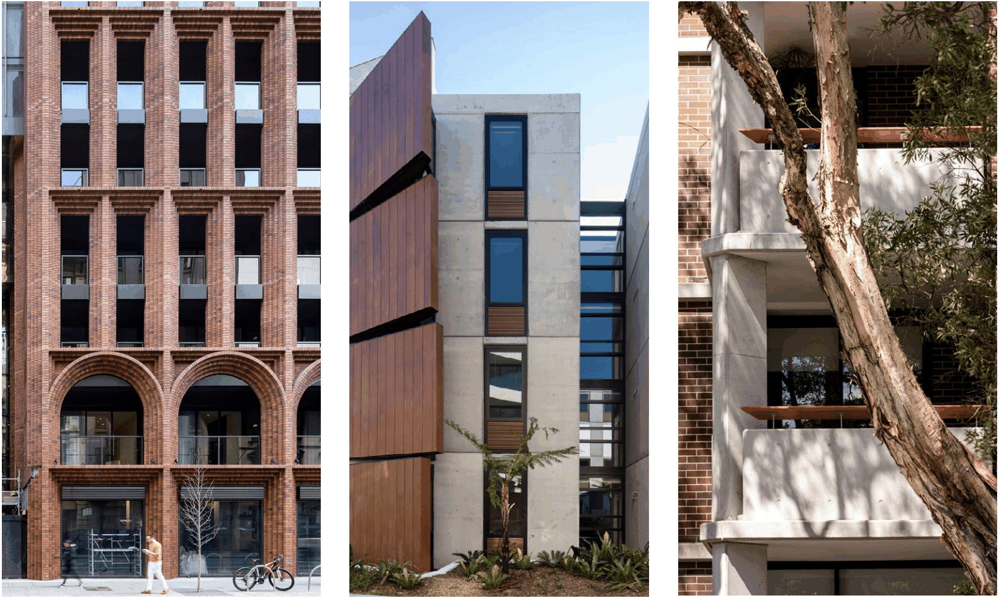

### 4.5 Materials and finishes

Buildings in our cities need to be

comprised of low maintenance, robust

and quality materials that will last the

test of time.  Canterbury Local Centre’s

heritage buildings demonstrates the

success of this approach and how it

provides Canterbury with its own special

character. The many heritage items and

historic shopfronts within the Local Centre

create the opportunity to reference the

past and to knit new development into the

built environment. These materials include

face brick and masonry.

#### Objectives

O1. To ensure high-quality materials and finishes seen in Canterbury’s heritage and historic pre 1950 buildings is used throughout new development, with an emphasis on the ground floor, to enhance the pedestrian experience. To ensure material selection and finishes are robust, have longevity, are low maintenance and contribute to beautiful buildings.

O3. To ensure Canterbury’s heritage is reflected in the treatment of new development.

#### Principles

P1. Primarily use face brickwork, masonry and off form concrete.

P2. Have a higher ratio of solid to void in facades in response to heritage.

P3. Insert fine detailing through the use of timber, copper and metal.

P4. Create simplicity through the selection a common language of materials and finishes, rather than selecting many and creating visually complexity.

#### Controls

C1. Buildings must include durable single finish material finishes such as masonry, face brick and/or off form concrete. Painted cement render or similar painted finishes and Aluminium Composite Panel Cladding (e.g. Alucobond) must not be used. The use of glazing is not supported for awning construction or for parapet edges on rooftops.

C2. Elevate the pedestrian experience at street level through fine grained detailing using brickwork and provide details using copper, tiles and tactile surfaces.

> [Picture on page 79: a picture, saved as a picture (images/ch-07-05-canterbury-page-79-1.gif, 150 dpi).]

The Regent, Candalepas Associates, Photographer: Brett Boardman

Shout Ridge, Lindfield, NSW (Source: Architectus)

Koichi Takada Architects, Arc ,Sydney NSW.

Figure 59: Examples of high quality materials and finishes for building envelopes.
