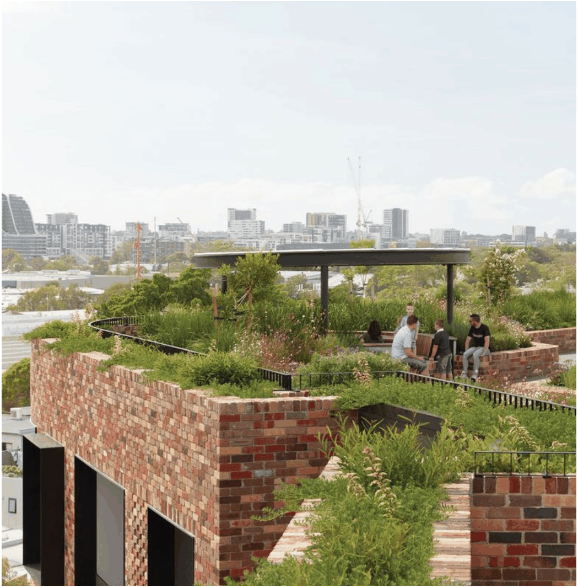
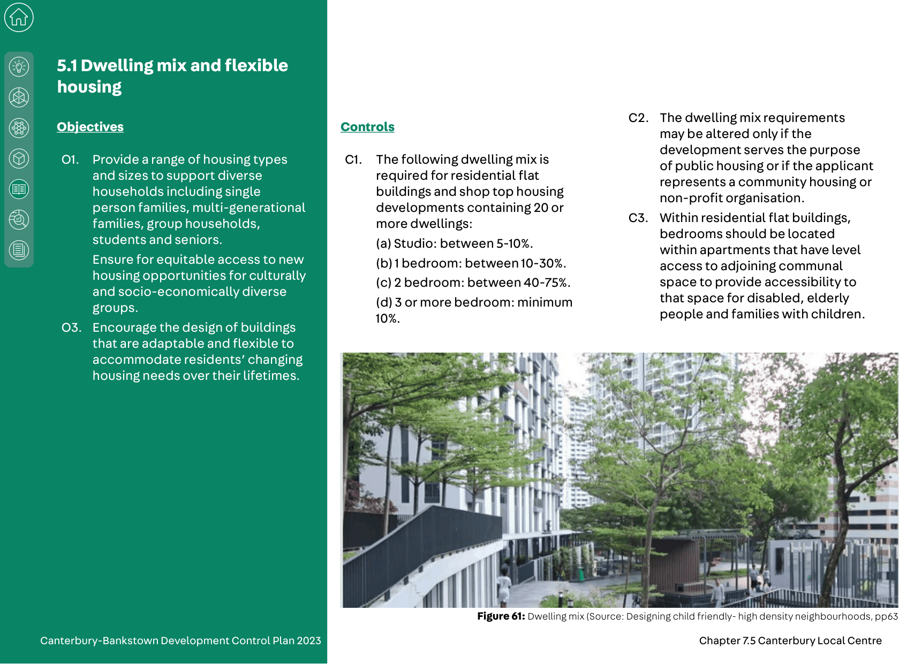

### 4.6 Rooftop and podium communal open space

#### Objectives

O1. Ensure that rooftops achieve good amenity standards for residents. Encourage the use of rooftops for passive recreation and communal uses.

O3. Design rooftops to minimise the urban heat island impacts by using landscaping species suitable for windy and dry conditions and by providing shade structures. Ensure rooftop open spaces are designed to promote the use of water and energy collected on site.

O5. Ensure balustrades around rooftop communal spaces are integrated into the design of the space and contributes to the overall appearance.

O6. Ensure harness anchor points are considered and integrated into the design where required for maintenance works to green roofs and walls.

#### Principles

P1. Include well designed shade structures constructed of low maintenance natural materials for shading to seating areas and for trees and landscape for protection from summer sun and UV.

P2. Design spaces that people want to linger in due to the provision of shade or winter sun, landscape and facilities for passive socialisation.

#### Controls

C1. Building rooftops that are designated communal open space areas must be designed to include:

(a) Fixed seating in areas with shade and solar access, where appropriate.

(b) Accessible toilet facilities.

(c) Structures for rain protection and sun shading.

(d) A BBQ/food preparation area with a sink that is universally accessible

(e) Watering systems for proposed landscaping, and

(f) Stormwater management and disposal.

C2. Any rooftop structures are to be included in the maximum height of building permitted for the site within CBLEP 2023. The height is to be shown in the Development Application drawings.

C3. Any proposed communal open space located on the building podium and/or rooftop is to:

(a) Be consolidated into a useable area with a minimum width of 6m and a minimum area of 36m².

(b) Be located so that solar access is provided for users of the open space.

(c) Be designed to a high quality and allow for landscaping and seating.

C4. Roof tops are to be structurally sound and have the capacity to support planting and

adequate drainage.

C5. Communal open spaces must be designed to:

a) Accommodate both passive and active recreational uses, including clearly defined quiet or passive areas for relaxation and social interaction; and

b) Include designated children’s play spaces that incorporate age-appropriate features such as swings, play equipment, landscaped mounds, and other interactive elements.

The functionality, layout, and design quality of communal open spaces must be clearly demonstrated in the submitted architectural and landscape plans.

> [Picture on page 81: a picture, saved as a picture (images/ch-07-05-canterbury-page-81-19.gif, 150 dpi).]

Figure 60: Rooftop communal open space, Arkadia, DKO by Tom Ross.

## SECTION 5 GENERAL PROVISIONS

| 5.1 | Dwelling mix and flexible housing | 83 |
|---|---|---|
| 5.2 | Parking | 84 |
| 5.3 | Underground floor space | 87 |
| 5.4 | Sustainability | 88 |

Chapter 7.5 Canterbury Local Centre 82

> [Picture on page 83: a picture, saved as a picture (images/ch-07-05-canterbury-page-83-1.gif, 150 dpi).]
> Words printed on the picture (title and legend, copied from the PDF):
> households including single
> person families, multi-generational
> families, group households,
> housing opportunities for culturally
> and socio-economically diverse
> groups.
> accommodate residents’ changing
