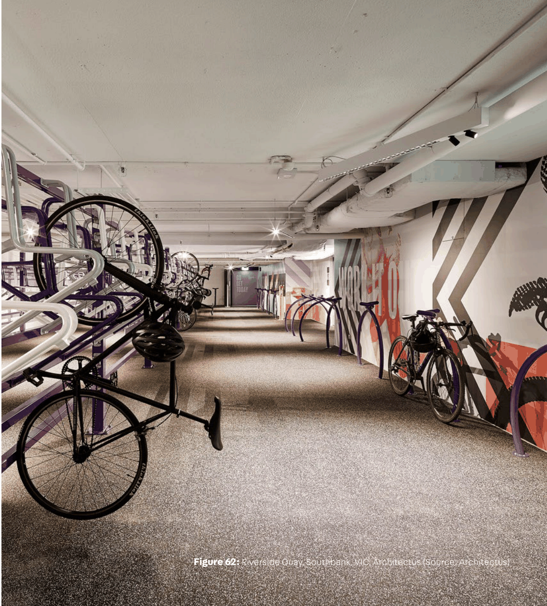
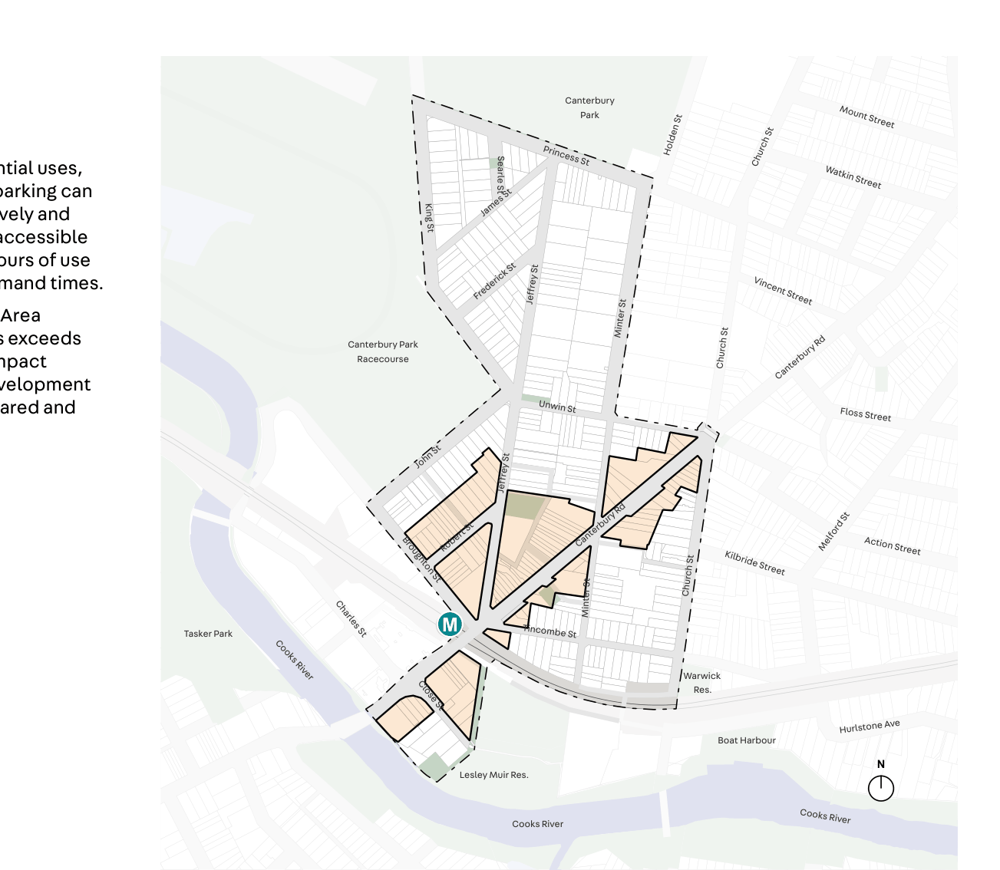

### 5.2 Parking

#### Objectives

O1. Promote sustainable transport and limit vehicular movements by restricting private parking and facilitating increasing access to, and use of, communal modes of transport within the Local Centre. Require a lower minimum parking rate in the Local Centre ‘Core’ near the Canterbury Metro station, with a slightly higher minimum parking rate outside of the Local Centre ‘Core’ to minimise a reliance on private motor vehicle trips.

#### Principles

P1. Encourage basement vehicular parking instead of at-grade or above ground parking.

P2. Provide flexibility for the efficient use of car parking in development by allow off-site users to use car parking.

> [Picture on page 84: a picture, saved as a picture (images/ch-07-05-canterbury-page-84-24.gif, 150 dpi).]

Figure 62: Riverside Quay, Southbank, VIC, Architectus (Source: Architectus)

P3. Where provided, design above ground car parking so that it can be adapted to alternate uses over time.

P4. Consider the location of car park and service vehicle entrances and exits to ensure the amenity of public domain is maintained and improved where possible.

P5. To facilitate adaptation of car parking to other uses in the long term, above ground car parking is to remain as part of the common property and not part of, or attached to, individual strata units.

#### Controls

C1. All car parking within the Local Centre must be provided in accordance with the rates as specified in Table 8 and Figure 63. If a land use is not included in Table 8, the car parking rates in Chapter 2 Chapter 3.2 of the CBDCP 2023 will apply.

| Land Use | Size/ Description | Inside Canterbury Core | Outside of Canterbury Core |  |
|---|---|---|---|---|
|  |  | Minimum car Maximum car parking rate parking rate | Minimum car parking rate | Maximum car parking rate |
| Detached dwelling |  | N/A 1 space per dwelling | N/A | 1 space per dwelling |
| Residential flat buildings/ Shop | Studio | 0 0.5 space per dwelling | 0 | 0.75 space per dwelling |
| top housing | 1 Bedroom 2 Bedroom 3 Bedroom Visitor | 0 0.5 space per dwelling 0.25 1 space per dwelling 0.75 1.5 spaces per dwelling 1 per 20 1 space per 10 dwellings dwellings | 0.2 space per dwellings 0.5 space per dwellings 1 space per dwelling 1 space per 10 dwellings | 0.75 space per dwelling 1.5 spaces per dwelling 2 spaces per dwelling 1 space per 5 dwellings |
| Office premises | N/A | 0 1.25 spaces per 1000m2 | 1 space per 100m² | 2 spaces per 100m² |
| Retail premises | Shops | 0 1.25 spaces per 100m2 | 1 space per 100m² | 2 spaces per 100m² |
| Education | Schools, | 0 1.25 spaces | 1 space per | 2 spaces per |
| establishments | Universities, TAFE | per 100m2 | 100m² | 100m² |
| All other land | N/A | Refer to Chapter 3.2- Parking of the CBDCP 2023 |  |  |
| uses |  |  |  |  |

Table 8: Car parking requirements within the Canterbury Local Centre 'core' and outside of 'core' areas.

C2. Parking for non-residential uses,

> [Picture on page 86: a map, saved as a picture (images/ch-07-05-canterbury-page-86-2.gif, 150 dpi); the street names and other small labels are on the picture.]
> Words printed on the picture (title and legend, copied from the PDF):
> Frederick St Jeffrey St
> Lesley Muir Res.

and non-staff related parking can be considered collectively and be shared if parking is accessible to the public and the hours of use have different peak demand times.

C3. If the total Gross Floor Area (GFA) of retail premises exceeds 2,000m², a Transport Impact Assessment for the development proposed is to be prepared and submitted.

#### LEGEND

Core car parking areas

Application of DCP

Figure 63: Canterbury Local Centre core and non-core car parking areas.
