#### 6. Key Sites

#### Overview of Key Sites

The following sites have been

identified as having a pivotal role in the

realisation of the vision and objectives

for the Canterbury Local Centre. The

development of the key sites will be

a catalyst for further development

within the Local Centre and present an

opportunity for precedent examples of

design excellence, Connection to Country

and the reflection of Canterbury's history

and heritage through building form and

materiality. The development on key sites

will share a common language that is

placed based.

To ensure for optimal outcomes for

Canterbury and an efficient process

for applicants, it is essential to engage

with Council early in the Development

Application process. Council will have

an expectation to see detailed analysis

of site, context and an understanding of

the Aboriginal and European history of

Canterbury.

To ensure for a ‘fine grained’ approach

to key sites, Council encourages the

subdivision of large sites into smaller lots

that are contextual to site. If this cannot

be achieved, then a variety of different

buildings should be introduced of varying

architectural character, scale and height

to provide individual identity for residents

and visitors.

#### Objectives

O1. Ensure that development is unique

to the character, climate and

demographic of Canterbury Local

Centre.

O2. Achieve Design Excellence, create

inspirational key sites with high

quality innovative architecture that

are sustainably built, reference

Canterbury’s history and heritage,

offer community benefit, provide

new publicly accessible and private

spaces that contribute positively to

Canterbury’s sense of place and its

skyline.

O3. Ensure that the principles of

Connecting to Country are

enshrined and represented in these

sites.

O4. Ensure development does not

compromise or reduce solar access

to parks.

O5. Integrate laneways, expand the

public domain, improve pedestrian

and cyclist permeability and

connect to existing and new open

space.

O6. Provide for a range of heights on key

sites to create an interesting and

diverse skyline.

O7. Ensure that the interface of sites

activates the public domain and

invites the public into new publicly

accessible spaces.

O8. Ensure that podiums are articulated

to appear as smaller parts to create

a positive fine grained and exciting

experiences at street level.

O9. Ensure street blocks present as

a group of buildings and not as a

single building.

O10. Ensure for a common language

between buildings using materials

that are long lasting and need little

maintenance such as masonry, face

brick and natural building materials

generally.

O11 Retain significant trees and

integrate them in the design of new

developments.

#### General controls applicable to all

#### Key Sites

In the event of any inconsistency between this section of this chapter and other parts of this DCP, these provisions prevail to the extent of any inconsistency.

#### Controls

C1. The design and delivery of key sites will take a Country centred approach in accordance with the guidelines and controls at Section

2.3 of this Chapter.

C2. An Aboriginal consultant shall be engaged at the outset of the site and context analysis and throughout the design process.

C3. Where appropriate, refer to section 3.3 for specifications for cycleways, laneways and arcades.

C4. Key sites should provide up to 25% tree canopy and up to 50% green cover. Canterbury Square shall provide a minimum of 40% tree canopy cover to beautify this space and provide shade.

C5. Key sites will reflect the masonry heritage character of the Canterbury Local Centre through the choice of materials and finishes in development. Face brickwork and masonry and natural materials shall be used at a higher solid to void ratio. Contemporary design is invited using a palette of face brickwork, off-form concrete with timber and copper detailing. Render, Alucobond, curtain walls and glazed awnings and balustrades are not supported.

C6. Building articulation is to minimise different materials and colours and aim for simplicity not complexity. A response to orientation should be implemented to provide for the articulation of each façade. This can be achieved by the western facade being more closed and shaded with vertical blades to control heat, while the northern facade has deep eaves and horizontal shading and is more open to the sun.

C7. To mitigate urban heat, permeable paving will be used in association with understorey planting with canopy trees. Water features including misting sprays, fountains and design elements that store water should be provided. Publicly accessible laneways will be shaded as will arcades.

C8. Building facades should show depth and shadow and exciting detailing as shown at 4.5 and 4.6 of this Chapter.

#### Key Site Map

#### LEGEND

59A King Street 186-206 Canterbury

#### 1

2 73-87 Jeffrey Street and 67-71A

Jeffrey Street

3 153-189 Canterbury Road

4 186-206 Canterbury Road

5 214-224 and 2-8 Close Street

6 146-150 Canterbury Road

7 17-23 Robert Street and 13

Broughton Street

8 9-15 Robert Street

1-13 Close St / 242-258 Canterbury Road

9

Key Sites

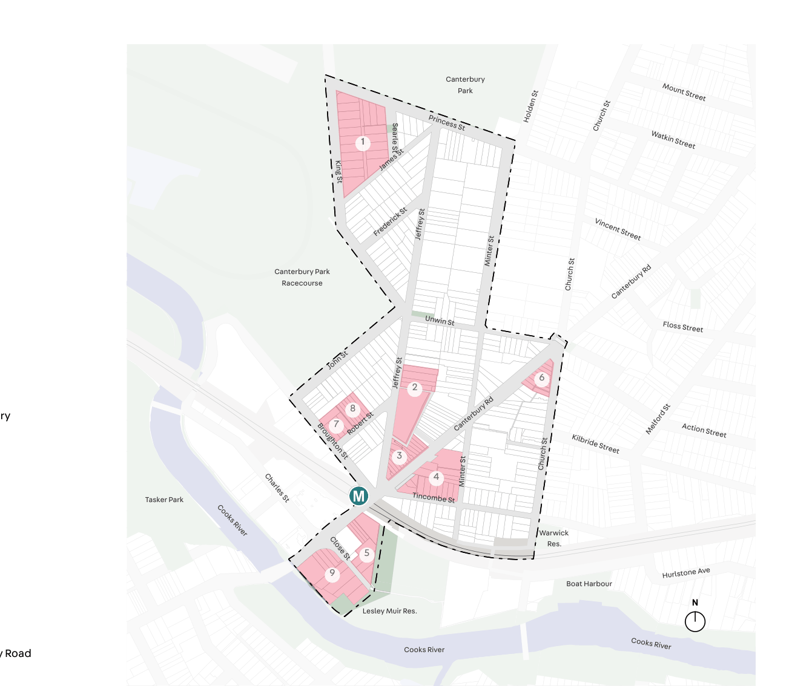

> [Picture on page 99: a map, saved as a picture (images/ch-07-05-canterbury-page-99-17.gif, 150 dpi); the street names and other small labels are on the picture.]
> Words printed on the picture (title and legend, copied from the PDF):
> Frederick St Jeffrey St
> Lesley Muir Res.

Figure 65: Key Sites Map.

#### LEGEND

Key site boundary

Potential public domain

enhancement along

Searle Street

Existing Green

Space

3m street setback

Green Space (communal)

Senior Citizen Center

6m landscaped

street setback

### KS1- 1 59A King Street

### 186-206 Canterbury

A street block in single ownership

bounded by King, James, Searle and

Princess Streets located adjacent to

the Canterbury Park Racecourse and

Canterbury Park. This block benefits from

a 6m ‘lane way’ between the lots fronting

King Street and Searle Street.

Indicative Building

Envelope

#### Vision

A green, leafy, cluster of medium rise

residential apartments set in landscape,

with a diversity of apartment typologies

that have access to a network of generous

open spaces connected throughout the

site.

#### Design Principles

P1. Enhance amenity, privacy and local

character with a 6m landscaped

street setback to King Street, James

Street and Princess Street that

includes provision for deep soil

planting and large trees.

P2. Provide a 3m front setback along

Searle Street to create an intimate

green character.

P3 Utilise the existing north-south

‘laneway’ to create communal

pedestrian connections across the

block.

P4. Retain the significant trees and

create a rear green buffer across

sites and green heart to enhance

amenity and habitat.

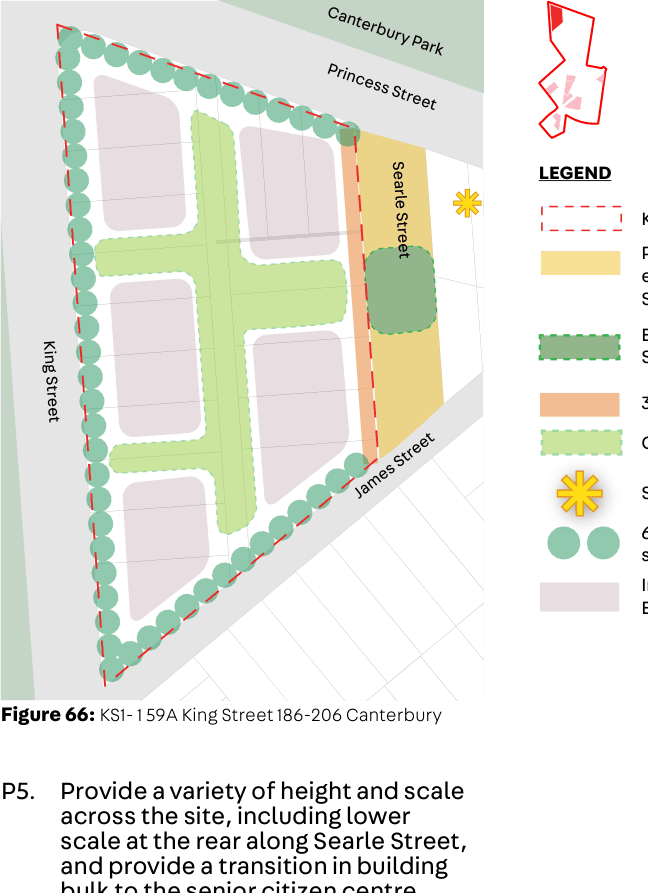

> [Picture on page 100: a picture, saved as a picture (images/ch-07-05-canterbury-page-100-49.gif, 150 dpi).]
> Words printed on the picture (title and legend, copied from the PDF):
> Canterbury Park
> Princess Street
> Searle Street
> King Street
> James Street
> LEGEND

Figure 66: KS1- 1 59A King Street 186-206 Canterbury

P5. Provide a variety of height and scale

across the site, including lower

scale at the rear along Searle Street,

and provide a transition in building

bulk to the senior citizen centre.

Key site boundary

Potential public domain

enhancement along

Searle Street

Existing Green

Space

3m street setback

Green Space (communal)

Senior Citizen Center

6m landscaped

street setback

Indicative Building

Envelope

#### LEGEND

Key site boundary

Active Frontages

Active Edges

KS2- 73-87 Jeffrey Street and

### 67-71A Jeffrey Street

3m ground level

setback

Proposed new 6m wide laneway New Civic Plaza

#### Vision

Indicative Building

footprint

Proposed new 4m wide

pedestrian through site link Proposed new 6m wide

access and service lane

Laneway activation where possible

Laneway pedestrianisation

Visual connection to Civic St.

Proposed pedestrian crossing

Playground

Vehicle access and servicing

Landmark built form

Proposed High Street

Improved street tree

canopy

The civic and vibrant heart of the Local

Centre. These two sites address Jeffrey

Street South and have a common

boundary with a newly created Jeffrey

Lane. This development will create a

new 1,500sqm public plaza, Canterbury

Square, that will activate the heart of the

Local Centre and extend Pierson Lane

to the northern edge of 61-17A Jeffrey

Street. The existing Jeffrey Lane will be

closed off. The Square will be reinforced

by high quality buildings that will set a

benchmark for design excellence within

the Local Centre and be a public space to

be enjoyed by the community.

#### Design Principles

P1. Deliver a high quality civic square

of at least 1,500m2 of public open

space to anchor the development

as a new civic hub for the Local

Centre that works in cooperation

with the new civic high street,

Robert Street.

Provide a minimum of 2 hours solar

access to 50% of the area of the

square at the winter solstice on the

21st June.

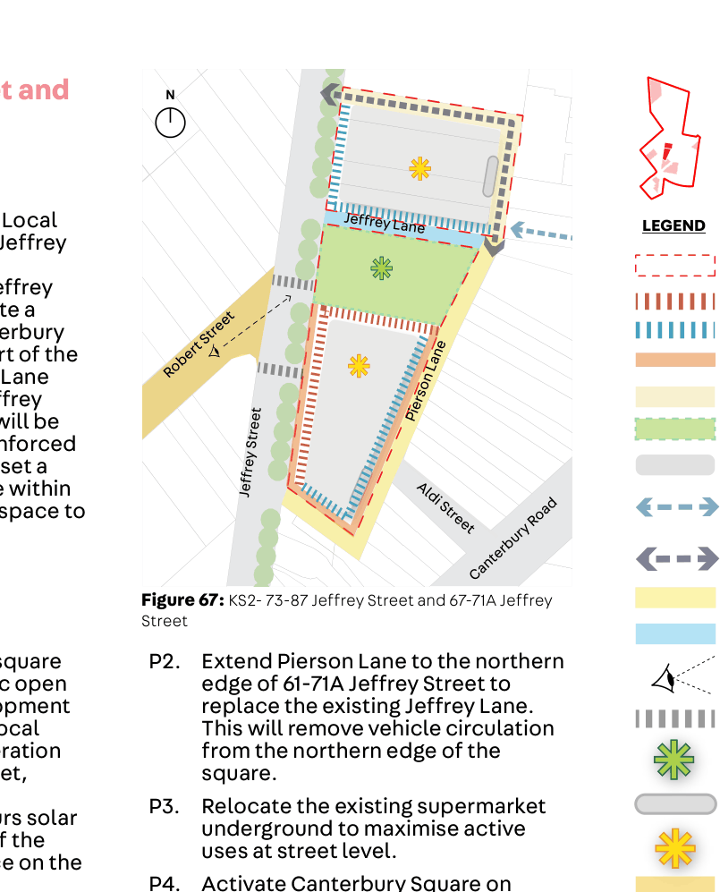

> [Picture on page 101: a picture, saved as a picture (images/ch-07-05-canterbury-page-101-55.gif, 150 dpi).]
> Words printed on the picture (title and legend, copied from the PDF):
> N
> Jeffrey Lane
> Robert Street
> Pierson Lane
> Jeffrey Street
> Aldi Street
> Canterbury Road
> Street
> underground to maximise active
> uses at street level.
> LEGEND

Figure 67: KS2- 73-87 Jeffrey Street and 67-71A Jeffrey

P2. Extend Pierson Lane to the northern

edge of 61-71A Jeffrey Street to

replace the existing Jeffrey Lane.

This will remove vehicle circulation

from the northern edge of the

square.

P3. Relocate the existing supermarket

P4. Activate Canterbury Square on

Jeffrey Street South and Pierson

Lane, where possible with fine grain

shopfronts.

Key site boundary

Active Frontages

Active Edges

3m ground level

setback

Proposed new 6m wide laneway New Civic Plaza

Indicative Building

footprint

Proposed new 4m wide

pedestrian through site link Proposed new 6m wide

access and service lane

Laneway activation where possible

Laneway pedestrianisation

Visual connection to Civic St.

Proposed pedestrian crossing

Playground

Vehicle access and servicing

Landmark built form

Proposed High Street

Improved street tree

canopy

P6. Mitigate urban heat gain in the

design and material selection for

the square. Use permeable paving,

water features, misters and lush

planting.

P7. Have a higher ratio of solid to void

in building facades in response to

Canterbury’s heritage character.

P8. Select materials and finishes

that have longevity, minimal

maintenance and are robust.

Reinforce the heritage character in

Canterbury using face brickwork

and masonry.

#### Landscape Principles

P1. Ensure partnership with First

Nations people in the planning and

delivery of public open space.

P2. Minimum 40% canopy coverage

across the site.

P3. Minimum 50% of the open space

must have a minimum of 2 hours of

continuous solar access.

P4. Minimum 50% of the site must be

deep soil zone – ensure all deep

soil zone are free draining and not

covered, all paving within deep soil

zone should be permeable.

P5. Include a variety of active and

passive recreational activity

options.

P6. Include a playground area of

minimum 350m².

P7. Include an open lawn area of

minimum 500m².

P8. Arrange the space to allow direct,

clear sightlines from surrounding

areas into and through the space as

per CPTED design principles.

P9. Include public art as part of the

design of the open space.

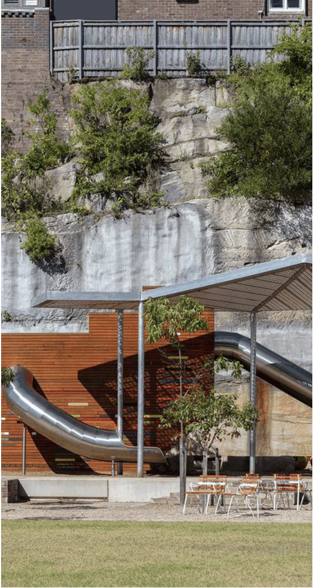

> [Picture on page 102: a picture, saved as a picture (images/ch-07-05-canterbury-page-102-42.gif, 150 dpi).]

Figure 68: Harold Park, Glebe, NSW.

#### LEGEND

Key site boundary

Active Edges

### KS3- 153-189 Canterbury Road

3m ground level setback

Potential through site link or arcade

Potential for landscaped rooftop treatment

#### Vision

High Priority Streets to increase

tree canopy

Indicative tower footprint Improved street tree canopy Activate laneway

Ventilation and view corridor

Views from Towers

Retain and integrate historic shopfront

A triangulated block with address to Canterbury Road, Jeffrey Street and Pierson and Aldi Lane. This KS is comprised of two-story heritage shopfronts that provide character, scale and memory of Canterbury’s past.

#### Design Principles

P1. Sensitively retain and integrate the

historic shopfronts on Canterbury

Road.

P2. Enhance the public domain and

activate the lane ways.

P3. Provide a podium design that is

sympathetic to the historic facades

in scale, materials and finishes.

P4. Provide upper storey setbacks

above the historic shopfronts to

provide separation between the

old and the new buildings. Provide

greenery in this triangular setback.

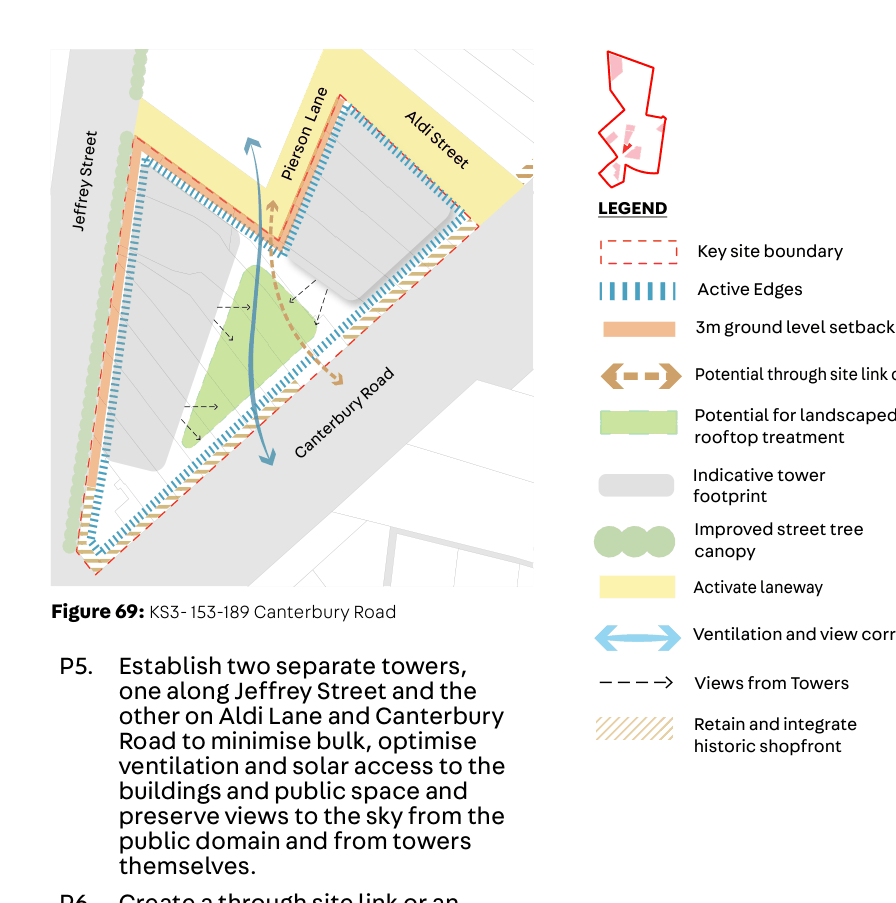

> [Picture on page 103: a map, saved as a picture (images/ch-07-05-canterbury-page-103-41.gif, 150 dpi); the street names and other small labels are on the picture.]
> Words printed on the picture (title and legend, copied from the PDF):
> High Priority Streets to increase
> Key site boundary
> 3m ground level setback
> Potential through site link or arcade
> Potential for landscaped
> Improved street tree
> Ventilation and view corridor
> Views from Towers
> Retain and integrate

Figure 69: KS3- 153-189 Canterbury Road

P5. Establish two separate towers,

one along Jeffrey Street and the

other on Aldi Lane and Canterbury

Road to minimise bulk, optimise

ventilation and solar access to the

buildings and public space and

preserve views to the sky from the

public domain and from towers

themselves.

P6. Create a through site link or an

arcade within the building footprint

from 173-175 Canterbury Road into

Pierson lane.

#### Vision

This site is a catalyst for the Local Centre

and for the southern side of Canterbury

Road. The site is comprised of sixteen

lots and is bounded by Canterbury Road,

Tincombe and Minter Streets and is

located to the north of the heritage listed

Canterbury Hotel, a notable building in

Canterbury’s urban fabric. The site will

be highly visible from the public domain

and will be the tallest building in the Local

Centre. This site will provide a mix of uses

in proximity to the new Metro.

#### Design Principles

P1. Create a quality outcome for

the Local Centre and consider

regional views by demonstrating

design excellence across all levels

of the development, reflecting

on the Canterbury’s history

and materiality, its Connection

to Country and establishing a

celebrated presence evident in the

prominence of its tallest elements.

P2. Set the buildings back from the

Tincombe Street and Canterbury

Road intersection to retain views

to the Canterbury Hotel along

Canterbury Road from the north and

south and provide public domain

enhancement to all surrounding

streets. Use face brick that is

complementary to the Canterbury

Hotel throughout the development.

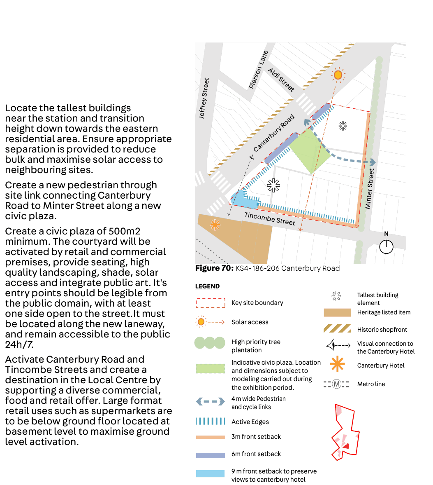

> [Picture on page 104: a map, saved as a picture (images/ch-07-05-canterbury-page-104-35.gif, 150 dpi); the street names and other small labels are on the picture.]
> Words printed on the picture (title and legend, copied from the PDF):
> Key site boundary
> High priority tree
> Indicative civic plaza. Location
> and dimensions subject to
> modeling carried out during
> the exhibition period.
> 4 m wide Pedestrian
> and cycle links
> 3m front setback
> 6m front setback
> 9 m front setback to preserve
> views to canterbury hotel
> Heritage listed item
> Visual connection to
> the Canterbury Hotel
> site link connecting Canterbury
> Key site boundary
> High priority tree
> Indicative civic plaza. Location
> and dimensions subject to
> modeling carried out during
> the exhibition period.
> 4 m wide Pedestrian
> and cycle links
> 3m front setback
> 6m front setback
> 9 m front setback to preserve
> views to canterbury hotel
> Key site boundary
> High priority tree
> Indicative civic plaza. Locatio
> and dimensions subject to
> modeling carried out during
> the exhibition period.
> 4 m wide Pedestrian
> and cycle links
> 3m front setback
> 6m front setback
> 9 m front setback to preserve
> views to canterbury hotel
> Heritage listed item
> Visual connection to
> the Canterbury Hotel

Figure 70: KS4- 186-206 Canterbury Road

P3. Locate the tallest buildings

near the station and transition

height down towards the eastern

residential area. Ensure appropriate

separation is provided to reduce

bulk and maximise solar access to

neighbouring sites.

P4. Create a new pedestrian through Road to Minter Street along a new

P5. Create a civic plaza of 500m2

minimum. The courtyard will be

activated by retail and commercial

premises, provide seating, high

quality landscaping, shade, solar

access and integrate public art. It's

entry points should be legible from

the public domain, with at least

one side open to the street.It must

be located along the new laneway,

and remain accessible to the public

24h/7.

P6. Activate Canterbury Road and

Tincombe Streets and create a

destination in the Local Centre by

supporting a diverse commercial,

food and retail offer. Large format

retail uses such as supermarkets are

to be below ground floor located at

basement level to maximise ground

level activation.

Chapter 7.5 Canterbury Local Centre 104

Tallest building

element

Heritage listed item

### and 2-8 Close Street

#### Vision

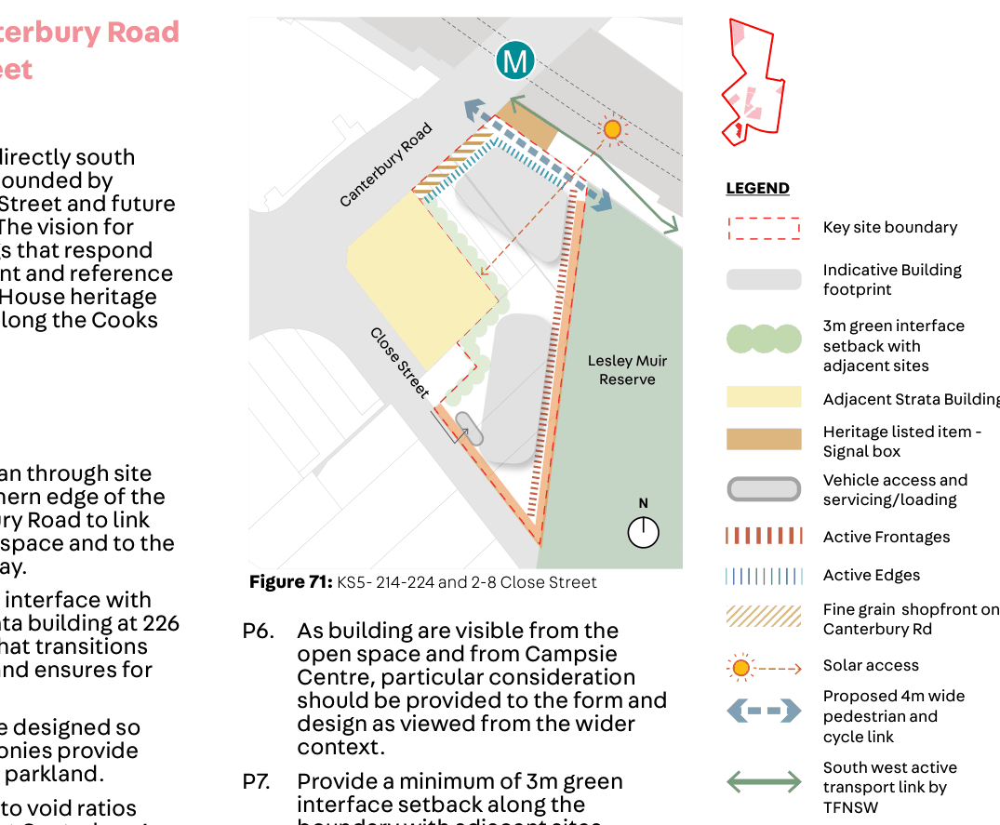

> [Picture on page 105: a map, saved as a picture (images/ch-07-05-canterbury-page-105-3.gif, 150 dpi); the street names and other small labels are on the picture.]
> Words printed on the picture (title and legend, copied from the PDF):
> Key site boundary
> 3m green interface
> Adjacent Strata Building
> Heritage listed item -
> Vehicle access and
> Fine grain  shopfront on
> Proposed 4m wide
> South west active
> transport link by
> 3m street setback
> interface setback along the
> Key site boundary
> 3m green interface
> Adjacent Strata Building
> Heritage listed item -
> Vehicle access and
> Fine grain  shopfront on
> Proposed 4m wide
> South west active
> transport link by

Figure 71: KS5- 214-224 and 2-8 Close Street

These sites are located directly south

of the train line and are bounded by

Canterbury Road, Close Street and future

open space to the east. The vision for

KS-5 is to create buildings that respond

to the natural environment and reference

connection to the Sugar House heritage

item further to the east along the Cooks

River pathway.

#### Design Principles

P1. Provide a pedestrian through site

link along the northern edge of the

site from Canterbury Road to link

to the future open space and to the

Cooks River Pathway.

P2. Provide a sensitive interface with

the residential strata building at 226

Canterbury Road that transitions

and reduces bulk and ensures for

solar access.

P3. Buildings should be designed so

windows and balconies provide

surveillance of the parkland.

P4. Have greater solid to void ratios

in facades to reflect Canterbury’s

heritage character.

P5. Provide active edges along

Canterbury Road and active street

frontage to the future open space.

#### M

### M

P6. As building are visible from the

open space and from Campsie

Centre, particular consideration

should be provided to the form and

design as viewed from the wider

context.

P7. Provide a minimum of 3m green boundary with adjacent sites.

P8. Access and service should be

located along Close Street.

P9. Activate Canterbury with fine grain

tenancies on the ground floor.

3m street setback

P10 Coordinate with TFNSW prior ot

the lodgement of a DA to explore

opportunities to provide servicing

to the potential reuse of the

heritage listed signal box along the

northern boundary of the site.

#### Vision

This triangular site establishes an

architectural landmark at the northern

gateway of Canterbury while retaining

the heritage listed police station along

Canterbury Road  and providing a softer

interface to the residential area south and

East to the site.

#### Design Principles

P1. Integrate the heritage item in

the development by locating

the primary building envelope

along Church Street rather than

Canterbury Road. This creates

opportunities for landscaped

courtyards framing the heritage

building, enhancing and preserving

its view.

P2. Provide upper storey setbacks

and articulation to the tower and

podium to address its prominent

location at the northern gateway to

the Local Centre and reduce visual

bulk to the residential area to the

east and the south.

P3. Deliver high quality landscape

treatment that integrates the

heritage item into the development

and enhances its amenity.

P4. Provide a 3m planted buffer

setback along the southern edge

#### LEGEND

Key site boundary Landscaped courtyards Indicative Building envelope Heritage Item

Existing historic shop HIgh quality landscape treatment

3m landscape buffer Interface with low density residential area Northern gateway to Canterbury Active Edges

Gateway tower

Vehicle access and servicing

3m street setback

P5. Retain and Integrate the existing

historic shop at 154 Canterbury

Road into the development.

Together with the heritage item

they create a cluster of historical

buildings on the south-western

corner of the site where a network

of character filled courtyards and

alleys leverages the historical built

legacy of the precinct.

P6 Deliver high quality landscape

treatment that connects the old

and the new buildings together,

emphasizing the historic nature of

the site in the design, lighting  and

the choice of materials.

P7 Provide for appropriate adaptive

reuse and restoration of the police

station building as part of any new

redevelopment

P8 The degree of retention of the

heritage listed police station

building is to be confirmed by

a heritage assessment to be

undertaken as part of any future

redevelopment of the site.

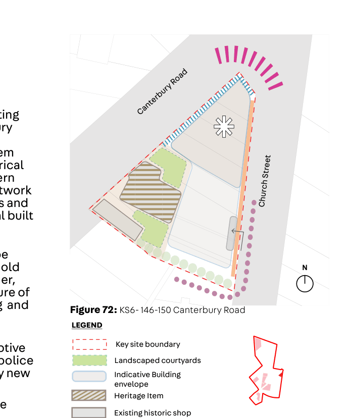

> [Picture on page 106: a picture, saved as a picture (images/ch-07-05-canterbury-page-106-76.gif, 150 dpi).]
> Words printed on the picture (title and legend, copied from the PDF):
> Canterbury Road
> Church Street
> N
> LEGEND
> Key site boundary
> Landscaped courtyards
> Indicative Building
> envelope
> Heritage Item
> Existing historic shop

Figure 72: KS6- 146-150 Canterbury Road

HIgh quality landscape

treatment

3m landscape buffer

Interface with low density

residential area

Northern gateway to

Canterbury

Active Edges

Gateway tower

Vehicle access and servicing

3m street setback

3m deep soil planting zone supporting mature tree growth Landscaped courtyard Landscaped podium and rooftop 3m street setback Indicative Building envelope

### KS7- 17-23 Robert Street and 13

### Broughton Street Tallest building element

#### Vision

Special architecture treatment of prominent corner Solar access to Robert Street

Proposed High Street

This significant site is a key component to

the vitality of the civic areas of the Local

Centre and is located at the corner of

Robert and Broughton Streets adjacent to

the station. Robert Street is the primary

civic street and works together with

Jeffrey Street South and Square to form

the Local Centre’s core. Taller slender

building will act as landmarks within the

core which will be read from inside and

outside of the Local Centre.

#### Design Principles

P1. The site forms part of a civic street

wall on the northern side of Robert

Street.

P2. Activate the ground floor with fine

grain shopfronts on both Robert

and Broughton Street frontages

and provide an engaging urban

environment for visitors and

residents.

P3. Provide a 3m street setback at

the frontage to Robert Street to

widen the street and establish

well designed high amenity public

domain to support the commercial

activity of the shopfronts and the

movement of pedestrians in the

Local Centre.

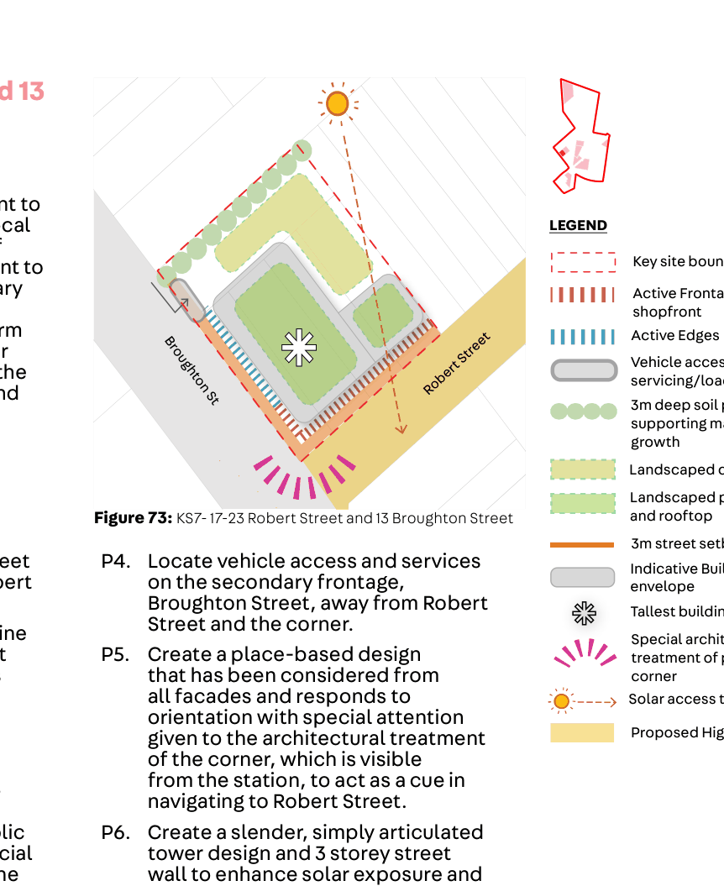

> [Picture on page 107: a map, saved as a picture (images/ch-07-05-canterbury-page-107-47.gif, 150 dpi); the street names and other small labels are on the picture.]
> [Picture text on page 107 is stored in the PDF without readable letters (no character map), so it could not be copied; see the original PDF.]
> Words printed on the picture (title and legend, copied from the PDF):
> on the secondary frontage,
> Street and the corner.
> Key site boundary
> Vehicle access and
> 3m street setback
> Proposed High Street

Figure 73: KS7- 17-23 Robert Street and 13 Broughton Street

P4. Locate vehicle access and services Broughton Street, away from Robert

P5. Create a place-based design

that has been considered from

all facades and responds to

orientation with special attention

given to the architectural treatment

of the corner, which is visible

from the station, to act as a cue in

navigating to Robert Street.

P6. Create a slender, simply articulated

tower design and 3 storey street

wall to enhance solar exposure and

amenity to Robert Street.

Active Frontages with fine grain

3m deep soil planting zone

supporting mature tree

Tallest building element

treatment of prominent

Solar access to Robert Street

#### Design Principles

P7. Establish at a minimum, a 3m wide

deep soil planting zone along the

western boundary capable of

supporting mature tree growth to

interface with the R4 residential

zone.

P8. Provide high quality landscape

design to the ground floor and

podium rooftop reflecting

Connecting to Country principles,

enhancing local amenity,

establishing habitat, and

supporting passive cooling of the

environment.

P9. Provide a high quality communal

rooftop that has planting that

responds to climate and provides

shade for users.

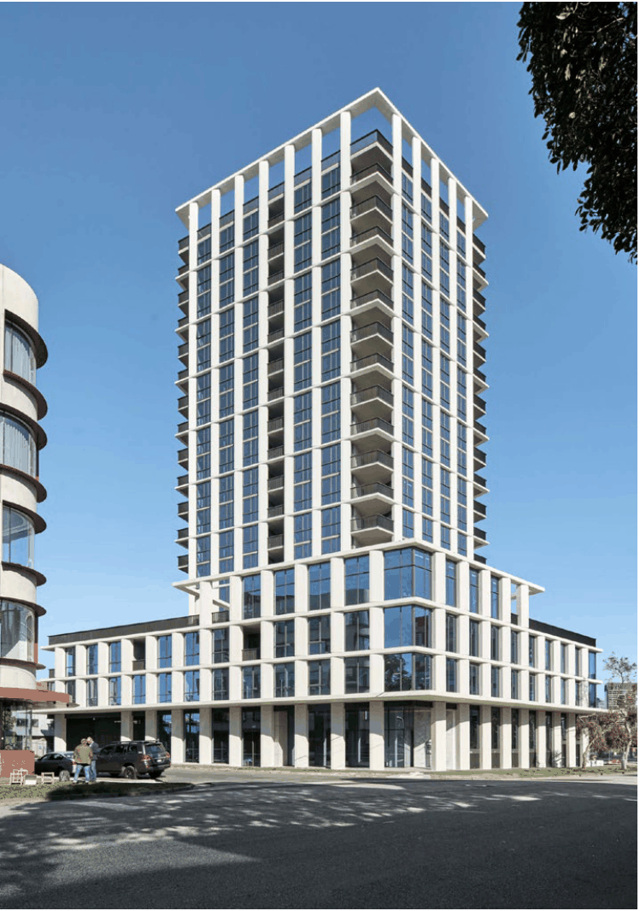

> [Picture on page 108: a picture, saved as a picture (images/ch-07-05-canterbury-page-108-20.gif, 150 dpi).]

Figure 74: Montague Square, by Element 5, VIC Melbourne.

Key site boundary

Active Frontages

3m street setback

2m Upper level setback along

the new lane way

### KS8- 9-15 Robert Street

9m wide access and service lane

6m wide pdestrian anc cycle lane

Vehicle access and

servicing/loading

#### Vision

Vehicle access and servicing /

loading to neighbouring site

3m deep soil planting zone

supporting mature tree

growth

Landscaped courtyard

Landscaped podium

and rooftop

Indicative Building envelope

Tallest building element

Solar access to Robert Street

Proposed High Street

This mid-block site is at the heart of

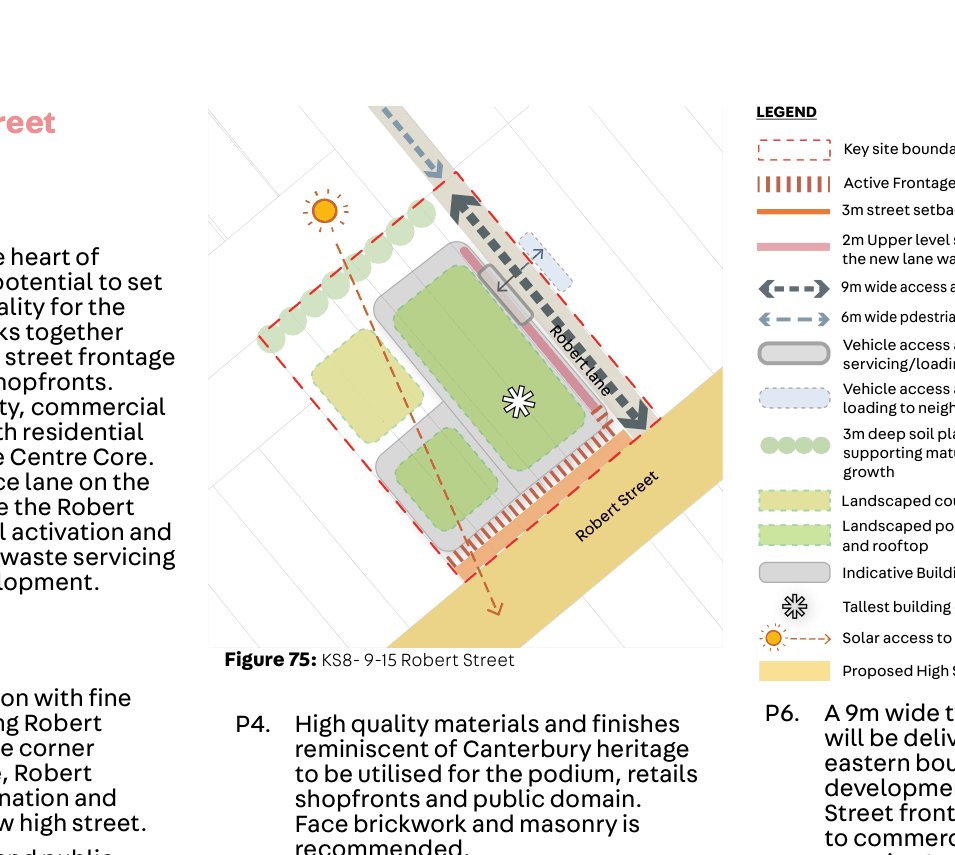

> [Picture on page 109: a map, saved as a picture (images/ch-07-05-canterbury-page-109-25.gif, 150 dpi); the street names and other small labels are on the picture.]
> Words printed on the picture (title and legend, copied from the PDF):
> reminiscent of Canterbury heritage
> shopfronts and public domain.
> Key site boundary
> 3m street setback
> the new lane way
> Vehicle access and
> supporting mature tree
> Tallest building element
> Proposed High Street

Figure 75: KS8- 9-15 Robert Street

Robert Street and has the potential to set

a benchmark for design quality for the

Local Centre. This site works together

with KS-7 to provide a civic street frontage

activated by fine grained shopfronts.

Uses may include hospitality, commercial

and retail at street level with residential

uses above to activates the Centre Core.

The site will deliver a service lane on the

eastern boundary to ensure the Robert

Street frontage has optimal activation and

pedestrian safety and that waste servicing

will occur behind the development.

#### Design Principles

P1. Ground floor activation with fine

grain shopfronts along Robert

Street which turns the corner

onto the service lane, Robert

Lane, creates a destination and

attractions to the new high street.

P2. A 3m street setback and public

domain improvement delivers a

high amenity pedestrian friendly

environment supporting the

vibrancy of the street.

P3. Establish at a minimum, a 3m wide

deep soil planting zone along the

western boundary capable of

supporting mature tree growth to

interface with the R4 residential

zone.

P4. High quality materials and finishes to be utilised for the podium, retails Face brickwork and masonry is

P5. Slender built form and a 3 storey

street wall enhances solar exposure

and amenity to Robert Street, with

a 3m upper-level setback along

Robert Street and 2m upper-level

setback along the new laneway.

2m Upper level setback along

9m wide access and service lane

6m wide pdestrian anc cycle lane

Vehicle access and servicing /

loading to neighbouring site

3m deep soil planting zone

Indicative Building envelope

Solar access to Robert Street

P6. A 9m wide two-way service lane

will be delivered along the site's

eastern boundary. It will service the

development and ensure the Robert

Street frontages remain dedicated

to commercial activity with high

amenity. In the future the lane will

extend as a pedestrian lane up to

John Street

P7. Provide high quality landscape

design to the podium rooftop

reflecting connection to country

principles, enhancing local

amenity, establishing habitat, and

supporting passive cooling of the

urban environment.

### KS9- 1-3 Close Street and 242-

#### 258 Canterbury Road

#### Vision

To create a development with a sense of place that reflects the heritage of Canterbury Local Centre and provides an address and connection with the Cooks River.

#### Key Objectives

O1. Break down the scale of the

development so it appears like

several buildings.

O2. Integrate the development to its

natural and historical context.

O3. Minimize the number of materials

used in facade and rationalize the

design.

O4. Establish a positive architectural

gateway to the south of the

precinct.

O5. Establish an engaging public realm

interface to Canterbury Road and

Close Street.

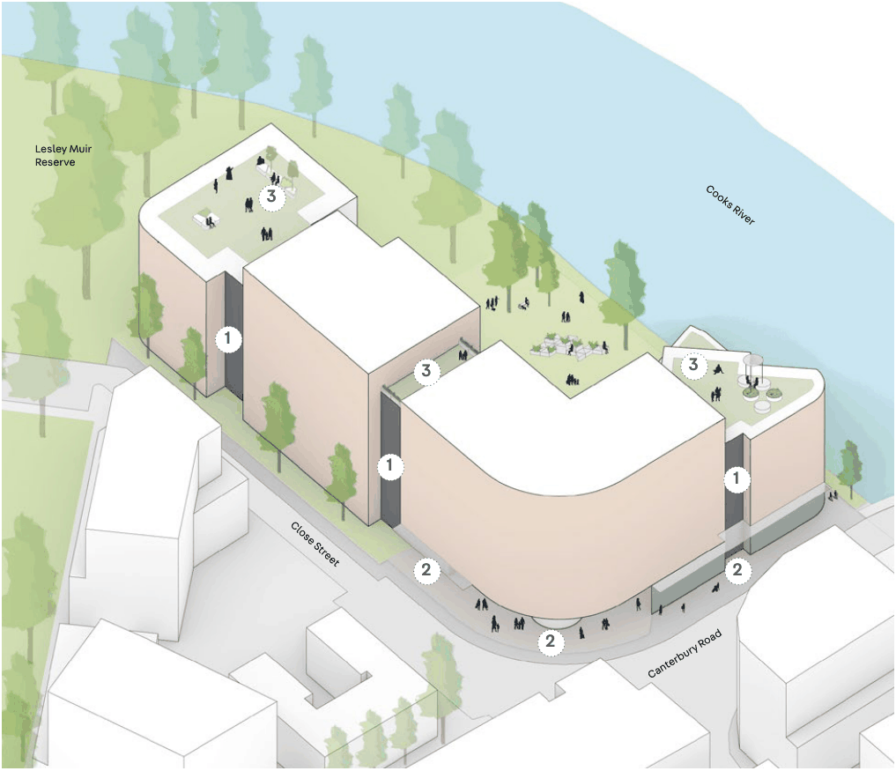

> [Picture on page 110: a map, saved as a picture (images/ch-07-05-canterbury-page-110-24.gif, 150 dpi); the street names and other small labels are on the picture.]

#### Vertical indentation

to minimise overbearing visual impact

#### 1
