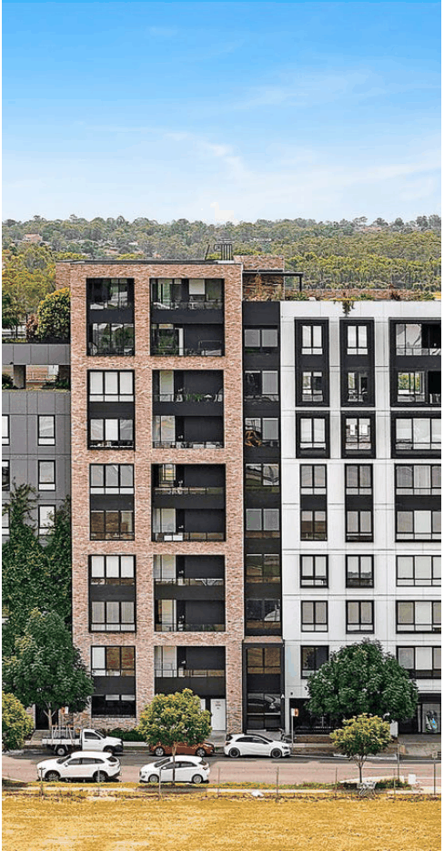
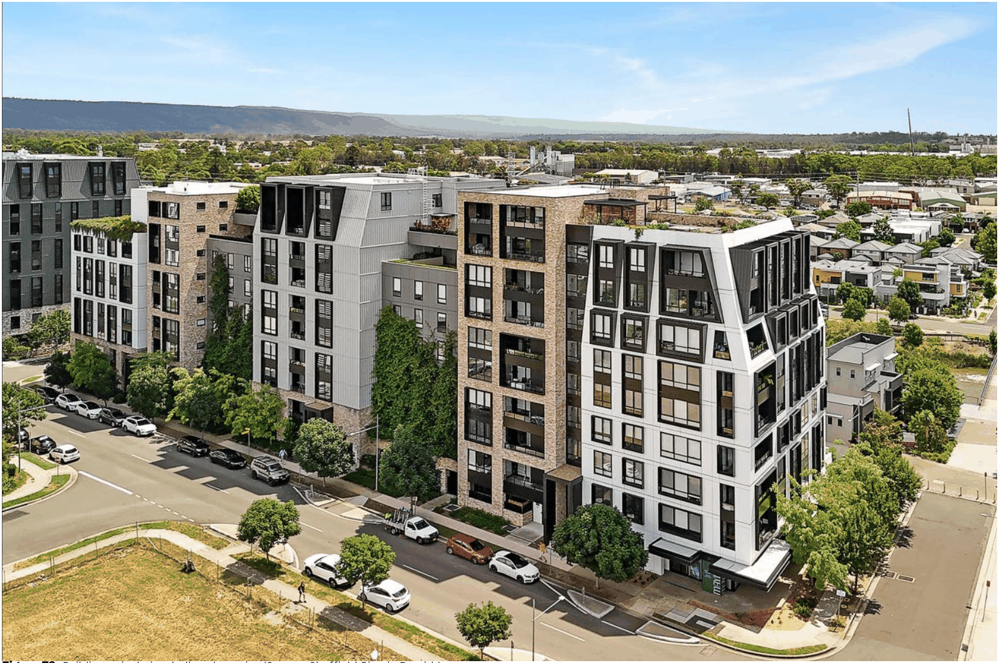
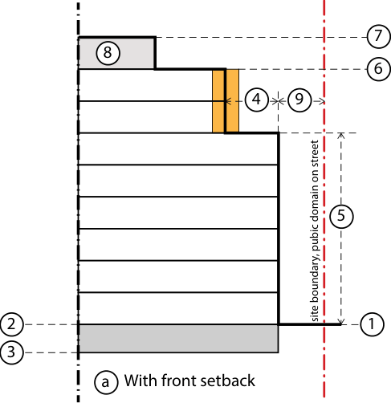
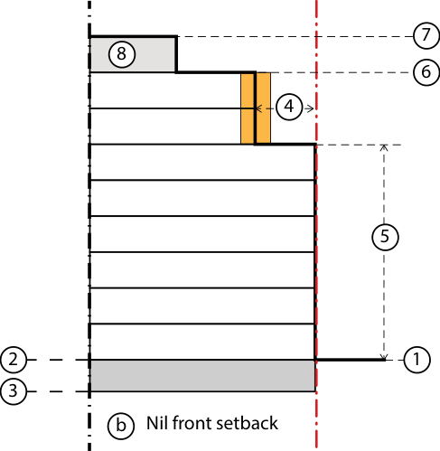

#### 2 Active frontage and

plaza on the corner of

Canterbury Road and

Close Street

Green roof top to provide

passive open space and

views over the river for the

residents

#### 3

Figure 76: Axonometric view of 1-13 Close Street and 242-258 Canterbury Road indicative massing of potential future development.

#### Design Principles

P1. Use materials that reflects

Canterbury’s heritage and history

and responds to the proximity of

the Sugar House and the Canterbury

Hotel on Canterbury Road. This

includes face brick, stone and

concrete.

P2. The facade along Close Street

is to appear visually broken

into three different buildings,

each one in a different but

complimentary face brick or

masonry and separated from

each other by a recessed vertical

indentation. Each indentation’s

length to depth ratio must range

between 2:1 and 3:1. The total length

of the two indentations must be

equal to 15% or more of the total

length of the Close Street facade.

P3. The facade along Canterbury

Road is to appear visually broken

into two buildings separated by one

recessed vertical indentation of

1.5m depth minimum and a length to

depth ratio ranging between 2:1 to

3:1.

P4. A portion of the development that

is visually expressed as a building,

(as opposed to an indentation)

must be taller than the adjacent

indentations by at least 1.5m so that

the visual differentiation between

the buildings is also reflected in

the skyline of the development

and fully perceived from the public

domain.

P5. The development must provide

opportunity for rooftop communal

open space that takes advantage of

its prime location along the Cooks

River and Lesley Muir Reserve.

P6. The development must provide a

generous double height internal

public plaza at the Close Street

intersection extending further into

a pedestrian connection through to

the Cooks River. The plaza should

be designed with high quality

material finishes and landscaping,

and should be sleeved with active

uses on the ground floor such as

cafe, restaurant, corner shop or

commercial premises.

P7. The development should provide

commercial ground floor along

Canterbury Road and close street to

the extent of the B2 zone.

P8. The landscape design and the

plant selection throughout the

development should reflect and

take cues from the Cooks River, its

history, its natural landscape and its

ecology.

P9 If a new DA is lodged to redevelop

the site, appropriate setbacks

and street wall height must be

considered to Canterbury Rd, close

St, Lesley Muir Reserve and the

Cooks River Pathway.

> [Picture on page 111: a picture, saved as a picture (images/ch-07-05-canterbury-page-111-72.gif, 150 dpi).]

Figure 77: Building articulation-bulk and massing (Source: Sheffield Circuit, Penrith)

> [Picture on page 112: a picture, saved as a picture (images/ch-07-05-canterbury-page-112-1.gif, 150 dpi).]

Figure 78: Building articulation-bulk and massing (Source: Sheffield Circuit, Penrith)

### APPENDICES

### Appendix 1- Definitions

Architectural character refers to the style, design, and general

arrangement of the exterior of a building and includes articulation,

composition of building elements such as but not limited to

fenestration, material use and details, building entrances,

balconies, balustrades, awnings, planters, pergolas, boundary

walls, fences.

Annual Exceedance Probability (AEP): The chance of a flood of a

given or larger size occurring in any one year, usually expressed as

a percentage. For example, if a peak flood discharge of 500m3/s

has an AEP of 5%, it means that there is a 5% chance (that is a one-

in-twenty chance) of a 500m3/s or larger event occurring in any

one year.

Articulation zone applies to a tall building and means that within

the street frontage length of a podium, a 1 - 1.5m deep articulation

zone is provided to allow architectural form to develop. Balconies

for amenity and surveillance of the street form part of this

articulation zone.

Building envelope means the space that is defined by the

maximum building height, gross floor area, street, side and rear

setbacks and upper storey setbacks.

Destination shade is where the shaded area is the focal point. Dynamic content sign means a small format sign that has a digital,

LCD, LED, plasma or other electronic display area capable of

displaying animated, variable or multimedia content and requires

a continual power supply for the display area to show content. EV Distribution Board is a distribution board dedicated to EV

charging that is capable of supplying not less than 50% of EV

connections at full power at any one time during off-peak periods,

to ensure impacts of maximum demand are minimised, and that

increases to electrical feed sizes are not required. To deliver

this, the distribution board will be complete with an EV Load

Management System and an active suitably sized connection

to the main switchboard. The distribution board must provide

adequate space for the future installation (post construction)

of compact meters in or adjacent to the distribution board, to

enable the body corporate to measure individual EV usage in the

future.

EV Ready Connection Is a spare dedicated 32A circuit included in

the EV Distribution Board to facilitate seamless future installation

of cabling from an EV charger to the board, along with a circuit

break-er to supply power to the circuit.

EV Load Management System is to be capable of:

⚬Reading real time current and energy from the electric vehicle

chargers under management

⚬Determining, based on known installation parameters and real

time data, the appropriate behaviour of each EV charger to

minimise building peak power demand whilst ensuring electric

vehicles connected are full recharged.

⚬Scale to include additional chargers as they are added to the

site over time.

Fine Grain is architectural character and includes massing,

articulation, composition of building elements including material

use and details. These include building entrances, fenestration,

signage, balconies, balustrades, awnings and planters at street

and lane level.

Floorplate refers to the total area occupied by a single floor of a

building, measured from the outer edges of the external walls.

It defines the building’s footprint at each level and influences

factors such as structural efficiency, spatial layout, access to

natural light, and overall building massing.

Front setback means a setback from a street boundary.

Green roofs (including green awnings) are roof surfaces that are

partially or fully covered with vegetation are known as green

roofs (or green awnings). They have a series of layers including a

vegetated layer, a growing medium, and a waterproof membrane. Incidental shade is shade experienced when passing by or

through.

Isolated site is a site that has limitations on its future potential

development because of its size and shape, proximity to other

development and its ability to be consolidated with other

properties for development purposes.

Large developments are developments with a minimum frontage

of 45m of greater.

Large food waste generating businesses are premises that

produce ≥660L/week of red bin capacity. Major drainage systems: “Overland” drainage routes, which can

include roads and recreational are-as. Minor drainage systems

refer to all gutters, pipes, culverts, open channels, natural creeks

and other storm water infrastructure.

Maximum External Solar Reflectance is the maximum allowable

percentage of solar reflectance for the external face of a

Reflective Surface. The percentage of solar reflectance is to be

measured at a normal angle of incidence Non-reflective surfaces are those surfaces that diffusely reflect

light and heat and for this DCP are defined as those surfaces that

have a specular normal reflection of less than 5%. Normal operations refers to all building energy requirements other

than the provision of standby power generations.

Open space is hard surfaced public space within a square,

courtyard or plaza as well as open parkland with landscape and

play areas.

Pedestrian lanes are non-trafficable by vehicles and cyclists and

are for pedestrians only. These lanes are narrower and are open to

the sky but may in part be covered by awnings. Pedestrian links are non-trafficable by vehicles and are for

pedestrians only. These lanes are narrower and are predominantly

open to the sky but may in part be covered by awnings or

buildings.

Podium means the base of a taller building that is built close to or

along the site boundary or boundaries.

Probable maximum flood (PMF): The largest flood that could

conceivably occur at a particular location, usually estimated from

probable maximum

Public domain are are the streets and open spaces surrounding or

adjoining the site.

Publicly accessible space is located on a private site and invites

the public into through site links and green spaces. Reflective Surface Ratio (RSR) is the ratio of reflective to non-

reflective external surface on any given façade. Reflective surfaces are those surfaces that directly reflect light

and heat and for this DCP are defined as those surfaces that have

a specular normal reflection of greater than 5% and includes

glazing, glass-faced spandrel panel, some metal finishes and high

gloss finishes.

Reinforced corner is where the building corner that must address

both street frontages, define and reinforce the street edge

through massing and façade orientation and ties together the

different street frontages and podiums. Reinforced corners

may exceed the maximum podium height of connected street

frontages.

Service lanes prioritise vehicles over pedestrians between 10pm-

7am. At other times during the day.

Shared EV Connection provides a minimum Level 2 40A fast

charger and power supply to a designated car parking space,

which is connected to an EV Distribution Board. Shared lanes give pedestrians priority over vehicles and have

footpaths that are level with lanes. Service vehicles use these

lanes between 8pm-7am.

Solar heat reflectance is the measure of a material’s ability to

reflect solar radiation. A 0% solar heat reflectance means no

solar heat radiation is reflected and 100% solar heat reflectance

means that all of the incident solar heat radiation is reflected. In

general, lighter coloured surfaces and reflective surfaces such as

metals will have typically higher solar heat reflectance, with dark

coloured surfaces or dull surfaces will typically have lower solar

heat reflectance. External solar heat reflectance measured at the

surface normal (90 degrees) is used in these controls

Solar Reflectance Index (SRI) is a composite measure of a

materials ability to reflect solar radiation (solar reflectance) and

emit heat which has been absorbed by the material. For example,

standard black paint has an SRI value of 5 and a standard white

paint has an SRI value of 100. The lower the SRI value of a material,

the more heat is absorbed and the hotter it will get. Solar transmittance is the percentage of solar radiation which can

pass through a material. Opaque surfaces such as concrete will

have 0% solar transmittance, dark or reflective glass may have

less than 10%, whilst transparent surfaces such as clear glass may

allow 80 to 90% solar transmittance.

Street frontage length is the length of a podium or street wall

before a lane, link, entry lobby or similar is provided. Street wall storey height is the storey height of the building or

podium. It is what defines streets, spaces and laneways. Tall buildings are buildings that are over 50m in height. Through-site links provide internal pedestrian and cycling

connections within a building, designed to enhance accessibility

and support active transport. These links should be lined with

fine-grained shop fronts to activate edges and create a vibrant,

engaging public interface.

Upper storey setback means the setback from a site boundary for

the part of the building located above the street wall or podium.

The upper storey setback controls can be applied as an 'average'

across the building frontage, to enable variability in appearance. WSUD is water sensitive urban design which is an integrated

approach to urban planning and design that aims to manage and

use water sustainably within the urban environment and provide

for urban green spaces.

> [Picture on page 117: a picture, saved as a picture (images/ch-07-05-canterbury-page-117-1.gif, 150 dpi).]
> Words printed on the picture (title and legend, copied from the PDF):
> 8
> 4 9
> 5
> site boundary, pubic domain on street
> 2
> 3
> a With front setback
> 7
> 6

Footpath level

1

Ground level

2

Basement level

3

4 Upper storey setback (average setback can apply as show in orange shaded area)

Figure 79: Built form controls – Heights, street wall and setbacks

1 2

> [Picture on page 117: a picture, saved as a picture (images/ch-07-05-canterbury-page-117-13.gif, 150 dpi).]
> Words printed on the picture (title and legend, copied from the PDF):
> 3
> 8
> 4
> b Nil front setback
> 7
> 6
> 5
> 1

Street wall storey height

5

Maximum building height in storeys

6

Maximum building height in metres

7

Building services

8

9 Front setback

### Appendix 2- Figures List

| Figure 01. | Canterbury Local Centre land application map | 6 | Figure 10. | Axonometric view of Canterbury North with indicative massing | 17 | Figure 19. | Indicative public domain plan of the new civic heart of the Local | 30 |
|---|---|---|---|---|---|---|---|---|
| Figure 02. | Mason and Main, | 7 |  | of potential future |  |  | Centre (not to scale) |  |
|  | Woods Bagot, |  |  | development |  | Figure 20. | Publicly accessible | 33 |
|  | Merrylands NSW . |  | Figure 11. | Residential Apartments | 18 |  | spaces map |  |
| Figure 03. | Artist's impression of the new Civic Square | 9 |  | with green buffer spaces. |  | Figure 21. | Map of cycleways, laneways and through | 35 |
| Figure 04. | Canterbury Local | 10 | Figure 12. | Axonometric view of | 19 |  | site links |  |
|  | Centre Structure Plan |  |  | Canterbury East with |  | Figure 22. | Loftus Lane by Aspect, | 36 |
| Figure 05. Figure 06. Figure 07. | Character Areas Map Axonometric view of character areas with indicative massing of potential future development Axonometric view of Canterbury Core with indicative massing of potential future development | 11 12 13 | Figure 13. Figure 14. Figure 15. | indicative massing of potential future development Thomas Dixon Centre, Brisbane, QLD, Architectus Canterbury Hotel Axonometric view of Canterbury South with indicative massing of potential future | 20 21 22 | Figure 23. Figure 24. | photo by Florian Groehn Cross Section A- Street Section and Plan Minter Street, urban neighbor­ hood street Cross Section B- Street Section and Plan Unwin Street, residential way | 37 38 |
| Figure 08. | Section and Plan of | 15 |  | development |  |  |  |  |
|  | Robert street |  | Figure 16. | Cooks River bank in | 23 |  |  |  |
| Figure 09. | Artist's impression of Civic street | 16 | Figure 17. Figure 18. | Canterbury Designing the Public Domain Public Domain Strategy map | 27 29 |  |  |  |

| Figure 25. | Cross Section C- Street Section and Plan John Street, connector street | 39 |
|---|---|---|
| Figure 26. | Cross Section D- Street Section and Plan Robert Lane- 6 m Easement | 40 |
| Figure 27. | Cross Section E- Street Section and Plan Robert Lane- 9 m Easement | 40 |
| Figure 28. | Cross Section F- Street Section and Plan Pier­ son Lane- 6 m Easement | 41 |
| Figure 29. | Cross Section G- Street Section and Plan Minter Street- 4 m Easement | 41 |
| Figure 30. | Internal through site link minimum height and width requirements | 42 |
| Figure 31. | Solar access Map | 46 |
| Figure 32. | Incidental shade | 48 |
| Figure 33. | Planting and water misting | 48 |
| Figure 34. | Sheltered linkages | 48 |
| Figure 35. | Incidental shade considering 3pm shade to seating | 48 |

| Figure 36. | Examples of shade in urban environment | 49 | Figure 44. | A street wall elevation is to be prepared to | 61 |
|---|---|---|---|---|---|
| Figure 37. Figure 38. | Shoutridge, Lindfield NSW, Architectus Area 9 map | 51 53 |  | demonstrate how the proposed development fits with the existing neighbouring buildings |  |
| Figure 39. | Key design guidance | 54 |  | in the block |  |
|  | for building height and storeys |  | Figure 45. | Street wall height map | 62 |
| Figure 40. Figure 41. | Building height in storeys map Key design guidance for floor to floor heights to ensure amenity, flexibility and a consistent street wall | 56 57 | Figure 46. Figure 47. Figure 48. | Diagram illustrating landscaped nodes and courtyard in triangulated sites with a L-shaped building Front setbacks map Upper storey setbacks | 63 64 66 |
| Figure 42. | No.1 Anzac Square, | 58 |  | map |  |
|  | Brisbane, QLD, Architectus |  | Figure 49. | Key design guidance for building separation | 67 |
| Figure 43. | A four storey street wall defines the street edge, Breese by Breathe | 60 |  | to ensure amenity, visual privacy, views, air circulation and sunlight |  |
|  | architects, photo by |  | Figure 50. | Building separation with | 68 |
|  | Tom Ross. |  |  | high amenities in public |  |
|  |  |  |  | domain |  |

| Figure 51. | Floorplate controls for towers seek to ensure good functionality, circulation, amenity, solar access and maximise views to the sky | 69 | Figure 61. Figure 62. | Dwelling mix (Source: Designing child friendly- high density neighbourhoods, pp63) Riverside Quay, Southbank, VIC, Architectus | 83 84 | Figure 72. Figure 73. Figure 74. | Adaptive reuse by 6 degree architects, Bang Bang, Elsternwick KS7- 17-23 Robert Street and 13 Broughton Street Montague Square, | 98 99 100 |
|---|---|---|---|---|---|---|---|---|
| Figure 52. | Natura, Macquarie Park, NSW, Architectus. | 70 | Figure 63. | Canterbury Local Centre core and non- | 86 |  | by element 5, VIC Melbourne |  |
| Figure 53. | Eve Street, Erskineville | 71 |  | core car parking areas |  | Figure 75. | KS8- 9-15 Robert Street | 101 |
| Figure 54. Figure 55. | Active street frontages and edges map Awnings map | 74 75 | Figure 64. Figure 65. | Key Sites Map KS1- 1 59A King Street 186-206 Canterbury | 91 92 | Figure 76. | Axonometric view of 1-13 Close Street and 242-258 Canterbury | 102 |
| Figure 56. | Design guidance on building façades to ensure visual diversity, | 76 | Figure 66. | KS2- 73-87 Jeffrey Street and 67-71A Jeffrey Street | 93 |  | Road indicative massing of potential future development |  |
|  | articulation and fine |  | Figure 67. | Harold Park, Glebe, | 94 | Figure 77. | Building articulation- | 103 |
|  | grain |  |  | NSW |  |  | bulk and massing |  |
| Figure 57. | Brick wall interfacing open space | 77 | Figure 68. | KS3- 153-189 Canterbury Road | 95 | Figure 78. | Building articulation- bulk and massing | 104 |
| Figure 58. | Glyde Bautovich Via Apartments | 77 | Figure 69. | KS4- 186-206 Canterbury Road | 96 |  | (Source: Sheffield Circuit, Penrith) |  |
| Figure 59. | Examples of high quality materials and finishes for building envelopes | 79 | Figure 70. | KS5- 214-224 and 2-8 Close Street | 97 | Figure 79. | Built form controls - Heights, street wall and setbacks. |  |
| Figure 60. | Rooftop communal open space, Arkadia, DKO by Tom Ross | 81 | Figure 71. | KS6- 146-150 Canterbury Road | 98 |  |  |  |

### Appendix 3- Table List

| Table 01. | Legend explanation of Publicly accessible spaces map of Canterbury | 34 |
|---|---|---|
| Table 02. | Indicative Minimum clearance of streetscape elements | 43 |
| Table 03. | Minimum tree canopy cover for private land | 44 |
| Table 04. | Controls | 52 |
| Table 05. | Minimum floor-to-floor heights | 58 |
| Table 06. | Minimum building separation for non- residential uses | 68 |
| Table 07. | Active street frontage design guidance | 73 |
| Table 08. | Car parking requirements for the Canterbury Local Centre 'core' and outside of 'core' areas | 85 |
