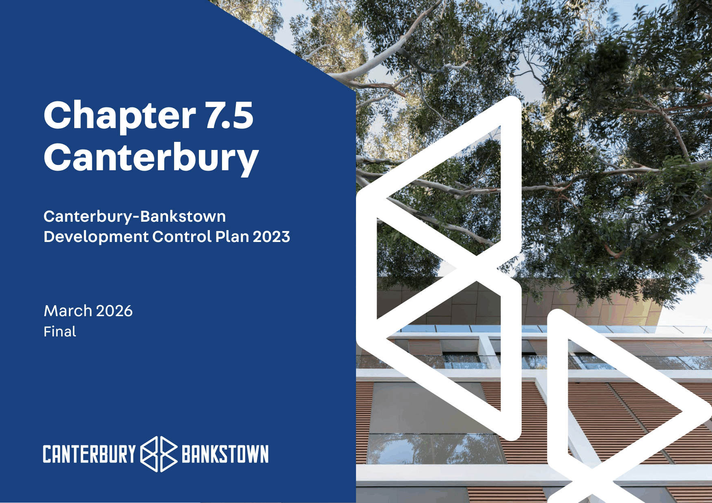
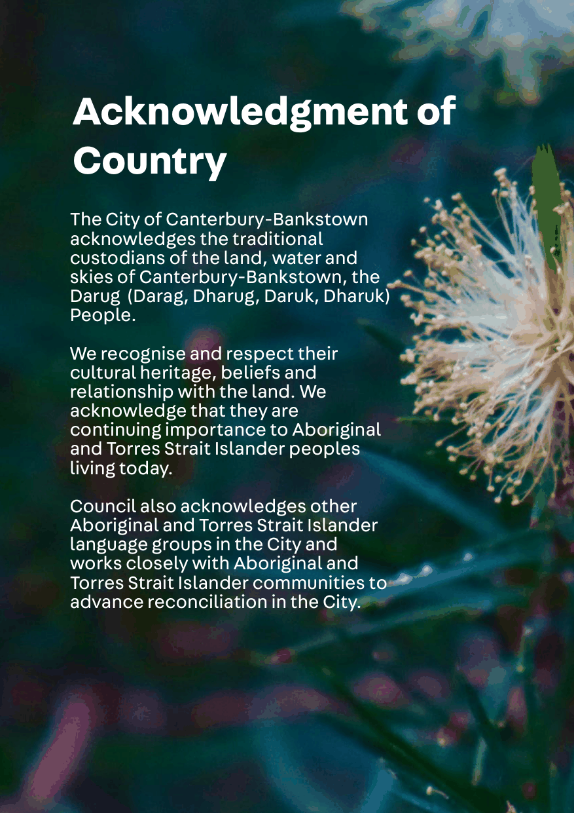

# Canterbury-Bankstown Development Control Plan 2023 - Chapter 7.5 Canterbury

> This chapter is split into 55 section file(s), one per numbered heading, in the order they appear in the PDF.

Source PDF: [2026.03.30 - DCP 2023 - AMENDMENT 12 - Chapter 7.5 - Canterbury Local Centre.pdf](https://planfortomorrow.sharepoint.com/sites/Planfortomorrow/Shared%20Documents/00%20NSW-Planning-Resources/dcp/canterbury-bankstown-development-control-plan-2023/ch-07-05-canterbury/2026.03.30%20-%20DCP%202023%20-%20AMENDMENT%2012%20-%20Chapter%207.5%20-%20Canterbury%20Local%20Centre.pdf)

> [Picture on page 1: a picture, saved as a picture (images/ch-07-05-canterbury-page-1-1.gif, 150 dpi).]

### Chapter 7.5

### Canterbury

### Canterbury-Bankstown

### Development Control Plan 2023

### March 2026

### Final

> [Picture on page 2: a picture, saved as a picture (images/ch-07-05-canterbury-page-2-1.gif, 150 dpi).]

Acknowledgment of

### Country

#### The City of Canterbury-Bankstown

#### acknowledges the traditional

custodians of the land, water and

skies of Canterbury-Bankstown, the

#### Darug  (Darag, Dharug, Daruk, Dharuk)

#### People. We recognise and respect their

cultural heritage, beliefs and

#### relationship with the land. We

acknowledge that they are

#### continuing importance to Aboriginal

#### and Torres Strait Islander peoples

#### living today. Council also acknowledges other

#### Aboriginal and Torres Strait Islander

language groups in the City and

works closely with Aboriginal and

Torres Strait Islander communities to

#### advance reconciliation in the City.

### We’re committed to creating a liveable

### and loveable City for all our residents

#### Great Cities

We believe in creating vibrant, dynamic, and diverse communities that offer opportunities for people to connect, pursue their passions, and contribute to the world around them.

#### Naturally Green

We protect and prioritise nature in and around our city to enhance environmental sustainability and improve the quality of life for our residents.

#### Design Excellence

We encourage buildings, spaces, and objects that are both beautiful and practical, enhancing the beauty, accessibility, and safety of our built environment.

#### People First

We prioritise the needs, preferences, and aspirations of our community in all aspects of urban planning and design, creating supportive and enriching places people love.

#### Community

We engage with our community to ensure their needs and aspirations are reflected in the outcome, creating sustainable, resilient, vibrant, diverse, and inclusive places.

#### Sustainability

We seek designs that reduce negative impacts on the environment while also promoting social and economic well-being.

#### Net-Zero

We encourage our community to design buildings and places that produce as much renewable energy as they consume, reducing greenhouse gas emissions, lowering energy bills, and increasing resilience to environmental shocks and stresses.

### Explore the Canterbury Local Centre DCP Chapter

Canterbury Local Centre, along with other significant centres in the Canterbury-Bankstown Local Government Area,

#### have an area specific Development Control Plan (DCP). This DCP contains the following parts:

### Introduction

### Understanding Place

### General Provisions

### Key Sites

### Designing the Public Building Layout, Form

### Domain

### and Design

### Definitions

### CONTENTS

<!-- sections -->
## Sections

1. [1 Introduction](01-introduction.md)
2. [2 Understanding Place](02-understanding-place.md)
3. [3 Designing the Public Domain](03-designing-the-public-domain.md)
4. [4 Building Layout, Form and Design](04-building-layout-form-and-design.md)
5. [5 General Provisions](05-general-provisions.md)
6. [6 Key Sites](06-key-sites.md)
7. [1.2 Vision for Canterbury Local](07-1-2-vision-for-canterbury-local.md)
8. [1.3 How to read this DCP](08-1-3-how-to-read-this-dcp.md)
9. [2.1 Structure Plan for the Local](09-2-1-structure-plan-for-the-local.md)
10. [2.2 Character Areas and key](10-2-2-character-areas-and-key.md)
11. [2 Green setbacks](11-2-green-setbacks.md)
12. [2.3 Connecting to Country](12-2-3-connecting-to-country.md)
13. [3.4 Tree canopy](13-3-4-tree-canopy.md)
14. [3.2 Public space](14-3-2-public-space.md)
15. [3.3 Cycleway Laneways](15-3-3-cycleway-laneways.md)
16. [3.5 Solar access](16-3-5-solar-access.md)
17. [3.1 Public domain strategy](17-3-1-public-domain-strategy.md)
18. [1 A new civic square, Canterbury](18-1-a-new-civic-square-canterbury.md)
19. [2 Robert Street is to be transformed](19-2-robert-street-is-to-be-transformed.md)
20. [3 Improve pedestrian and cycling](20-3-improve-pedestrian-and-cycling.md)
21. [4 Enhance existing public domain](21-4-enhance-existing-public-domain.md)
22. [5 Increase and maintain existing](22-5-increase-and-maintain-existing.md)
23. [7 Enhance pedestrian environment and](23-7-enhance-pedestrian-environment-and.md)
24. [3.2 Public space and publicly](24-3-2-public-space-and-publicly.md)
25. [3.3 Cycleways, laneways,](25-3-3-cycleways-laneways.md)
26. [3.4 Tree canopy and green cover](26-3-4-tree-canopy-and-green-cover.md)
27. [3.5 Solar access to public open](27-3-5-solar-access-to-public-open.md)
28. [3.6 The provision of shade and](28-3-6-the-provision-of-shade-and.md)
29. [4.1 Minimum lot sizes and](29-4-1-minimum-lot-sizes-and.md)
30. [4.2.1 Building height and storeys](30-4-2-1-building-height-and-storeys.md)
31. [4.2.2 Floor to floor heights Objectives](31-4-2-2-floor-to-floor-heights-objectives.md)
32. [4.2.3 Street wall](32-4-2-3-street-wall.md)
33. [4.2.4 Front setbacks Objectives](33-4-2-4-front-setbacks-objectives.md)
34. [4.2.5 Upper storey setbacks Objectives](34-4-2-5-upper-storey-setbacks-objectives.md)
35. [4.2.6 Building separation Objectives](35-4-2-6-building-separation-objectives.md)
36. [4.2.7 Maximum floorplate area](36-4-2-7-maximum-floorplate-area.md)
37. [4.3.1 Residential ground floor frontage Objectives](37-4-3-1-residential-ground-floor-frontage.md)
38. [4.3.2 Active Street frontage and edges](38-4-3-2-active-street-frontage-and-edges.md)
39. [4.4 Visual diversity, articulation and fine grain of buildings](39-4-4-visual-diversity-articulation-and-fine.md)
40. [1 Fine grain](40-1-fine-grain.md)
41. [2 Variety in architectural](41-2-variety-in-architectural.md)
42. [3 Long podiums visually](42-3-long-podiums-visually.md)
43. [4.5 Materials and finishes](43-4-5-materials-and-finishes.md)
44. [4.6 Rooftop and podium communal open space](44-4-6-rooftop-and-podium-communal-open-space.md)
45. [5.1 Dwelling mix and flexible](45-5-1-dwelling-mix-and-flexible.md)
46. [5.2 Parking](46-5-2-parking.md)
47. [5.3 Underground floor space](47-5-3-underground-floor-space.md)
48. [5.4.2 Urban cooling and](48-5-4-2-urban-cooling-and.md)
49. [5.4.2 Reduction of the Urban Heat](49-5-4-2-reduction-of-the-urban-heat.md)
50. [5.4.3 Energy efficient (BASIX](50-5-4-3-energy-efficient-basix.md)
51. [5.4.4 Water efficiency](51-5-4-4-water-efficiency.md)
52. [5.4.5 Electric Buildings](52-5-4-5-electric-buildings.md)
53. [5.4.6 Solar energy requirements](53-5-4-6-solar-energy-requirements.md)
54. [6 Key Sites](54-6-key-sites.md)
55. [2 Active frontage and](55-2-active-frontage-and.md)
