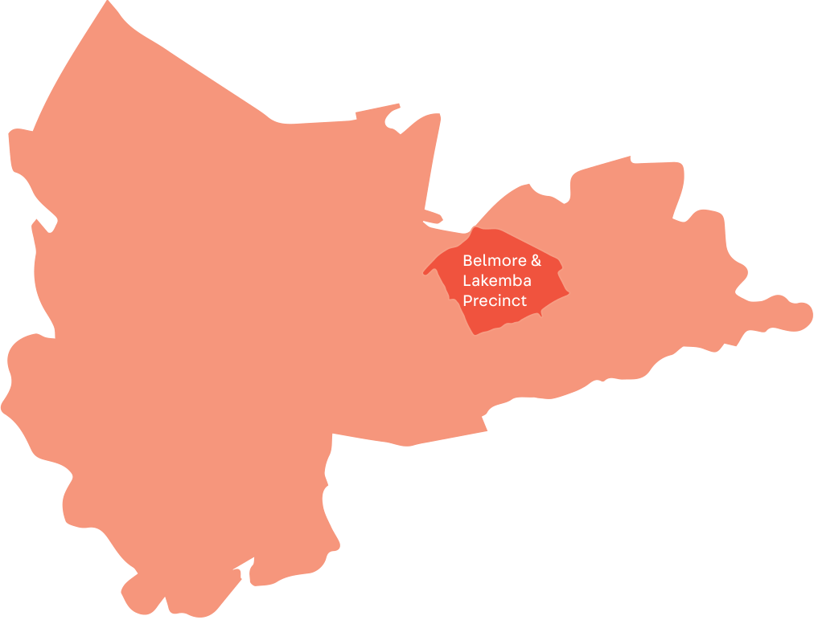

### 1.1 Application of this

### Chapter

This Chapter of the Canterbury-Bankstown DCP 2023, (CBDCP 2023), supports the Canterbury- Bankstown Local Environmental Plan 2023, (LEP), by providing additional objectives, principles and development controls to enhance the functionality, design and amenity of development within the Belmore and Lakemba Precinct, (also referred to as ‘the Precinct’ in this Chapter). The Precinct is comprised of two Local Centres, Belmore and Lakemba as noted in the Canterbury- Bankstowns Local Strategic Planning Statement. This Chapter of the CBDCP 2023 applies to all development on the land within the Precinct as identified in Figure 2. Other Chapters, as relevant, of the CBDCP 2023 must also be addressed as part of a Development Application. Where there is an inconsistency between the controls in this Chapter and other Chapters of the CBDCP 2023, this chapter prevails to the extent of the inconsistency except in respect of Chapter 4 Heritage.

> [Picture on page 6: a picture, saved as a picture (images/ch-07-06-belmore-and-lakemba-page-6-24.gif, 150 dpi).]
> Words printed on the picture (title and legend, copied from the PDF):
> Belmore &
> Lakemba
> Precinct

#### LEGEND

Canterbury-Bankstown Local Government Area (LGA)

Belmore and Lakemba Precinct

Location of the Belmore and Lakemba Precinct within Canterbury-Bankstown LGA

#### Figure 1.

#### LEGEND

Land Application Map

Figure 2. Belmore and Lakemba Precinct land application map

Wangee Road

The Boulevarde

#### Lakemba Station

#### M

Haldon Street

Lakemba Street

#### Belmore Station

#### M

Burwood Road

Leylands Parade

Canterbury Road

1:12,500

N

100 200 300 500M

Chapter 7.6 Belmore and Lakemba Precinct 7
