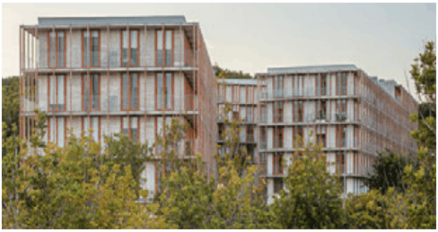
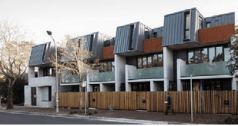
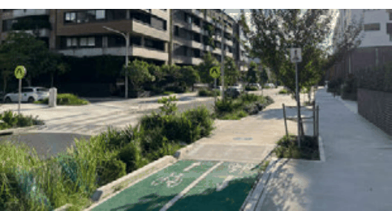
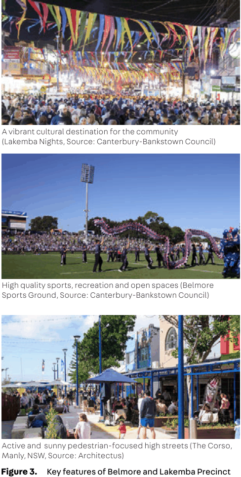
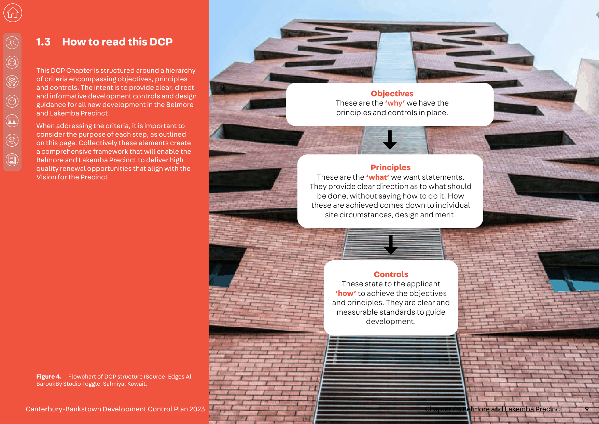

### 1.2	 Vision for Belmore and

### Lakemba Precinct

#### Vision

The Belmore and Lakemba Local Centres are vibrant hubs where the community can come together and celebrate their cultural diversity. The Local Centres will provide greater housing choice that is well located to services and infrastructure to cater to the diverse needs of our communities. New buildings will be well-designed, in ways that respond to Belmore and Lakemba's unique character, providing sensitive interfaces and transitions between low-rise areas and heritage, and ensuring that new urban areas retain a human scale and community feel. Growth in Belmore and Lakemba will be supported by enhanced public transport connections, increased retail activity and new services, new walking and cycling links and green walkable streets. Burwood Road and Haldon Streets vibrancy will be enhanced and continue to support a thriving and distinct local business community. Investment into key parks and community infrastructure including the Belmore Sports and Recreation Precinct, Parry Park and a new community and open space area in the heart of Lakemba will ensure the community can enjoy high amenity as the Local Centres evolve over time.

> [Picture on page 8: a picture, saved as a picture (images/ch-07-06-belmore-and-lakemba-page-8-29.gif, 150 dpi).]

Well designed apartments, Harquitectes

(Barcelona, Spain, Source: Glyde_Bautovich)

> [Picture on page 8: a picture, saved as a picture (images/ch-07-06-belmore-and-lakemba-page-8-32.gif, 150 dpi).]

Diversity of mid and low rise housing choices (Darlington, NSW, Source: Brett Boardman)

> [Picture on page 8: a picture, saved as a picture (images/ch-07-06-belmore-and-lakemba-page-8-35.gif, 150 dpi).]

Green, cool and resilient streets that promote walking and cycling (Erskineville, NSW, Source: Architectus)

> [Picture on page 8: a picture, saved as a picture (images/ch-07-06-belmore-and-lakemba-page-8-38.gif, 150 dpi).]
> Words printed on the picture (title and legend, copied from the PDF):
> A vibrant cultural destination for the community
> (Lakemba Nights, Source: Canterbury-Bankstown Council)
> High quality sports, recreation and open spaces (Belmore
> Sports Ground, Source: Canterbury-Bankstown Council)
> Active and  sunny pedestrian-focused high streets (The Corso,
> Manly, NSW, Source: Architectus)

Figure 3. Key features of Belmore and Lakemba Precinct

> [Picture on page 9: a picture, saved as a picture (images/ch-07-06-belmore-and-lakemba-page-9-1.gif, 150 dpi).]
> Words printed on the picture (title and legend, copied from the PDF):
> Vision for the Precinct.
> BaroukBy Studio Toggle, Salmiya, Kuwait.
> These are the ‘why’ we have the
> principles and controls in place.
> These are the ‘what’ we want statements.
> They provide clear direction as to what should
> be done, without saying how to do it. How
> these are achieved comes down to individual
> site circumstances, design and merit.
> These state to the applicant
> ‘how’ to achieve the objectives
> and principles. They are clear and
> measurable standards to guide
> development.

Figure 4. Flowchart of DCP structure (Source: Edges Al
