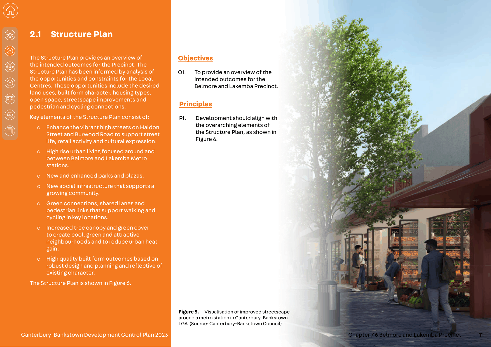

## Section 2 UNDERSTANDING PLACE

#### This section establishes the unique

social, spatial and urban context that

#### reflects Belmore and Lakemba Precinct.

#### Proposed development must contribute

to delivering the Vision for Belmore and

#### Lakemba by adhering to the Structure

#### Plan, demonstrating how a site's

#### development contributes to the character

areas and has regard for Connecting with

#### Country principles.

| 2.1 | Structure Plan | 11 |
|---|---|---|
| 2.2 | Character Areas | 13 |
| 2.3 | Connecting with Country | 38 |

> [Picture on page 11: a picture, saved as a picture (images/ch-07-06-belmore-and-lakemba-page-11-1.gif, 150 dpi).]
> Words printed on the picture (title and legend, copied from the PDF):
> stations.
> growing community.
> cycling in key locations.
> gain.
> existing character.
