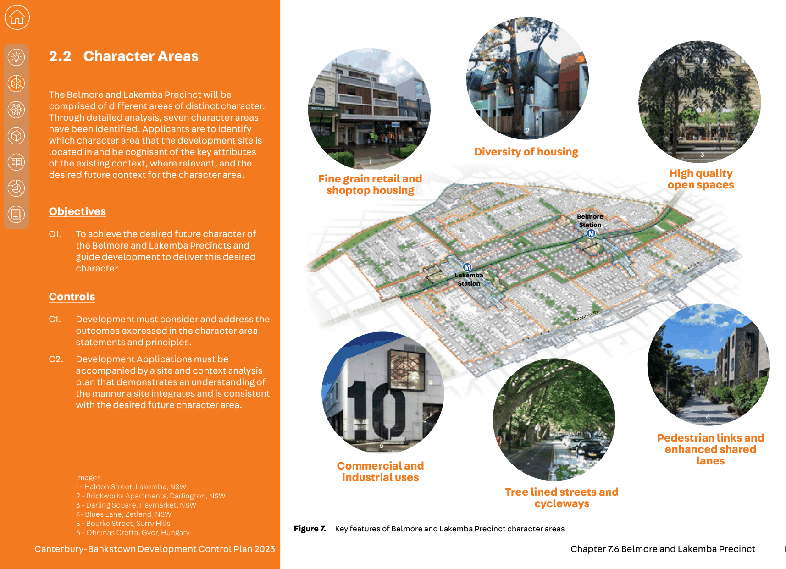

### 2.1 Structure Plan

The Structure Plan provides an overview of the intended outcomes for the Precinct. The Structure Plan has been informed by analysis of the opportunities and constraints for the Local Centres. These opportunities include the desired land uses, built form character, housing types, open space, streetscape improvements and pedestrian and cycling connections. Key elements of the Structure Plan consist of: ⚬ Enhance the vibrant high streets on Haldon Street and Burwood Road to support street life, retail activity and cultural expression. ⚬ High rise urban living focused around and between Belmore and Lakemba Metro

⚬ New and enhanced parks and plazas. ⚬ New social infrastructure that supports a

⚬ Green connections, shared lanes and pedestrian links that support walking and

⚬ Increased tree canopy and green cover to create cool, green and attractive neighbourhoods and to reduce urban heat

⚬ High quality built form outcomes based on robust design and planning and reflective of

The Structure Plan is shown in Figure 6.

#### Objectives

O1. To provide an overview of the

intended outcomes for the

Belmore and Lakemba Precinct.

#### Principles

P1. Development should align with

the overarching elements of

the Structure Plan, as shown in

Figure 6.

Figure 5. Visualisation of improved streetscape

around a metro station in Canterbury-Bankstown

LGA  (Source: Canterbury-Bankstown Council)

Chapter 7.6 Belmore and Lakemba Precinct 11

### Belmore and Lakemba Structure Plan

Wangee Road

#### Legend

Application of DCP

Commercial and mixed use

Industrial

High density residential

Medium density residential

Low density residential

School

#### Lakemba

Existing open space

#### Station

Expanded open space

Upgraded open space

Haldon Street

Proposed new open space

Proposed community facility

Planned station plaza

M Metro station

Major road

High street improvements

Priority streets for tree canopy

Priority streets for cycleways

Planned East-West cycle link (Sydney Metro)

Proposed pedestrian link (min. 4m)

Proposed widened pedestrian link (12m)

Proposed retail arcade (min. 6m)

Proposed lane extension (6m)

Proposed new shared lane (9m)

Proposed lane expansion (9m)

Active frontages

Active edges

Figure 6. Belmore and Lakemba Structure Plan

Lakemba Street

#### Belmore

#### Station

Burwood Road

The Boulevarde

Leylands Parade

Canterbury Road

1:12,500

0 100 200 300 500M

N

> [Picture on page 13: a map, saved as a picture (images/ch-07-06-belmore-and-lakemba-page-13-1.gif, 150 dpi); the street names and other small labels are on the picture.]
> Words printed on the picture (title and legend, copied from the PDF):
> statements and principles.
> 1 - Haldon Street, Lakemba, NSW
> 2 - Brickworks Apartments, Darlington, NSW
> 3 - Darling Square, Haymarket, NSW
> 4- Blues Lane, Zetland, NSW
> 5 - Bourke Street, Surry Hills
> 6 - Oficinas Cretta, Gyor, Hungary

Figure 7. Key features of Belmore and Lakemba Precinct character areas
