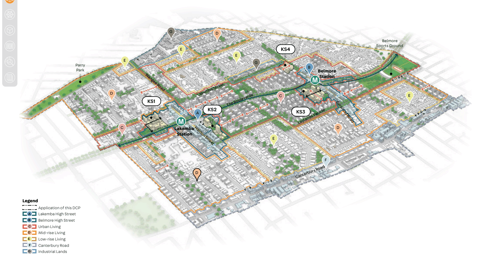
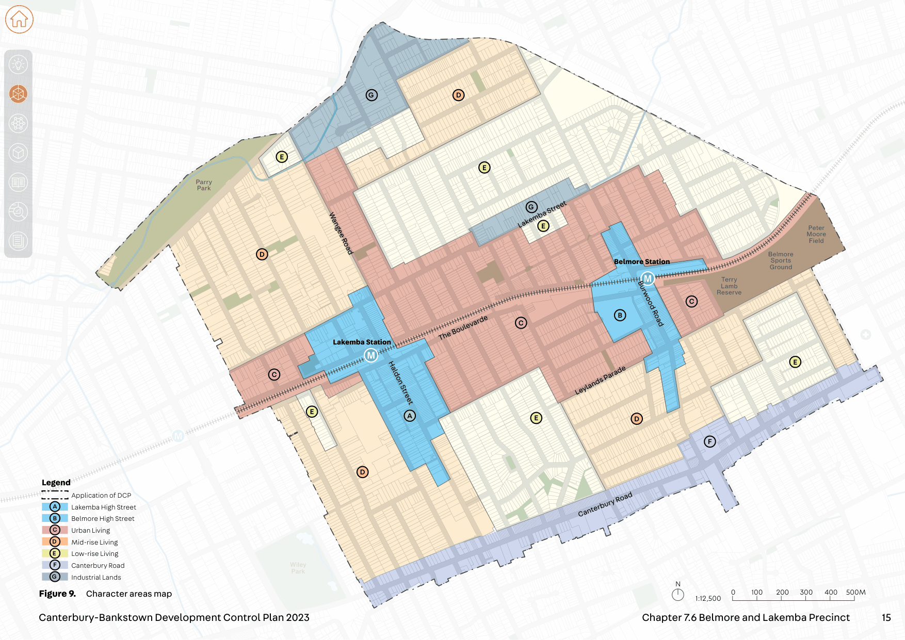

### 2.2	 Character Areas

The Belmore and Lakemba Precinct will be comprised of different areas of distinct character. Through detailed analysis, seven character areas have been identified. Applicants are to identify which character area that the development site is located in and be cognisant of the key attributes of the existing context, where relevant, and the desired future context for the character area.

#### Objectives

O1. To achieve the desired future character of the Belmore and Lakemba Precincts and guide development to deliver this desired

#### Controls

C1. Development must consider and address the outcomes expressed in the character area

C2. Development Applications must be accompanied by a site and context analysis plan that demonstrates an understanding of the manner a site integrates and is consistent with the desired future character area.

#### Diversity of housing

Fine grain retail and

#### High quality

#### open spaces

#### shoptop housing

Pedestrian links and

#### enhanced shared

#### lanes

Commercial and

#### industrial uses

Tree lined streets and

#### cycleways

> [Picture on page 14: a map, saved as a picture (images/ch-07-06-belmore-and-lakemba-page-14-1.gif, 150 dpi); the street names and other small labels are on the picture.]
> Words printed on the picture (title and legend, copied from the PDF):
> Application of this DCP
> A Lakemba High Street
> B Belmore High Street
> C Urban Living
> D Mid-rise Living
> E Low-rise Living
> F Canterbury Road
> G Industrial Lands

Key Sites (see Section 6 of this DCP)

#### M

Axonometric view of character areas with indicative massing of potential future development

#### Figure 8.

#### M

N

Chapter 7.6 Belmore and Lakemba Precinct 14

> [Picture on page 15: a map, saved as a picture (images/ch-07-06-belmore-and-lakemba-page-15-1.gif, 150 dpi); the street names and other small labels are on the picture.]
> Words printed on the picture (title and legend, copied from the PDF):
> Application of DCP
> A Lakemba High Street
> B Belmore High Street
> C Urban Living
> D Mid-rise Living
> E Low-rise Living
> F Canterbury Road
> G Industrial Lands
> 100 200 300 500M

Figure 9. Character areas map

Chapter 7.6 Belmore and Lakemba Precinct 15

### Desired Future Character Areas
