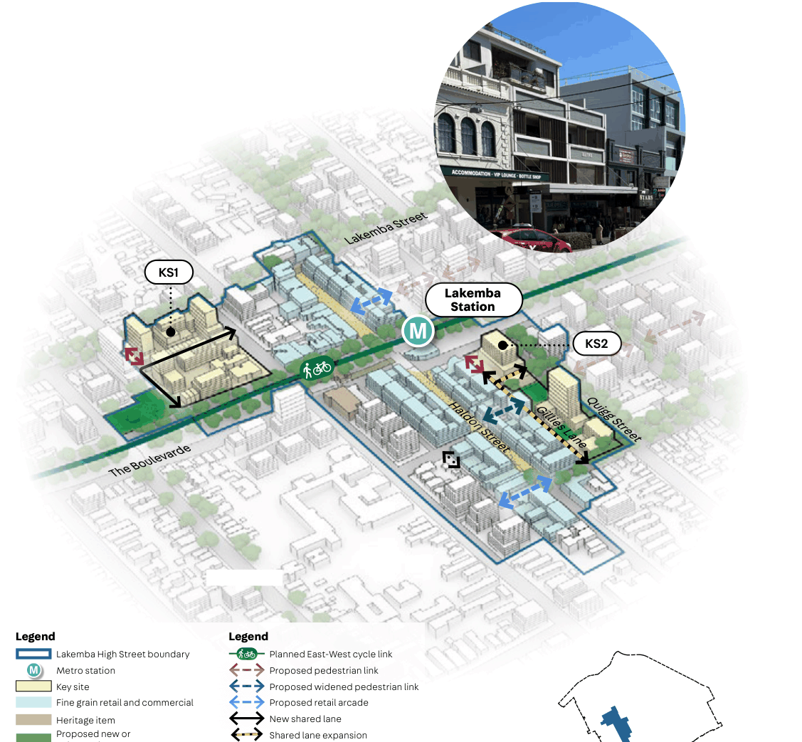
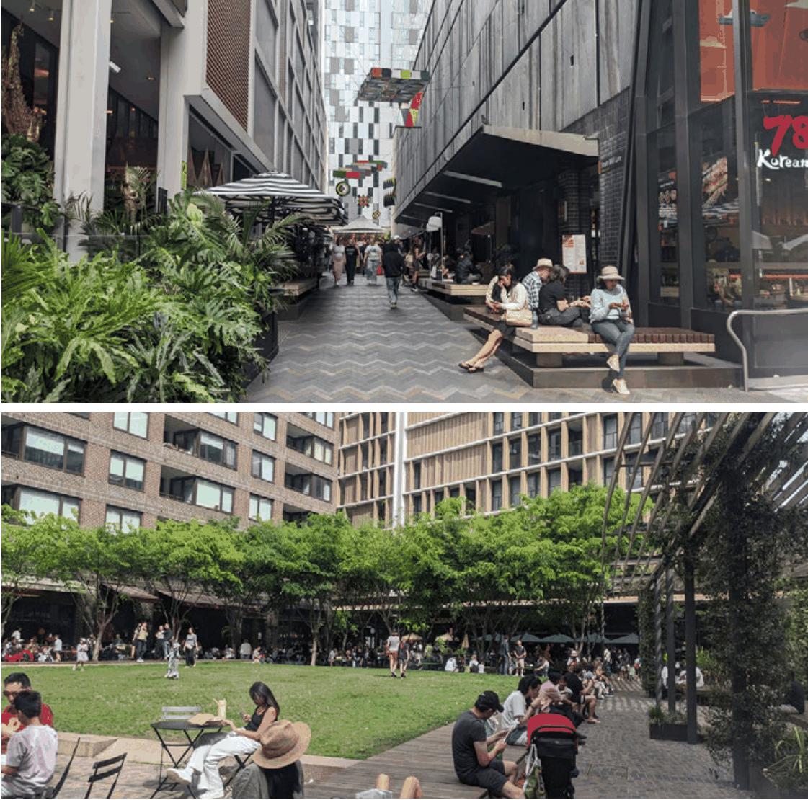
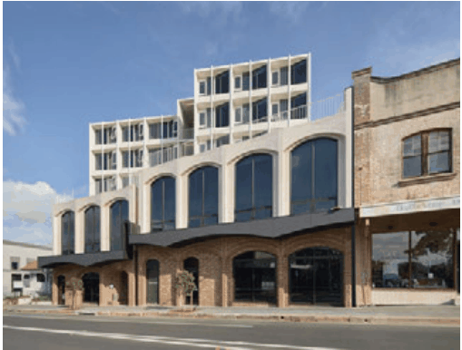
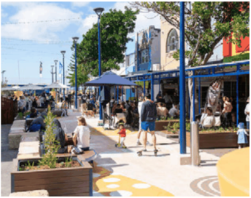
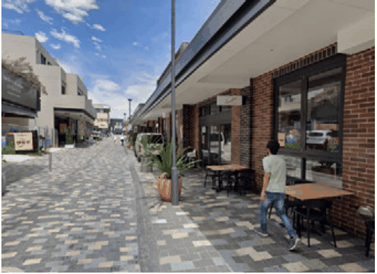

#### 2.2.1 Lakemba High Street

#### The Lakemba High Street character area

#### will have its vibrant multicultural identity

enhanced, offering a dynamic mix of shopping, dining and community services, alongside new housing to support a

#### thriving atmosphere day and night.

Building on the success of the Ramadan Markets, Haldon Street will be prioritised as a pedestrianised space lined with vibrant retail uses that activate the street level, complemented by shoptop housing above to create a lively civic area. The bulk and scale of new development will reflect the predominant 2 to 3 storey street wall height in Haldon Street and the parapet character, with fine grain tenancies incorporating masonry and brick. Where possible, pre 1950 shop facades will be retained and sympathetically restored. Additional storeys will be setback on a podium, featuring green terraces and balconies.

> [Picture on page 16: a map, saved as a picture (images/ch-07-06-belmore-and-lakemba-page-16-22.gif, 150 dpi); the street names and other small labels are on the picture.]
> Words printed on the picture (title and legend, copied from the PDF):
> Lakemba High Street boundary
> Fine grain retail and commercial
> Proposed new or
> Planned East-West cycle link
> Proposed pedestrian link
> Proposed widened pedestrian link
> Proposed retail arcade
> New shared lane
> Shared lane expansion

enhanced open space High street improvements

Lane extension

Axonometric view of Lakemba High Street with indicative massing of potential

#### Figure 10.

future development and photo of Haldon Street's fine grain retail with shoptop housing.

As the cultural heart of Lakemba, the character area will feature high-quality public spaces that encourages exploration and social interaction. The character area surrounds the Metro station and the enhanced public space and aims to meet diverse community needs while promoting entertainment, convenience, and connectivity. KS-1 and 2 will provide new and enhanced public space and links at ground level, supported by higher-density developments. Specifically, KS-2, the Quigg Street block, will be revitalised to include a new central open space with the opportunity for consolidated community facilities, while on KS-1, Jubilee Reserve will be expanded and improved. Gillies Lane behind Haldon Street will be designed to balance service needs with pedestrian amenity. An attractive and safe interface to open space and community facilities will be provided at Quigg Street. An improved and widened pedestrian link between Haldon Street and Gillies Lane will link this key site to Haldon Street.

> [Picture on page 17: a picture, saved as a picture (images/ch-07-06-belmore-and-lakemba-page-17-24.gif, 150 dpi).]

Darling Square in Haymarket is a lively, pedestrian friendly place that seamlessly integrates retail, dining, residential and community gath-ering spaces. This dynamic area features a blend of mixed-use developments, thoughtfully designed and activated pedestrian links and an iconic library building, all centered around a green open space that serves as the heart of the community (Source: Architectus)

> [Picture on page 18: a picture, saved as a picture (images/ch-07-06-belmore-and-lakemba-page-18-1.gif, 150 dpi).]

Fine grained shoptop housing, Nightingale, Marrickville, Sydney (Source: Tom Roe)

#### Principles

P1. Built form along Haldon Street: New developments on Haldon Street should retain the existing high street character by:

a)	 Maintaining a street wall height of 2 to 3 storeys in line with the predominant existing building height. New development should be consistent with the solid to void ratios in historic shopfront masonry buildings, awnings, parapets and windows. Refer to Section 4.2.3 Street wall.

b)	 Retaining and integrating pre 1950 shopfront facades sympathetically into the design of new development, including restoration and removal of any uncharacteristic and intrusive features.

c)	 Reinforcing fine-grain active frontages with glazing and openings that invigorate Haldon Street, fostering a lively atmosphere and creating a dynamic pedestrian environment, whilst also protecting residents from potential noise generation. Refer to Section

4.3.2 Active street frontages and edges.

> [Picture on page 18: a picture, saved as a picture (images/ch-07-06-belmore-and-lakemba-page-18-27.gif, 150 dpi).]

Activated sunny retail strip,  The Corso, Manly, (Source: Architec-tus)

d)	 Using traditional materials such as brickwork and masonry that reflect the area’s heritage and pre 1950s facades. Refer to Section 4.5 Materials and finishes.

e)	 Setting back upper levels to provide green podium communal spaces and passive surveillance opportunities. Refer to Section

4.6 Communal and podium open space.

2

P2. Lanes: Lanes behind Haldon Street will be enhanced to  support pedestrians and cyclists amenity while also accommodating service vehicles and driveways creating a high amenity network that promotes safety and accessibility for all users. Refer to Section

3.3 Streets, shared lanes, pedestrian links and arcades. Development interfacing laneways should:

a) For commercial uses: consider opportunities for active lane edges, including cafes, outdoor seating, planters and where possible deep soil.

> [Picture on page 18: a picture, saved as a picture (images/ch-07-06-belmore-and-lakemba-page-18-52.gif, 150 dpi).]

Activated shared laneway, Birdwood Lane, Lane Cove (Source: Architectus)

b)	 For residential uses: provide high quality landscaping, deep soil and apartments with private entries.

3

P3. Key sites (KS-1 Jubilee Reserve and KS-2 Quigg Street): Development at Jubilee Reserve and the Quigg Street key sites must deliver improved permeability, new open space and active street and lane interfaces. These sites are identified as key catalysts for community infrastructure and access. Refer to Section 6 Key Sites.

P4. Pedestrian link between Haldon Street and Gillies Lane: A widened open-air link between Haldon Street and Gillies Lane is to be delivered with active frontages, including retail and café seating, lighting, and planting, to create a vibrant, safe, and well-used connection.
