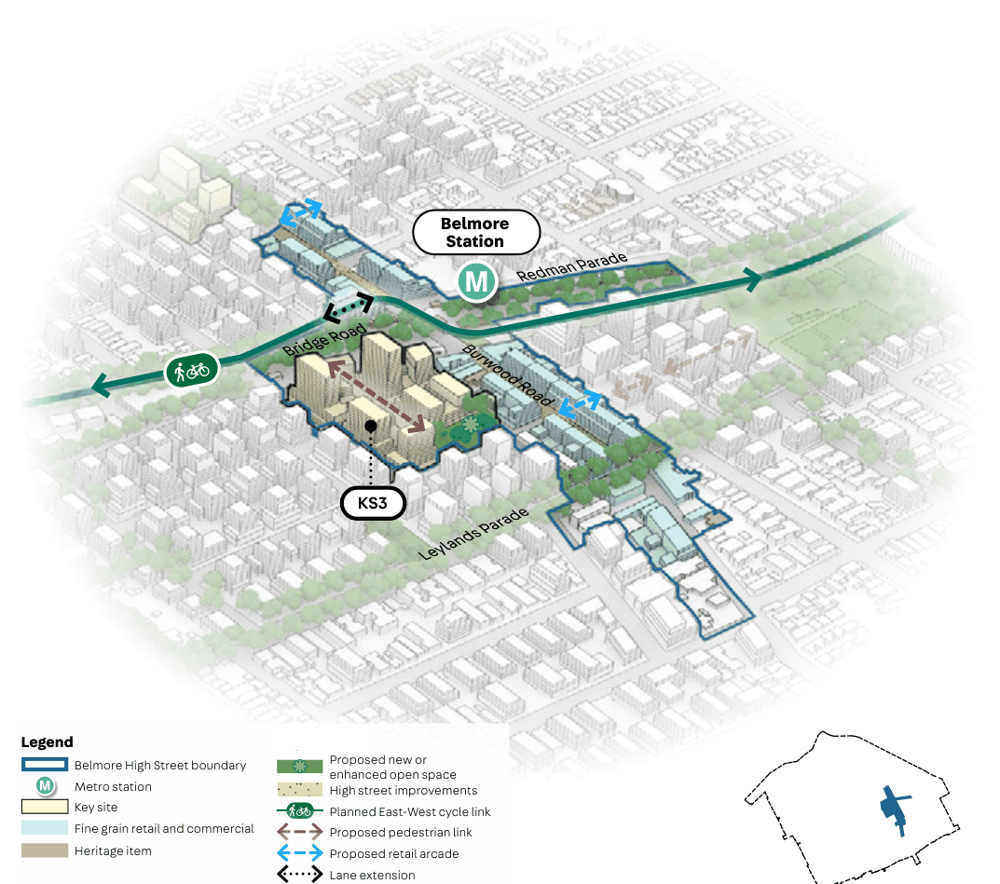
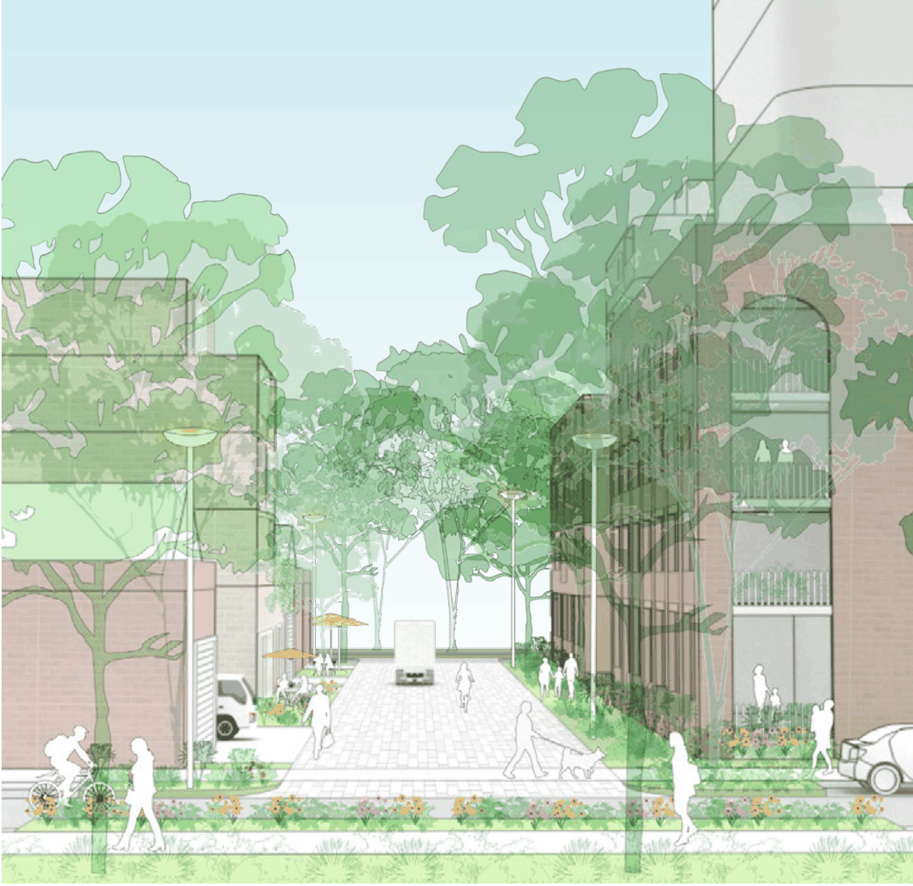
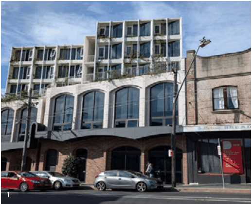
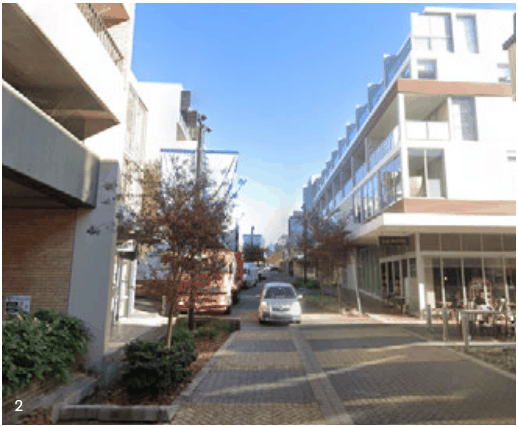

#### 2.2.2 Belmore High Street

#### The Belmore High Street character

area will be revitalised and showcase a diverse mix of retail and urban services,

#### complemented by new residential

#### developments that enhance the area's

#### liveliness and appeal.

The character area will feature an improved pedestrian environment and activated shared lanes, making it more accessible and attractive for walking and cycling in and around the new Metro station. The local services and shops will provide convenient amenities.

Enhancements to Burwood Road will prioritise the pedestrian experience, incorporating traffic calming measures and urban greening while maintaining essential north-south transport connections for vehicles and buses. Burwood Road will maintain a diverse mix of retail and commercial services, complemented by residential apartments above. A 2-3 storey street wall characterised by brick and masonry finishes will define the architectural identity of the area with additional storeys set back to enhance the traditional streetscape.  Pre 1950 shop facades will be retained and sympathetically integrated into new development.

> [Picture on page 19: a map, saved as a picture (images/ch-07-06-belmore-and-lakemba-page-19-28.gif, 150 dpi); the street names and other small labels are on the picture.]
> Words printed on the picture (title and legend, copied from the PDF):
> Belmore High Street boundary
> Fine grain retail and commercial
> Proposed new or
> enhanced open space
> High street improvements
> Planned East-West cycle link
> Proposed pedestrian link
> Proposed retail arcade

Axonometric view of Belmore High Street with indicative massing of potential

#### Figure 11.

future development.

Shared lanes will facilitate service vehicle access while improving the pedestrian and cycling network creating opportunities for retail activation behind Burwood Road. Enhanced pathways, greenery and cycling connections along the railway line and Leylands Parade will link this character area to key destinations, including the Metro station, Belmore Sports and Recreation Precinct and higher density residential areas between Belmore and Lakemba. The Canterbury Leagues Club key site is a significant attraction within the Belmore Local Centre and represents a substantial landholding strategically located near the station. This site presents a significant opportunity to catalyse Belmore Local Centre, through mixed use development with high rise apartments. It will feature pedestrian friendly links and shared lanes, improved interfaces and greening as well as a new publicly accessible open space that will serve as a green focal point, with activated edges to encourage community gathering, enjoyment and amenity.

> [Picture on page 20: a picture, saved as a picture (images/ch-07-06-belmore-and-lakemba-page-20-24.gif, 150 dpi).]

Figure 12. Illustration of enhanced lanes behind Burwood Road that manage rear retail and residential frontages. Setbacks to retail accommodate servicing, driveways as well as incidental active edges and landscaping. Setbacks to residential are for landscaped garden apartments.

#### Principles

P1. Built Form along Burwood Road: New developments along Burwood Road should retain and enhance the fine-grain traditional high street character by:

a)	 Maintaining a street wall height of 2-3 storeys that aligns with the predominant existing building height and architectural detailing including solid to void ratios, awnings, parapets and windows. See Section

4.2.3 Street wall.

b)	 Retaining pre 1950 shop facades and sympathetically integrating them into the design of new development. Key elements such as the historic paraphets and awnings should be restored and uncharacteristic and intrusive features removed.

c)	 Fostering the fine-grain active street frontages with glazing and openings that animate Burwood Road at street level. Mitigate noise and create a lively pedestrian atmosphere. See Section 4.3.2 Active street frontage and edges.

d)	 Using materials that reflect the traditional face brickwork and masonry of surrounding buildings including heritage and pre 1950 facades. See Section 4.5 Materials and finishes.

Images:

1- Shoptop housing, Nightingale, Illawarra Road, Marrick-ville, NSW (Source: Architectus) 2- Enhanced lane, Grosvenor Lane, Neutral Bay, NSW (Source: Architectus)

e)	 Setting back the upper levels above

the street wall to provide green podium

communal spaces and passive surveillance.

See Section 4.6 Rooftop and communal open

space.

P2. Lanes: Lanes will be enhanced to better

accommodate pedestrians and cyclists,

while also facilitating service vehicles and

driveways, creating a high-amenity network

that promotes safety and accessibility for all

users.

P3. Development interfacing lanes should

manage servicing and driveway access

within setbacks while also providing

increased amenity, activity and greening.

Specifically:

a)	 For commercial uses, consider opportunities

for active lane edges, including cafes,

outdoor seating, planters and where

possible deep soil.

b)	 For residential uses, provide high quality

landscaping, deep soil, and apartments with

private entries. Refer to Section 3.3 Streets,

shared lanes, pedestrian links and arcades.

P4. The Leagues Club key site; development

on this site must provide improved

permeability, active edges to streets and

shared lanes and deliver new open space,

as identified the KS-3 plan. See Section 6 Key

Sites.

> [Picture on page 21: a picture, saved as a picture (images/ch-07-06-belmore-and-lakemba-page-21-63.gif, 150 dpi).]
> Words printed on the picture (title and legend, copied from the PDF):
> 1

> [Picture on page 21: a picture, saved as a picture (images/ch-07-06-belmore-and-lakemba-page-21-64.gif, 150 dpi).]
> Words printed on the picture (title and legend, copied from the PDF):
> 2
