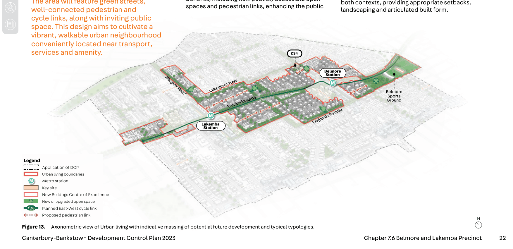
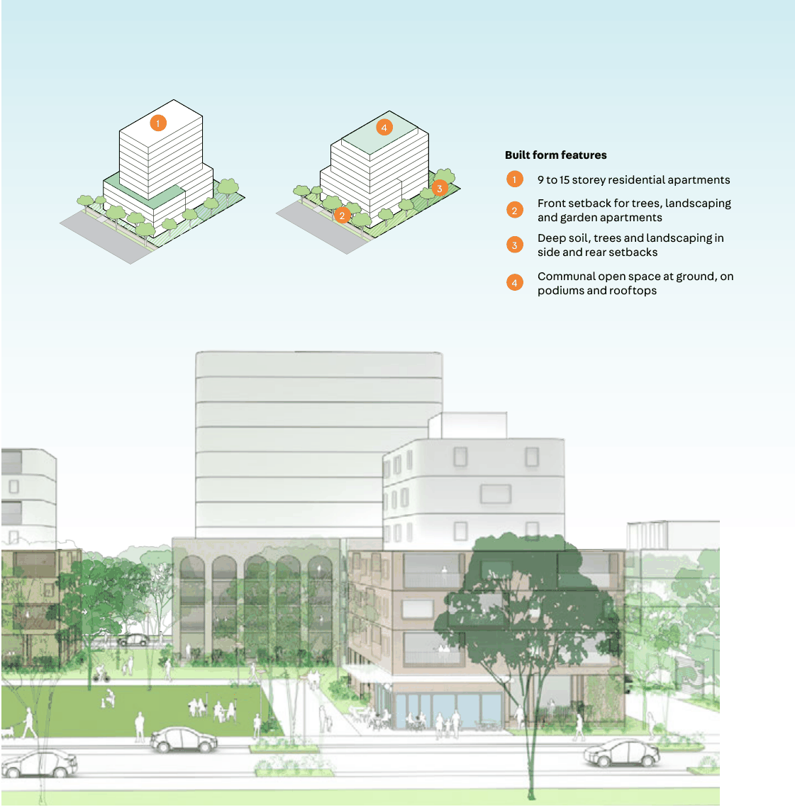
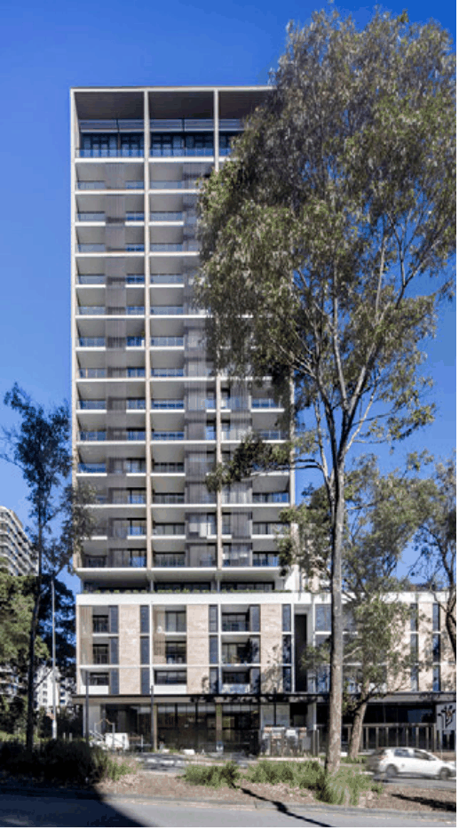
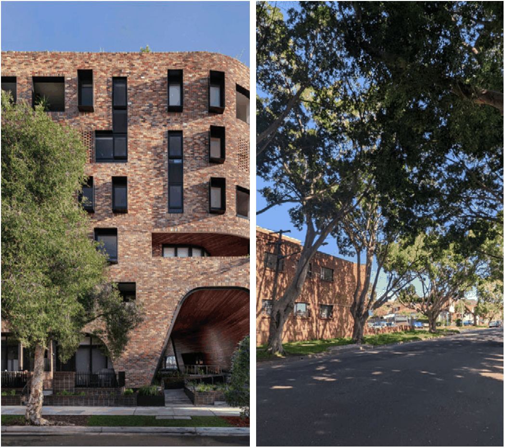

#### 2.2.3  Urban living

domain and connectivity for everyone. Corner sites will be designed to accommodate landmark towers and focal points in the street.

#### The Urban living character area will offer

#### architecturally inspiring apartments within

#### slender towers on podiums that create

#### a varied skyline and contribute to a high

#### quality public domain and streetscape.

This character area will experience substantial revitalisation, featuring new apartment developments primarily ranging from 9 to 15 storeys with a four to five storey street wall that integrates with the surroundings. Key sites will facilitate high-quality developments that offer additional public benefits, including new publicly accessible open spaces and pedestrian links, enhancing the public

While parts of this neighbourhood have existing residential flat buildings, others consist of detached dwellings. New development will need to consider

> [Picture on page 22: a map, saved as a picture (images/ch-07-06-belmore-and-lakemba-page-22-21.gif, 150 dpi); the street names and other small labels are on the picture.]
> Words printed on the picture (title and legend, copied from the PDF):
> Application of DCP
> Urban living boundaries
> New Bulldogs Centre of Excellence
> New or upgraded open space
> Planned East-West cycle link
> Proposed pedestrian link

Figure 13. Axonometric view of Urban living with indicative massing of potential future development and typical typologies.

both contexts, providing appropriate setbacks, landscaping and articulated built form.

The area will feature green streets, well-connected pedestrian and

#### cycle links, along with inviting public

space. This design aims to cultivate a

#### vibrant, walkable urban neighbourhood

conveniently located near transport,

#### services and amenity.

New developments will prioritise direct street access and landscaped private open space within setbacks for ground-floor apartments and terraces, encouraging passive surveillance of the streets, pedestrian links and shared lanes. Apartments adjacent to open space will be designed to provide a high quality interface and frontage to parks. Podiums and rooftops will offer opportunities to contribute to urban greening and communal open space for residents. This neighbourhood benefits from a well-established tree canopy along Leylands Parade, offering shade, biodiversity and a beautiful green streetscape. New tree canopy will be focused along key streets including Wangee Road, Lakemba Street and The Boulevarde. This will contribute to a cool, green and attractive network of streets. Additionally, proposed cycleways along key streets will offer a safe, convenient and healthy way to navigate the neighbourhood while connecting to the new east-west Sydney Metro pedestrian link.

> [Picture on page 23: a map, saved as a picture (images/ch-07-06-belmore-and-lakemba-page-23-22.gif, 150 dpi); the street names and other small labels are on the picture.]
> Words printed on the picture (title and legend, copied from the PDF):
> Built form features
> 1 9 to 15 storey residential apartments
> Front setback for trees, landscaping
> and garden apartments
> Deep soil, trees and landscaping in
> side and rear setbacks
> Communal open space at ground, on
> podiums and rooftops

Illustration of apartments interfacing a park with direct ground floor access and landscaping. An activated edge is

#### Figure 14.

provided to the park and street with outdoor dining.

#### Principles

P1. New taller developments must be sympathetic to the surrounding context, that includes a mix of detached dwellings, three-storey walk-ups and newer apartment buildings. In areas interfacing with lower-density zones, a sensitive transition is essential. This should be achieved through careful consideration of scale, setbacks, separation, landscaping, and privacy measures. See Section 4.2 The building envelope.

P2. Development adjacent to public open space will be orientated to face the park, maximise park outlook from living areas and balconies and create a positive interface that promotes passive surveillance through entrances, balconies, terraces, and high quality landscaping. Development interfacing Belmore Sports and Recreation Precinct will demonstrate consideration of the high level precinct plan in Figure 24. See Section 3.1 Public domain strategy – Indicative high level precinct plan for Belmore Sports Ground.

P3. High-quality pedestrian links must be free

of obstructions and feature landscaping

along their edges. These links should also

include adequate lighting and setbacks

that accommodate landscaping, as well as

garden apartments with direct ground floor

entries to enhance passive surveillance. See

Section 3.3 Streets, shared lanes, pedestrian links

and arcades.

P4. Encourage the provision of small scale retail,

commercial, food and drink premise uses at

street corners and pedestrian links to create

active edges. See Section 4.3.2 Active street

frontages and edges.

P5. Elegant towers set upon podiums will feature

facades that respond to orientation, expose

concrete structure and are responsive to the

context using face brickwork. Podiums will

include articulation and breaks to ensure

they don’t overwhelm the streetscape. See

Section 4.2.1 Building height and storeys and 4.4

Visual diversity, articulation and fine grain.

P6. The use of brick and masonry will integrate

with the existing brick character of the

neighbourhood. High quality finishes and

textures should be provided at street level.

See Section 4.5 Materials and finishes.

> [Picture on page 24: a picture, saved as a picture (images/ch-07-06-belmore-and-lakemba-page-24-53.gif, 150 dpi).]

Slender tower on podium, Natura, Macquarie Park by Architec-tus (Source: Architectus)

P7. The landscape character of Leylands Parade, characterised by its majestic  Hills Weeping Fig trees, is to be preserved, with an emphasis on extending the tree canopy. Developments interfacing with this street must incorporate landscaping that reflects this natural character and incorporate design principles that consider and protect the existing root system of the trees. Additionally, other identified key streets should strive to emulate this green canopy within setbacks, enhancing the overall greenery of the area. See Section 3.1 Public domain strategy.

P8. Development on the Burwood North key site is to provide improved permeability and interfaces to streets and lanes and deliver new open space. See Section 6 Key sites.

> [Picture on page 25: a picture, saved as a picture (images/ch-07-06-belmore-and-lakemba-page-25-19.gif, 150 dpi).]

Brick articulated building, Arkadia Apartments, Alexandria by DKO

(Source: Architectus)

Hills Weeping Fig trees on Leylands Parade, Belmore (Source: Architectus)
