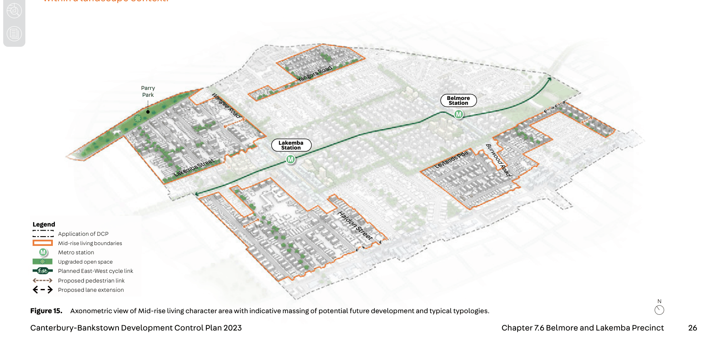
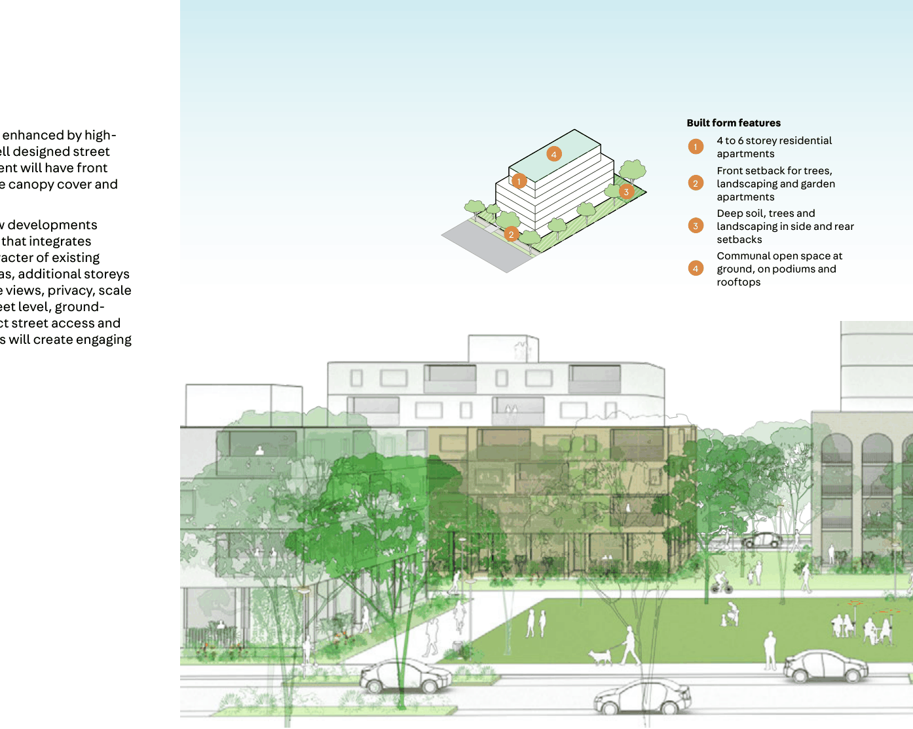

#### 2.2.4 Mid-rise living

#### The Mid-rise living character area will

#### feature a harmonious blend of both new

#### and historic housing, ranging from single

detached dwellings and walk-up flats to

#### mid-rise contemporary apartments set

> [Picture on page 26: a map, saved as a picture (images/ch-07-06-belmore-and-lakemba-page-26-7.gif, 150 dpi); the street names and other small labels are on the picture.]
> Words printed on the picture (title and legend, copied from the PDF):
> Application of DCP
> Mid-rise living boundaries
> Upgraded open space
> Planned East-West cycle link
> Proposed pedestrian link
> Proposed lane extension
> Axonometric view of Mid-rise living character area with indicative massing of potential future development and typical typologies.

Figure 15.

#### within a landscape context.

> [Picture on page 27: a map, saved as a picture (images/ch-07-06-belmore-and-lakemba-page-27-1.gif, 150 dpi); the street names and other small labels are on the picture.]
> Words printed on the picture (title and legend, copied from the PDF):
> Built form features
> 4 to 6 storey residential
> Front setback for trees,
> landscaping and garden
> Deep soil, trees and
> landscaping in side and rear
> Communal open space at
> ground, on podiums and

The character areas will be enhanced by high-quality landscaping and well designed street interfaces. New development will have front setbacks to provide for tree canopy cover and deep soil.

A 4 storey street wall in new developments will establish a lower scale that integrates harmoniously with the character of existing streetscapes. In select areas, additional storeys will be set back to preserve views, privacy, scale and sunlight access. At street level, ground-floor apartments with direct street access and welcoming front courtyards will create engaging frontages.

min 30m

Illustration of 4 to 6 storey apartments interfacing a park with direct ground floor access and landscaping providing

#### Figure 16.

passive surveillance and amenity and typical typologies with key built form features.

#### Principles

P1. Development interfacing with lower density areas must provide a sensitive transition using scale, setbacks, separation, landscaping and privacy measures, to ensure cohesive integration of new and existing development. See Section 4.2 The building envelope.

P2. Developments are to demonstrate a range of residential dwelling sizes and typologies, including larger family apartments, townhouse or terrace style dwellings and smaller apartments for a mix of household types. See Section 4.1 Minimum lot sizes and Section 4.2.1 Building height and storeys.

P3. In areas where additional levels are permitted these levels are to be setback from the podium to ensure for a consistent street wall. See Section 4.2.3 Street wall and Section 4.2.5 Upper storey setbacks.

P4. Developments on streets including the Boulevarde and Lakemba Street are to provide well landscaped front setbacks. See Section 3.1 Public domain strategy and Section

4.2.4 Front setbacks.

P5. Development adjacent to public open space will be orientated to face the park, optimise views from living areas and balconies and create a positive interface that promotes passive surveillance through entrances, balconies, terraces, and high quality

Images:

1- Markham Avenue, Ashburton, VIC, by Architectus (Source: Architectus)

2- Gantry, Camperdown, NSW by Bates Smart (Source: Brett Boardman)

landscaping. Development interfacing

Belmore Sports and Recreation Precinct

will demonstrate consideration of the high

level precinct plan in Figure 24. See Section
