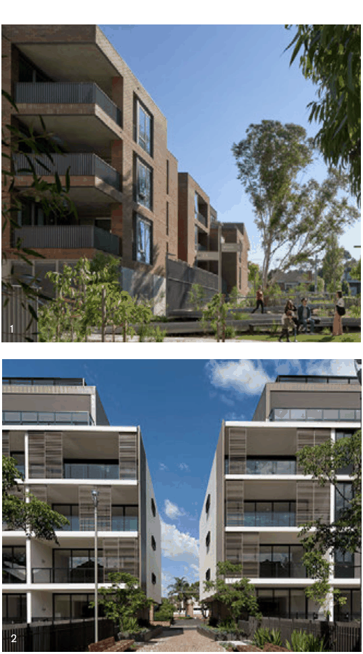

### 3.1 Public domain strategy – Indicative high level

precinct plan for Belmore Sports Ground.

P6. High-quality pedestrian links must be free

of obstructions and feature landscaping

along their edges. These links should also

include adequate lighting and setbacks

that accommodate landscaping, as well as

apartments with direct entries to enhance

passive surveillance. See Section 3.3 Streets,

shared  lanes, pedestrian links and arcades.

P7. The use of face brick and masonry in new

development will reflect the existing brick

character of the neighbourhood. See Section

4.5 Materials and finishes.

> [Picture on page 28: a picture, saved as a picture (images/ch-07-06-belmore-and-lakemba-page-28-55.gif, 150 dpi).]
> Words printed on the picture (title and legend, copied from the PDF):
> 1
> 2
