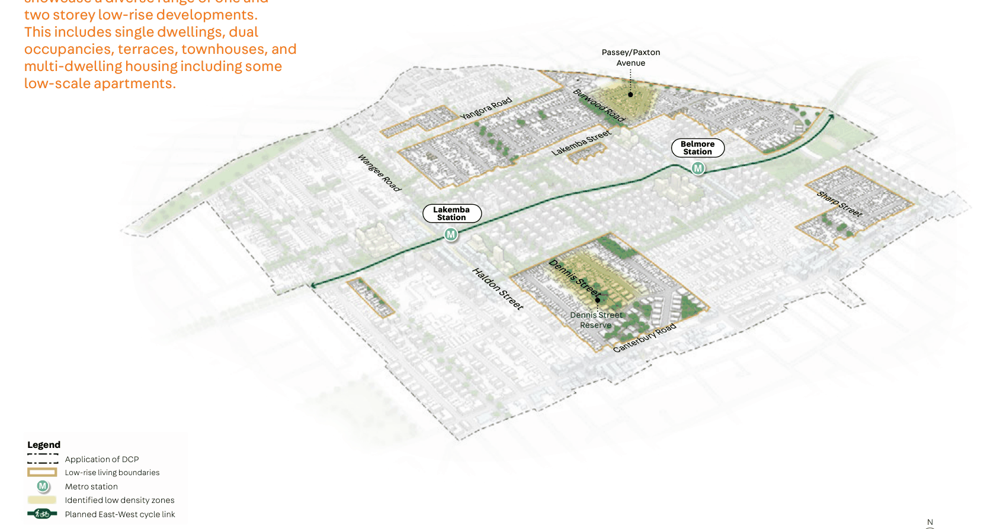
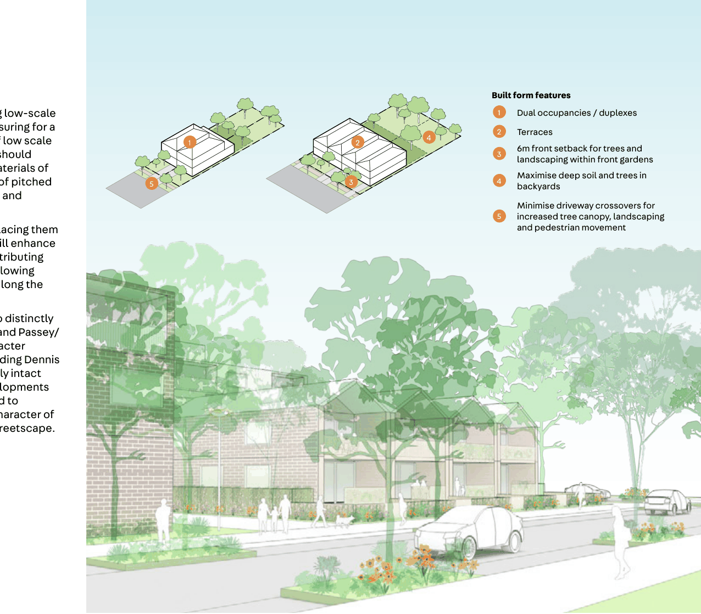
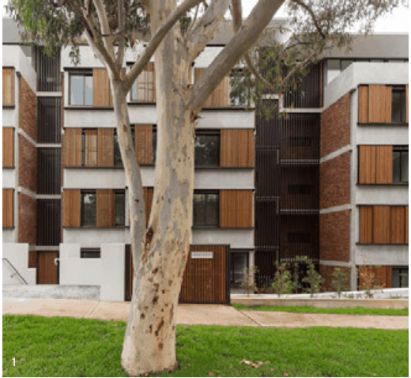
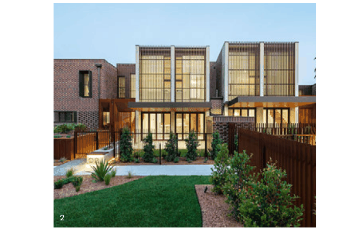
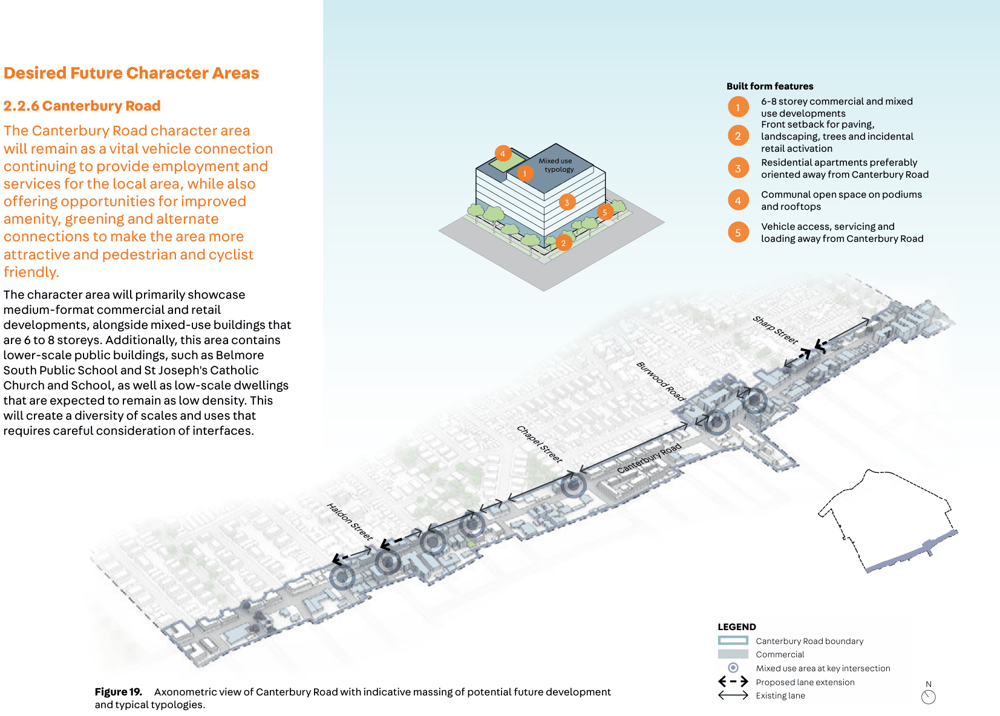

#### 2.2.5 Low-rise living

#### The Low-rise living character areas will

> [Picture on page 29: a map, saved as a picture (images/ch-07-06-belmore-and-lakemba-page-29-3.gif, 150 dpi); the street names and other small labels are on the picture.]
> Words printed on the picture (title and legend, copied from the PDF):
> Application of DCP
> Low-rise living boundaries
> Identified low density zones
> Planned East-West cycle link

showcase a diverse range of one and

#### two storey low-rise developments.

#### This includes single dwellings, dual

occupancies, terraces, townhouses, and

#### multi-dwelling housing including some

#### low-scale apartments.

Axonometric view of low-rise living character areas with indicative massing of potential future development and typical typologies.

#### Figure 17.

1

6.0 15.0

Maintaining and celebrating the existing low-scale character of these areas is crucial to ensuring for a cohesive streetscape and protection of low scale historic character. New developments should draw inspiration from the design and materials of existing homes, reflecting the patterns of pitched roofs, face brick and masonry materials and appropriate finishes. Limiting driveway crossovers through placing them next to each other or in rear laneways will enhance walkability and amenity in the area, contributing to a greener and shadier environment allowing for more landscaping and tree canopy along the streets and in setbacks. Within this character area, there are two distinctly low-density zones along Dennis Street and Passey/ Paxton Avenue, where the existing character should be maintained. The area surrounding Dennis Street Reserve is characterised by largely intact single storey interwar houses. Any developments adjacent to this area should be designed to respect and complement the historic character of the existing dwellings and the overall streetscape.

> [Picture on page 30: a map, saved as a picture (images/ch-07-06-belmore-and-lakemba-page-30-27.gif, 150 dpi); the street names and other small labels are on the picture.]
> Words printed on the picture (title and legend, copied from the PDF):
> Built form features
> 1 Dual occupancies / duplexes 7.5
> 6m front setback for trees and
> landscaping within front gardens
> Maximise deep soil and trees in
> Minimise driveway crossovers for
> increased tree canopy, landscaping
> and pedestrian movement

Figure 18. Illustration of terraces along a street with landscaped front gardens, tree canopy with parking access at the rear of sites and typical typologies of duplexes and terraces with key built form features.

#### Principles

P1. Development will maintain and integrate into the existing low-scale character and historic significance of this character area. New development will provide a sensitive transition and ensure that scale, setbacks, separation, landscape character seamlessly integrate the new with older developments. See Section 4.2 The building envelope.

P2. Developments are to demonstrate a range of residential options and contribute to an inviting, human-scaled street edge and enhance the landscape character of the

area. See Section 4.1 Minimum lot sizes and Section 4.2.1 Building height and storeys.

P3. Maintain and draw inspiration from the surrounding design and materials of existing homes, reflecting existing patterns such as pitched roofs, brick and masonry structures, appropriate finishes and maintain the bulk and scale of the surrounding architectural context to create cohesion throughout. See Section 4.5 Materials and finishes.

Images:

1 - Finlayson Apartments Lane Cove (Source: Brett Boardman)

2 - The Abbey, Cronulla, NSW, by AJH+ (Source: Tom Ferguson)

P4. New development in Dennis Street and

Passey/Paxton Avenue must consider the

surrounding historic inter-war housing

character to ensure for a harmonious

outcome. The historic housing and character

of Dennis Street should be maintained as

predominantly intact single storey inter-war

houses make up this street.

P5. Front setbacks should accommodate deep

soil planting and support a continuous tree

canopy. Driveways should be limited or

consolidated where possible to improve

pedestrian safety and maintain  green

walkable streets. See Chapter 5 Residential

Accommodation of the CBDCP 2023 for detail

on setback requirements and design for this

character area.

> [Picture on page 31: a picture, saved as a picture (images/ch-07-06-belmore-and-lakemba-page-31-46.gif, 150 dpi).]
> Words printed on the picture (title and legend, copied from the PDF):
> 1

> [Picture on page 31: a picture, saved as a picture (images/ch-07-06-belmore-and-lakemba-page-31-47.gif, 150 dpi).]
> Words printed on the picture (title and legend, copied from the PDF):
> 2

> [Picture on page 32: a map, saved as a picture (images/ch-07-06-belmore-and-lakemba-page-32-1.gif, 150 dpi); the street names and other small labels are on the picture.]
> Words printed on the picture (title and legend, copied from the PDF):
> Built form features
> 6-8 storey commercial and mixed
> Front setback for paving,
> landscaping, trees and incidental
> Residential apartments preferably
> oriented away from Canterbury Road
> Communal open space on podiums
> Vehicle access, servicing and
> loading away from Canterbury Road
> medium-format commercial and retail
> Canterbury Road boundary
> Mixed use area at key intersection
> Proposed lane extension
> and typical typologies.

Figure 19. Axonometric view of Canterbury Road with indicative massing of potential future development
