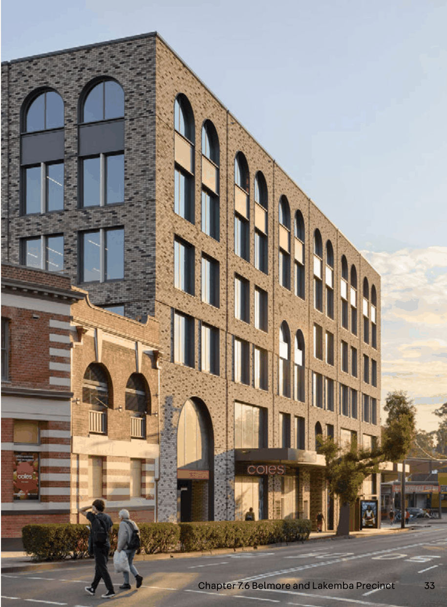
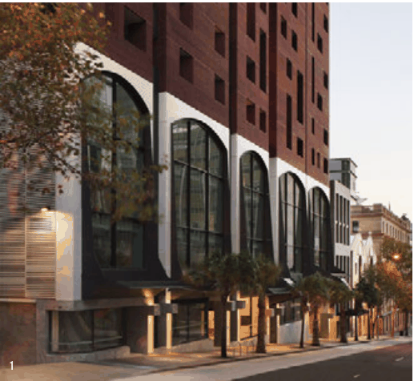
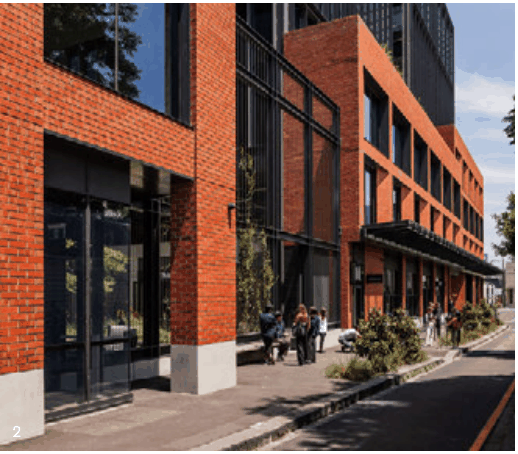

#### 2.2.6 Canterbury Road

#### The Canterbury Road character area

#### will remain as a vital vehicle connection

continuing to provide employment and

#### services for the local area, while also

#### offering opportunities for improved

#### amenity, greening and alternate

#### connections to make the area more

#### attractive and pedestrian and cyclist

#### friendly.

The character area will primarily showcase

developments, alongside mixed-use buildings that are 6 to 8 storeys. Additionally, this area contains lower-scale public buildings, such as Belmore South Public School and St Joseph's Catholic Church and School, as well as low-scale dwellings that are expected to remain as low density. This will create a diversity of scales and uses that requires careful consideration of interfaces.

A setback at ground level for commercial uses along Canterbury Road will create more spacious footpaths, verges and landscaping, providing protection for pedestrians from traffic, and allowing for deep soil areas to increase tree canopy. Generous front setbacks for residential dwellings will allow for increased screening, privacy, landscaping and deep soil. New residential apartments will be strategically located along key intersections and situated above ground away from Canterbury Road. Apartments will be designed to mitigate noise and pollution and provide adequate sunlight and outlook. Behind Canterbury Road, lanes will be extended to enhance connectivity, facilitating an improved east-west pedestrian and cycling network safely distanced from vehicular traffic. Lanes will feature generous setbacks for landscaping and offer opportunity for the creation of secondary frontages that may include outdoor seating for retail establishments.

Image - Brick commercial building with active edge, Surry Hills Village, Redfern, NSW, by SJB & Toga (Source: Tom Roe)

> [Picture on page 33: a picture, saved as a picture (images/ch-07-06-belmore-and-lakemba-page-33-24.gif, 150 dpi).]

#### Principles

P1. Ground floor commercial and retail spaces along Canterbury Road will feature active edges along frontages and at key corners, High quality paving and landscaping including deep soil areas for tree canopy and vegetation should be provided within setbacks. See Section 4.3.2 Active street frontages and edges and Section 3.4 Tree canopy, green cover and deep soil.

P2. New development will enhance lanes by incorporating generous setbacks for landscape and potentially create active edges, where possible, while balancing servicing needs and driveways. If required, development will provide an additional setback for land dedication to enable lane extensions. See Section 3.3 Streets, shared lanes, pedestrian links and arcades.

P3. New development will be sympathetic to the range of typologies, heights and uses along Canterbury Road. In particular, new development that interfaces the low scale areas to the north of Canterbury Road, Belmore South Public School and St Joseph Catholic Church, will provide a considered interface. See Section 4.2 The building envelope.

Images:

1- Mixed use building with high quality active edge and landscaping, Sydney (Source: SJB) . 2- Commercial building with an active edge and setback at lobby for landscaping and seating. Industry Lanes, Vic, Architectus.(Source: Architectus)

P4. New mixed-use developments should be

concentrated at key cross streets, with

residential units situated above ground level.

These apartments should be designed and

oriented to mitigate amenity impacts from

noise and pollution, while ensuring for solar

access, views, landscaping and high-quality

podium and rooftop space. See Section 4.2

The building envelope and 4.6 Rooftop and

communal open space.

> [Picture on page 34: a picture, saved as a picture (images/ch-07-06-belmore-and-lakemba-page-34-44.gif, 150 dpi).]
> Words printed on the picture (title and legend, copied from the PDF):
> 1

> [Picture on page 34: a picture, saved as a picture (images/ch-07-06-belmore-and-lakemba-page-34-45.gif, 150 dpi).]
> Words printed on the picture (title and legend, copied from the PDF):
> 2
