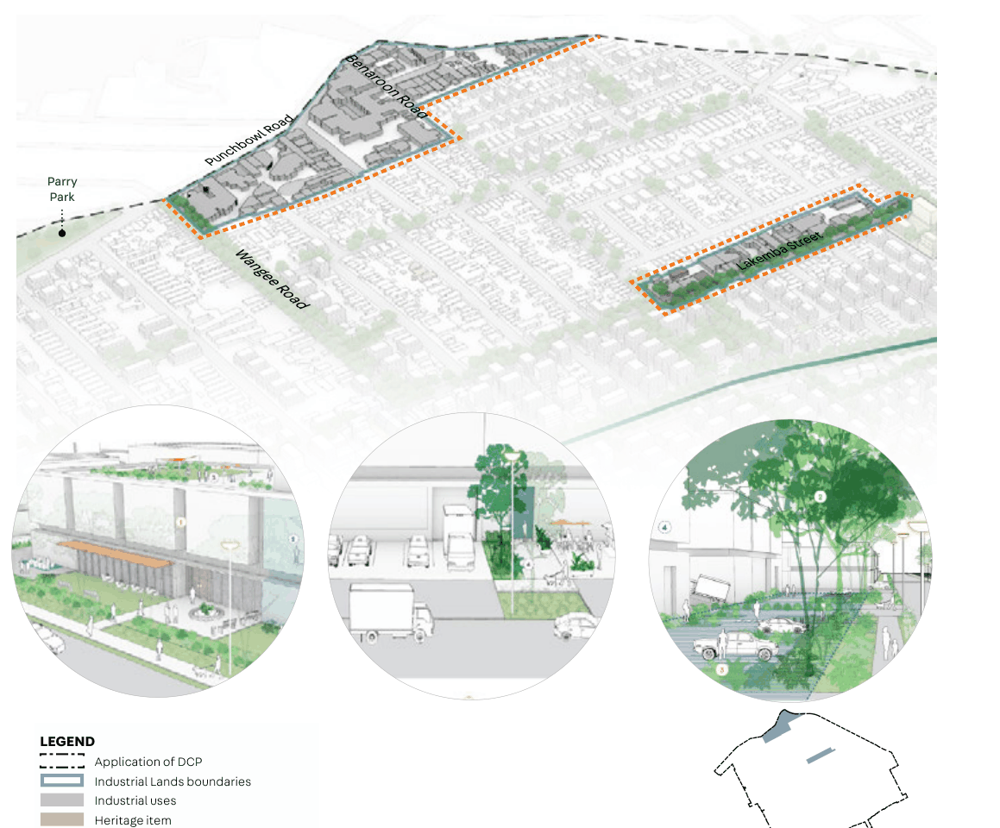

#### 2.2.7 Industrial lands

The industrial land character areas play a

#### vital role in supporting the local economy

#### by offering employment opportunities

#### and essential services. There are two

#### character areas.

The Punchbowl Road Industrial area features medium-scale, low-rise light industrial uses with direct access to Punchbowl Road, connecting to larger employment lands in Greenacre and Enfield. This area is well-established and situated at the northern periphery of the Precinct. By contrast, the Lakemba Street Industrial area is a smaller, fine grain cluster of light industrial tenancies embedded within the residential  context. There is a strong commitment to preserving existing industrial zoned land with unchanged controls.  As the surrounding context evolves, a sensitive and functional interface between industrial lands and residential areas will be essential for ensuring for amenity and mitigating impacts.

In particular, the Lakemba Street Industrial area presents opportunities to enhance streetscape amenity through tree planting, landscaping, and the introduction of pedestrian and cycle friendly improvements linking Belmore and Lakemba Stations. Over time, tenancies could incorporate complementary uses such as cafés or other local retail offers to activate the street and contribute to a more walkable neighbourhood.

> [Picture on page 35: a picture, saved as a picture (images/ch-07-06-belmore-and-lakemba-page-35-32.gif, 150 dpi).]
> Words printed on the picture (title and legend, copied from the PDF):
> Benaroon Road
> Punchbowl Road
> Parry
> Park
> Lakemba Street
> Wangee Road
> LEGEND
> Application of DCP
> Industrial Lands boundaries
> Industrial uses
> Heritage item

Sensitive interface

Axonometric view of Industrial lands with indicative massing of potential future development

N

#### Figure 20.

and illustrations of industrial typologies providing a high quality street interface.

Redevelopment of industrial sites should prioritise: ⚬ Improving the public domain and mitigating urban heat outcomes through landscaping, permeable paving and tree canopy planting; ⚬ Reduction of building bulk through modulation of the building envelope and improvement in design quality; ⚬ Simplicity in design using quality materials; ⚬ Minimal quality signage; ⚬ Sustainable design and operation; and ⚬ Safe, legible access for pedestrians, cyclists and service vehicles.
