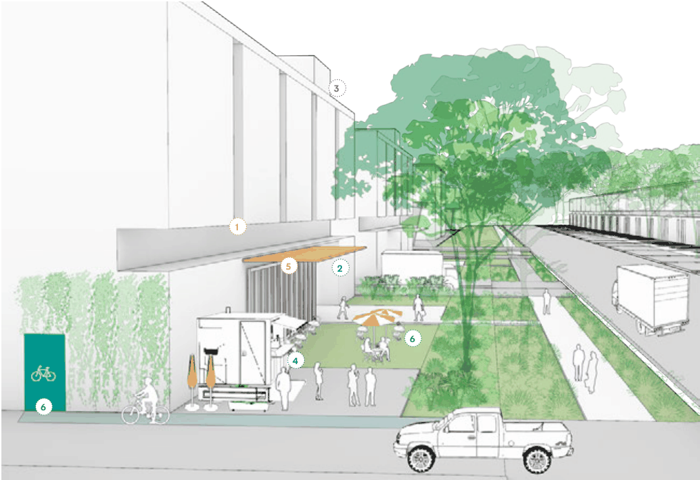
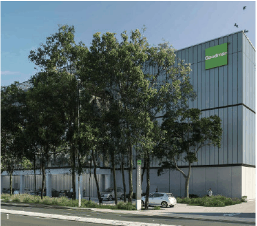
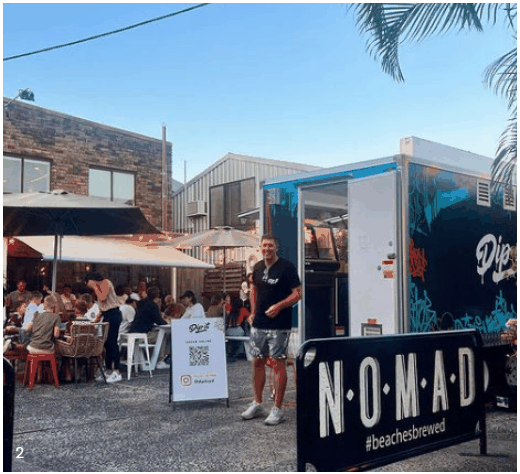

#### 3 Rooftop landscape

#### design and innovative

roof structures

> [Picture on page 36: a picture, saved as a picture (images/ch-07-06-belmore-and-lakemba-page-36-30.gif, 150 dpi).]
> Words printed on the picture (title and legend, copied from the PDF):
> 6
> 3
> 1
> 5 2
> 6
> 4

#### Employee and visitor amenity

such as end of trip facilities and landscaped open space

Illustration of industrial development with key principles for providing a high quality street interface

#### Figure 21.

#### Principles

P1. Retain and protect industrial zoned land to  safeguard employment and essential services for the Belmore and Lakemba Precinct and surrounding areas.

P2. Minimise land use conflicts between residential and industrial zones by ensuring developments:

a)	 Provide generous setbacks, screening and landscape buffers;

b)	 Manage the bulk and scale through modulation of the building envelope and facade treatment;

c)	 Mitigate noise, pollution and other operational impacts; and

d)	 Safely accommodate truck access while protecting pedestrians and cyclists safety.

P3. Industrial areas should be designed as inviting environments for workers, businesses, visitors and passers-by. Integrate tree canopy and high quality landscaping, create lunch and social gathering spaces and implement effective surveillance and safety measures.

Images:

1 - Multi-storey warehouse with landscaping and tree canopy, Gardeners Road Alexandria, NSW (Source: Goodman Australia)

2 - Outdoor dining at Nomad brewery, Dee Why, NSW (Source: Architectus)

P4. Industrial lands adjoining public open

spaces, such as Parry Park, should protect

and enhance adjacent biodiversity assets,

integrating landscaping and setbacks that

support ecological function.

P5. New developments in the Lakemba Street

industrial area should contribute to a high

quality streetscape through:

a)	 Setbacks that allow for deep soil planting

and support increased tree canopies;

b)	 Opportunities for street activation through

features such as cafés, outdoor seating, and

inviting entrances to tenancies; and

c)	 Limited driveway crossovers to ensure a

pedestrian friendly environment.

P6. All new development must align with

Chapter 9 Industrial Precincts of the

CBDCP 2023, which outlines objectives,

principles and controls related to

industrial development including setbacks,

landscaping, transport and access, building

design and sustainability.

> [Picture on page 37: a picture, saved as a picture (images/ch-07-06-belmore-and-lakemba-page-37-53.gif, 150 dpi).]
> Words printed on the picture (title and legend, copied from the PDF):
> 1

> [Picture on page 37: a picture, saved as a picture (images/ch-07-06-belmore-and-lakemba-page-37-54.gif, 150 dpi).]
> Words printed on the picture (title and legend, copied from the PDF):
> 2
