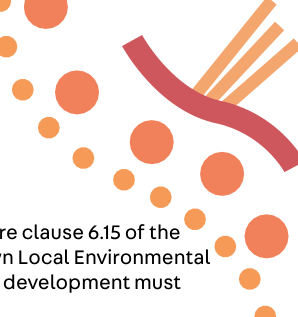
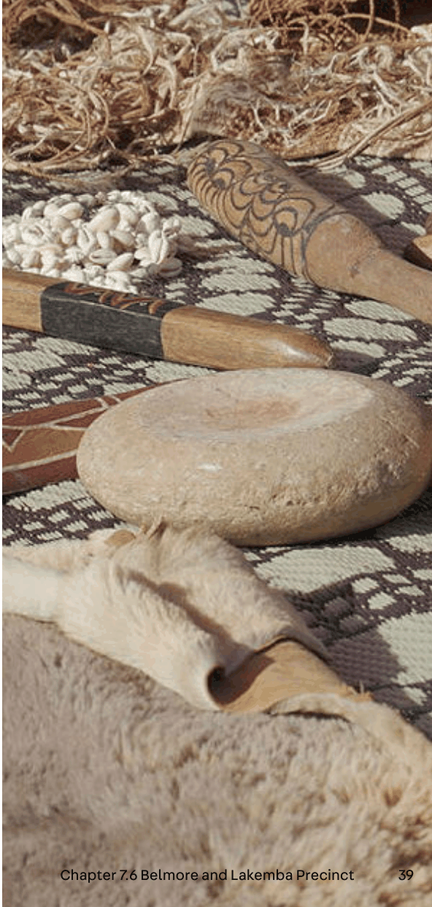

### 2.3	 Connecting with Country

#### Objectives

O1. To recognise, respect and respond to Aboriginal cultural heritage in the planning, development and daily life of the Belmore and Lakemba Precinct.

#### Principles

P1. To take a Country centred approach and thinking that is layered into new development in the Precinct consistent with the Government Architect NSW ‘Connecting with Country framework’ (CWCF).

P2. To integrate Aboriginal cultural practices, history, narratives and values in the design of proposed development.

P3. To encourage development to respond to the physical and cultural connection of the local Aboriginal community to the land.

P4. Foster collaboration and knowledge sharing between Aboriginal and non-Aboriginal individuals.

#### Controls

> [Picture on page 38: a picture, saved as a picture (images/ch-07-06-belmore-and-lakemba-page-38-23.gif, 150 dpi).]

C1. For development where clause 6.15 of the Canterbury-Bankstown Local Environmental Plan 2023 applies, the development must demonstrate:

a)	 How the design considers aspects of Country under Sections 3 and 4 of the Government Architect NSW ‘Connecting with Country framework’;

b)	 How the design gives regard to the culture and heritage of the traditional custodians of the land, the Darug People, on which the development is proposed;

c)	 Connecting design with the existing site topography, natural environment and landscape setting; and

d)	 Incorporating sustainable practices by using natural building materials.

C2. For development where Design Excellence clause of the Canterbury-Bankstown Local Environmental Plan 2023 applies, the development must determine the appropriate scope of engagement with the Aboriginal community and its representatives, whether it be high, medium or low as outlined in Section 3.1 of the Government Architect NSW ‘Connecting with Country framework’. If engaging with the Aboriginal community, development must:

a)	 Demonstrate the methods and outcomes from the engagement with the Aboriginal community; and

b)	 Adhere to protocols outlined in the NSW Government’s Practice Note ‘Engaging with Aboriginal Communities’ and ‘Aboriginal Cultural and Intellectual Property Protocol’.

C3. If significant items such as ancestral remains or artefacts are discovered during subsoil investigations, excavation, demolition or other earthworks, the applicant must engage with the Aboriginal community to determine culturally appropriate handling, repatriation or reburial.

C4. Development that proposes open space and landscaping should demonstrate consideration of ‘walking Country’ which reflects Aboriginal cultural practices, artefacts, artwork and narratives. Aspects involving the senses of seeing, hearing, touching, smelling and tasting, should be included.

Image - NAIDOC Family Day 2023 (Source: Canterbury- Bankstown Council)

C5. Design aspects of each development

should give regard to the culture and

heritage of the traditional custodians of

the land, the Darug People, on which the

development is proposed. The following

design opportunities should be considered

to ensure a Country-centred approach:

a)	 Connect design with the natural

environment and landscape setting, being:

people, animals, resources and plants

equally.

b)	 Acknowledge shared history between

Aboriginal and colonial settlers to promote

healing and reconciliation by incorporating

storytelling and knowledge of the past.

c)	 Incorporate sustainable practices by using

natural building materials that have a cultural

and heritage significance.

d)	 Incorporate Aboriginal place names, as

guided by the Geographic Names Board, to

foster understanding and raise awareness.

e)	 Focus on details and patterns to insert

cultural meaning.

C6. All work prepared to address the Connecting

with Country objectives, principles and

controls must address the NSW Indigenous

Cultural and Intellectual Property Protocol,

to ensure applicants are aware of their

duties with respect to the integration of this

content.

> [Picture on page 39: a picture, saved as a picture (images/ch-07-06-belmore-and-lakemba-page-39-67.gif, 150 dpi).]
