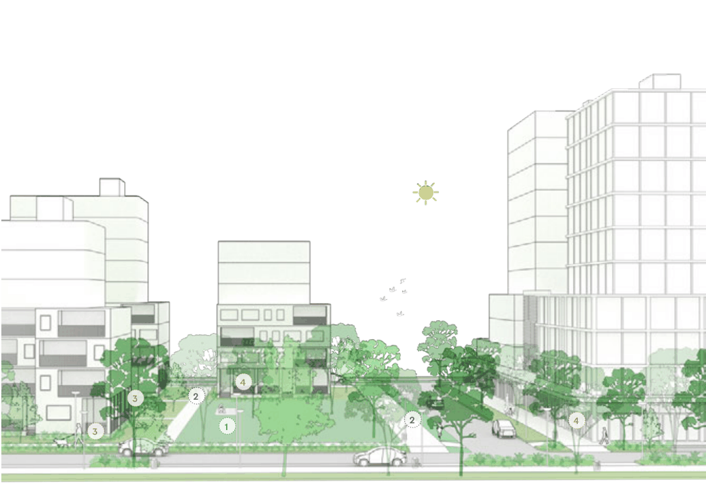

### 3.1 Public domain strategy

The public domain consists of streets, squares, parks, shared lanes and pedestrian links. These elements, in conjunction with the built form interface to private land, play a vital role in creating unique, vibrant and sustainable places that are attractive, inviting and inclusive for all. The public domain strategy ensures housing growth is supported by the delivery of high-quality public spaces that encourage walking, cycling, community interaction and engagement. This section outlines key opportunities for enhancing the public domain in the Belmore and Lakemba Precinct, as identified in Figure 23. Public domain strategy.

#### Objectives

O1. To improve the quality, appearance and function of the public domain.

O2. Provide a diverse range of quality public spaces to support residents, workers and visitors.

O3. Ensure a high level of permeability through the Precinct.

O4. Provide high quality, functional and attractive formal and informal spaces for community interaction.

O5. To establish a vibrant and attractive Precinct where the network of streets, shared lanes and open spaces support the increase in population density, the increased pedestrian movement and footpath trading activities.

> [Picture on page 41: a picture, saved as a picture (images/ch-07-06-belmore-and-lakemba-page-41-32.gif, 150 dpi).]
> Words printed on the picture (title and legend, copied from the PDF):
> 4
> 2
> 3
> 1
> 3
> 2
> 4

#### 2

Variety of

#### public spaces

to meet the needs

of the community

#### 1

#### Permeable

#### connected

network that

encourages walking, cycling and public transport use

Figure 22. Designing the public domain
