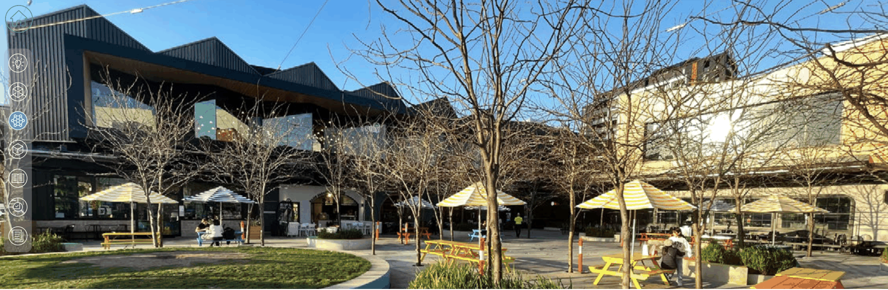
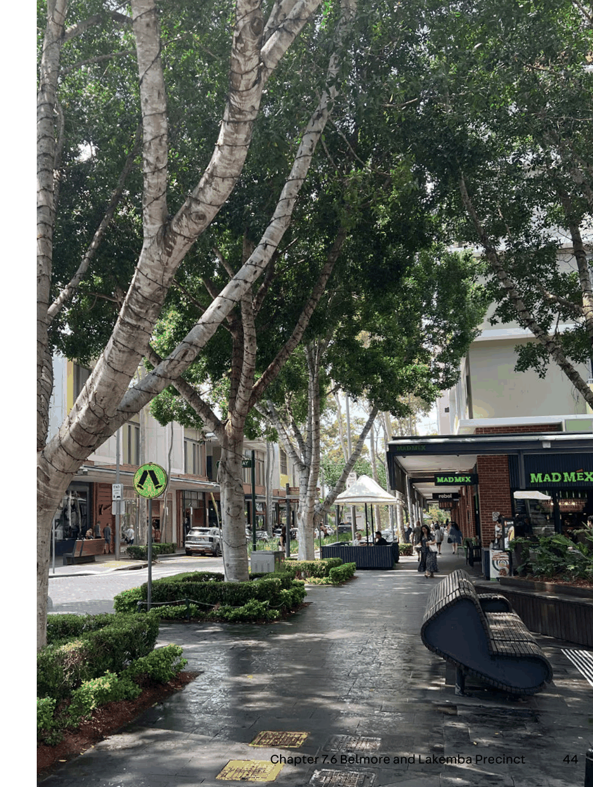
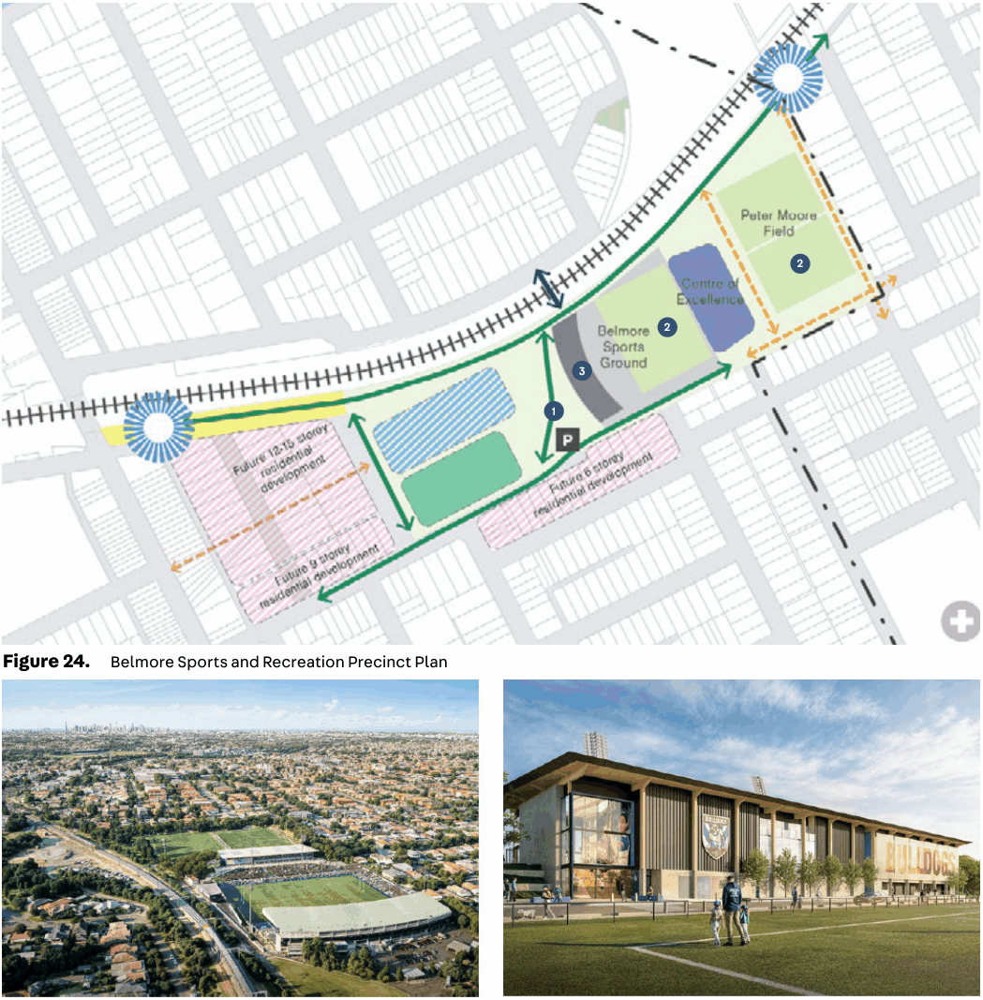
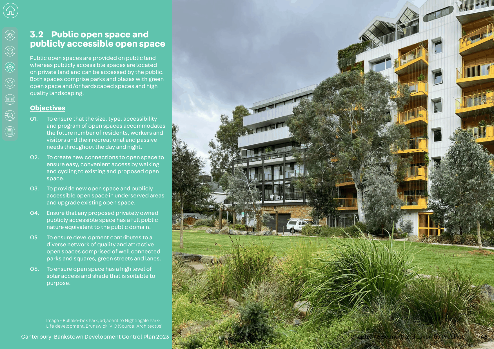

#### 4 Solar access,

#### shade, surveillance

and activation of the

public domain

Chapter 7.6 Belmore and Lakemba Precinct 41

### Belmore and Lakemba

### Public Domain Strategy

Yangora Road

Burwood Rd

Punchbowl Road

Lakemba Street

Wangee Road

Redman Parade

#### Belmore

#### Station

Edison Lane

Bridge Road

Burwood Rd

Lakemba Street

The Boulevarde

#### Legend

Paragon Lane

Application of DCP

Sharp Street

Peel Street

M Metro station

Moreton Street

#### Lakemba

#### Station

Existing open space Expanded open space

Leylands Parade

Haldon St

Upgraded open space

The Boulevarde

Gillies Street

Gillies Lane

Proposed new open space Proposed community facility Planned station plaza

Chalmers Road

Canterbury Road

Major road High street improvements

Quigg Street

Priority streets for tree canopy

Chapel Street

Edge Street

Hall Lane

Myee Street

Priority streets for cycleways Planned East-West cycle link (Sydney Metro) Proposed pedestrian link (min 4m) Proposed retail arcade (min. 6m) Proposed widened pedestrian link (12m) Proposed new shared lane (9m)

Canterbury Road

Proposed lane extension (6m) Proposed shared lane widening (9m)

Figure 23. Public Domain Strategy

1:12,500

0 100 200 300 500M

N

> [Picture on page 43: a picture, saved as a picture (images/ch-07-06-belmore-and-lakemba-page-43-1.gif, 150 dpi).]

#### Principles

P1. Development must contribute to the delivery of public domain improvements in line with the Public Domain Strategy at Figure 23 including:

a)	 Haldon Street transformation: Proritise pedestrian movement  on Haldon Street (between The Boulevarde and Oneata Street) building on the success of temporary road closures during the Lakemba Night Markets. Enhance surrounding streets and laneways to support a safe and walkable network by providing lighting on building facades, locating entries to buildings away from congested areas where relevant, and providing simple and legible signage.

Image - Central green space and activated plaza, Ed-mondson Park, NSW (Source: Architectus)

b)	 Burwood Road revitalisation: Re-balance Burwood Road to be more pedestrian friendly with traffic calming measures, urban greening and a safe and walkable lanes.

c)	 New open space and consolidated community facilities at the Quigg Street key site: Create a new open space and community facility near Haldon Street, supported by a site-specific master plan, and connected via an activated pedestrian link to Haldon Street.

d)	 Connecting sports, recreation and health: Improve access and interfaces to the Belmore Sports and Recreation Precinct. Improve connectivity between major facilities and attractions including Canterbury Hospital, Canterbury Leagues Club, Burwood Road, bus stops and Metro stations. See Figure 24 for indicative high level plan.

e)	 Greening Wangee Road: Enhance tree canopy to support pedestrians and cyclists connections along Wangee Road linking to key community attractors, including Lakemba Mosque, local schools and Parry Park.

f) Leylands Parade - a green street: Preserve and enhance the distinctive landscape character of Leylands Parade by completing the tree canopy between Belmore Sports and Recreation Precinct and an expanded Marie Street Reserve. Carefully manage traffic flow with pedestrian safety and amenity along this street.

g)	 Active transport network expansion: Extend the active transport network initiated by the South West Metro active transport corridor, with additional infrastructure and pedestrian crossings on Lakemba Street, Wangee Road, Gillies Street, Quigg Street and Redman Parade.

h)	 Open space expansion: Identify opportunities to widen existing open spaces, including Peel Park, Marie Street Reserve and Jubilee Park and deliver new open spaces through development uplift.

i) Pedestrian links: Provide minimum 4m wide pedestrian links in long blocks to improve mid-block connectivity.

j) Lane upgrade: Expand and improve lanes in

E1 and E2 zones for enhanced servicing and improved pedestrian and cycle access.

k) Shared use of open spaces: Encourage shared use arrangements of open space with nearby schools such as Belmore Boys High School, Belmore North Public School and Hampden Park Public School.

P2. Ensure that developments adjacent to the Belmore Sports and Recreation Precinct is aligned with the high level plan shown in Figure 24. Developments should be orientated to face the park and provide a positive active interface through entrances, balconies, terraces and high quality landscaping that enhances passive surveillance and amenity.

Image - Green activated streets at Rouse Hill Town Centre, NSW (Source: Architectus)

> [Picture on page 44: a picture, saved as a picture (images/ch-07-06-belmore-and-lakemba-page-44-35.gif, 150 dpi).]

Indicative high level precinct plan for

#### Belmore Sports Ground

This indicative plan sets out a vision and key principles to enhance the accessibility, connectivity, functionality and activation of the Belmore Sports and Recreation Precinct. The area will continue to offer formal sporting facilities and fields, while also delivering improved informal green space, play areas and landscaping along with an enhanced pedestrian connection along the railway line to Belmore station.

#### Legend

Existing through site

connections

Existing pedestrian and cycle underpass

Aspirational future connections

Potential through site link to support connection between the precinct and Burwood Road

Future gateway and arrival points to provide wayfinding Enhanced connection and arrival experience New proposed open space and new destination play-ground

Active recreation and

stormwater basin function

Proposed NRL Bulldogs Centre of Excellence Existing grandstand

1 Potential future stadium arrival and entrance - flexibility for

events, markets

2 Elite Sports Use - Restricted Public Access (current use by

NRL Bulldogs and Sydney Olympic Football Club) 3 Community facility within grandstand P Limited parking areas to service day-to-day operation of

stadium

Future residential development to consider interface with park e.g. housing fronting park,

landscape treatments, setbacks and building orientation

> [Picture on page 45: a picture, saved as a picture (images/ch-07-06-belmore-and-lakemba-page-45-37.gif, 150 dpi).]
> Words printed on the picture (title and legend, copied from the PDF):
> 2
> 2
> 3
> 1

Figure 24. Belmore Sports and Recreation Precinct Plan

Artists impressions of Canterbury Bankstown Bulldogs Centre of Excellence, Belmore (Source: Bulldogs)

> [Picture on page 46: a picture, saved as a picture (images/ch-07-06-belmore-and-lakemba-page-46-1.gif, 150 dpi).]
> Words printed on the picture (title and legend, copied from the PDF):
> quality landscaping.
> space.
> purpose.
> Image - Bulleke-bek Park, adjacent to Nightingale Park-
> Life development, Brunswick, VIC (Source: Architectus)
