### 3.3	 Streets, shared lanes,

### pedestrian links and arcades

Streets, shared lanes, pedestrian links and arcades are places of movement: to watch, to pass through and see the movement of people. This public framework provides for social and commercial exchange. In urban areas, a well-designed network of shared lanes and pedestrian links are essential for improving permeability and connecting to main streets and open space, creating walkability and equity of access and enjoyment. The street should be safe and inviting to pedestrians and cyclists while accommodating vehicles and traffic and be enhanced by tree canopies that promote amenity and sustainability. Pedestrian links prioritise pedestrians, featuring open skies and awnings, while shared lanes accommodate pedestrians and cyclists and driveway access. Service vehicles operate in shared lanes when they are less used. Arcades serve as internal retail 'lanes' that enhance permeability and provide an engaging shopping experience. These narrow, intimate spaces encourage pedestrians to come and stay and facilitate connections through street blocks, reducing walking distances. New development is essential for contributing to a high-quality, permeable, and connected movement network that is green, inviting and safe for everyone. This is achieved by thoughtfully designing how a development interfaces with streets, lanes and pedestrian  links through consideration of setbacks, public domain

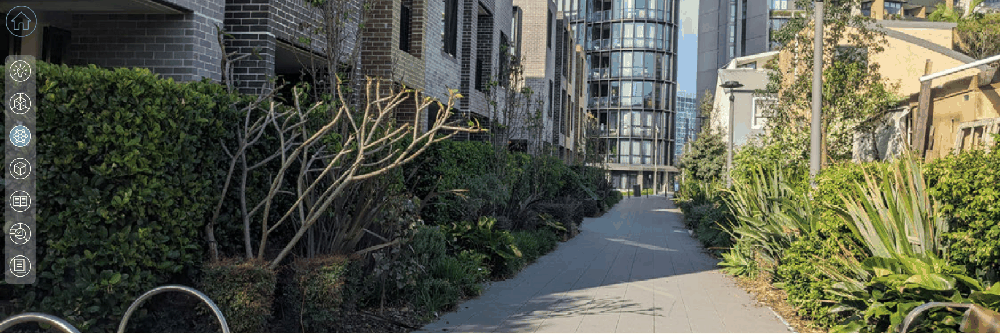

> [Picture on page 49: a picture, saved as a picture (images/ch-07-06-belmore-and-lakemba-page-49-1.gif, 150 dpi).]

#### Objectives

O1. To improve connectivity for pedestrians and cyclists between key destination points.

O2. To provide a high quality, safe, connected cycle network that enables the community to choose to ride to work, home or a destination.

O3. To ensure shared lanes, pedestrian links and arcades are accessible, attractive, continuous, well-lit, safe and where appropriate, open to the sky.

O4. To provide amenity and safety to existing and proposed shared lanes, pedestrian links and arcades, and active uses to engage pedestrians, where appropriate.

Image - Pedestrian link with landscaping and garden apartments, Zetland (Source: Architectus)

O5. To design shared lanes, pedestrian links and arcades that provide an intimate space to linger within a fine grain spatial network.

O6. To provide for vehicular entries and servicing away from primary street frontages using shared lanes.

#### Principles

P1. Large development sites and sites located in the middle of large blocks should provide pedestrian links to improve permeability.

P2. Development must incorporate design measures that enhance pedestrian safety and comfort, including passive surveillance from habitable rooms and private open space, well-lit pathways and clear sightlines.

P3. Development that interfaces with pedestrian links should consider providing an active edge, where possible.

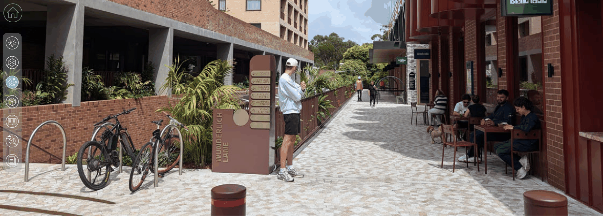

> [Picture on page 50: a picture, saved as a picture (images/ch-07-06-belmore-and-lakemba-page-50-1.gif, 150 dpi).]

#### Controls

C1. Where required by Council, shared lanes, pedestrian links and arcades must be provided in the locations identified in Figure 23 Public Domain Strategy. These connections must be designed to ensure permeability, safety and integration with the broader movement network.

C2. Figures 25 to 32 illustrate cross-sections of Council's vision for specific streets, shared lanes, and pedestrian links. Development in these areas must demonstrate how the built form, setback treatments and any public domain improvements align with and contribute to delivering this vision.

Image - Activated arcade link, Surry Hills Village, Redfern (Source: Architectus)

C3. Pedestrian links are to have a minimum width of 4m and cater for the movement of pedestrians and cyclists in both directions. Shared lanes are to have a minimum width of 9m. These key public domain assets are to be designed to:

a)	 Ensure that buildings or structures are not located over any proposed pedestrian link, other than awnings.

b)	 Provide lighting, paving, street furniture and tree planting to clearly indicate the priority of the pedestrian or cycling user, (to be provided in accordance with Council’s specifications and design standards).

c)	 Development must demonstrate the provision of physical and visual connections with neighbouring sites, including any

necessary level adjustments. Detailed plans illustrating these connections are to be provided as part of the Development Application.

d)	 Awnings should be provided for active frontages and active edges to provide weather protection, offering shade and shelter from sun and rain. Awnings are to be designed and delivered in accordance with the requirements specified in Section 4.3.2 Active street frontages and edges.

e)	 Stormwater management measures must be incorporated to minimise the flow of pollutants from the laneway. Treatments must be implemented in accordance with Section 3 – Stormwater Drainage Systems in the Canterbury Bankstown DCP 2023.

f) Shared lanes and pedestrian links should be clear of all obstructions, including stairs, escalators and columns and provide a clear line of sight from one end to the other for surveillance and accessibility.

g)	 Shared lanes and pedestrian links will be open 24 hours a day, well-lit and adhere to Crime Prevention Through Environmental Design (CPTED) principles.

h)	 Where a development has the potential to create a shared lane or pedestrian link by extending an existing or proposed lane within its site, the lane should be completed or extended within the development site. If a development can deliver part of a lane or initiate a new lane, it should make provision for it.

C4. Pedestrian links and new shared lanes are to registered as an easement on title or dedicated to Council prior to issue of an Occupation Certificate. Council reserves the right to not accept dedication. Any proposed dedication must be discussed at a pre-lodgement meeting.

C5. The maintenance of the shared lane and pedestrian link in perpetuity including cleaning, repairing and replacing damaged or worn paving, furniture and the like and maintaining landscaping in a healthy condition is the responsibility of the land owner, not Council. A management plan must accompany any development involving the provision of a shared lane or pedestrian

link. The plan is to demonstrate how ongoing

Image - Enhanced pedestrian link with street art, activation and bike  parking, Rose Street, Fitzroy (Source: Architectus)

access, maintenance, and functionality

of the shared lane or pedestrian link will

be ensured, including through any future

changes in ownership.

C6. Arcades within retail and commercial

developments are to be designed to:

a)	 Be two storeys in height or where proposed

as a single storey ground level, have a

minimum floor to ceiling height of 5m.

b)	 Have widths of 4m – 6m where the links are

provided within a two storey height, or 5m

– 8m wide where provided at a single floor

level.

c)	 Be located at ground level and lined with

spaces to facilitate active uses.

d)	 Be designed to have access to natural light.

e)	 Be open at each end or, where air

conditioned, provide entry doors that are

glazed and comprise a minimum 70% of the

width of the entrance.

f) Be publicly accessible from 6am to 10pm

each day.

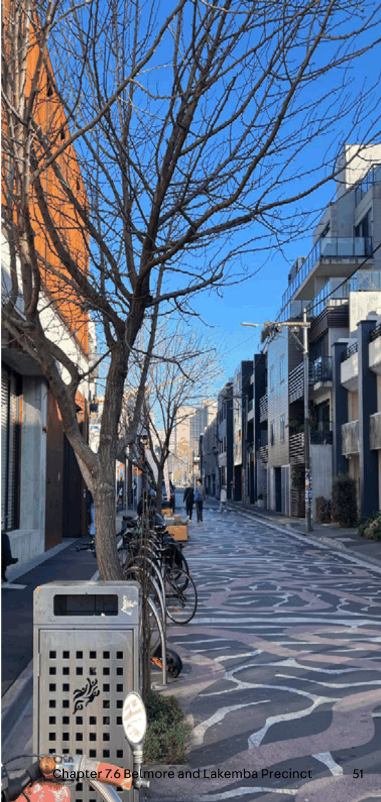

> [Picture on page 51: a picture, saved as a picture (images/ch-07-06-belmore-and-lakemba-page-51-60.gif, 150 dpi).]

#### Haldon Street, Lakemba

The vision for Haldon Street is to transform this high street into a more pedestrian friendly environment particularly between The Boulevarde and Oneata Street where the Lakemba Night Markets are held. This revitalisation will feature vibrant retail spaces that engage and activate the ground level, paired with shoptop housing above, fostering a lively atmosphere that promotes both active and passive surveillance. To enhance the pedestrian experience, Haldon Street will feature level paving that seamlessly connects the road reserve and footpaths. Tree planters, benches and outdoor dining areas will create a welcoming buffer between vehicles and pedestrians, encouraging social interaction and leisurely strolls along the street. To facilitate the seamless closure of Haldon Street to vehicles during special events, strategically placed boulders will be installed at both ends of the street to enable quick opening and closing. This transformation aims to cultivate a high-amenity, inviting high street that provides flexibility

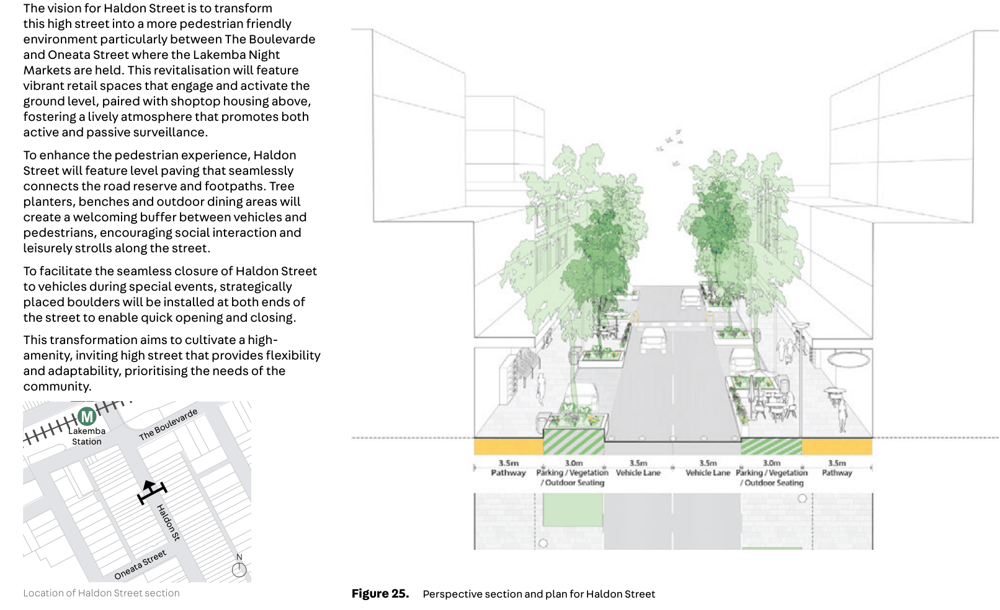

> [Picture on page 52: a picture, saved as a picture (images/ch-07-06-belmore-and-lakemba-page-52-24.gif, 150 dpi).]
> Words printed on the picture (title and legend, copied from the PDF):
> community.
> Lakemba
> The Boulevarde
> Station
> Haldon St
> N
> Oneata Street
> Location of Haldon Street section

and adaptability, prioritising the needs of the

#### M

Figure 25. Perspective section and plan for Haldon Street

#### Burwood Road, Belmore

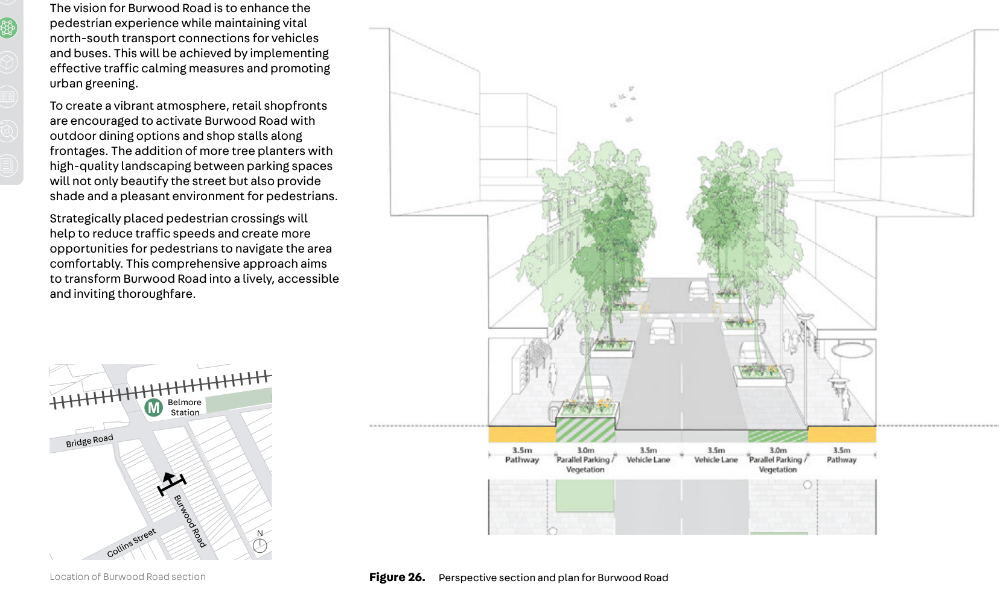

> [Picture on page 53: a picture, saved as a picture (images/ch-07-06-belmore-and-lakemba-page-53-2.gif, 150 dpi).]
> Words printed on the picture (title and legend, copied from the PDF):
> and inviting thoroughfare.
> Belmore
> Station
> Bridge Road
> N
> Burwood Road
> Collins Street
> Location of Burwood Road section

Figure 26. Perspective section and plan for Burwood Road

The vision for Burwood Road is to enhance the pedestrian experience while maintaining vital north-south transport connections for vehicles and buses. This will be achieved by implementing effective traffic calming measures and promoting urban greening. To create a vibrant atmosphere, retail shopfronts are encouraged to activate Burwood Road with outdoor dining options and shop stalls along frontages. The addition of more tree planters with high-quality landscaping between parking spaces will not only beautify the street but also provide shade and a pleasant environment for pedestrians. Strategically placed pedestrian crossings will help to reduce traffic speeds and create more opportunities for pedestrians to navigate the area comfortably. This comprehensive approach aims to transform Burwood Road into a lively, accessible

#### M

#### Tree lined street

The vision for tree lined streets in residential areas is to increase tree canopy and amenity through the provision of landscaping in the road reserve between parking lanes and include a generous pedestrian pathway with high quality paving and opportunities for intermittent seating. Within residential areas, new development will provide front setbacks that incorporate high quality landscaping, deep soil and trees as well as balconies, terraces and entries to garden apartments to provide passive surveillance over the street.

Tree lined streets are identified on Figure 23. Public Domain Strategy.

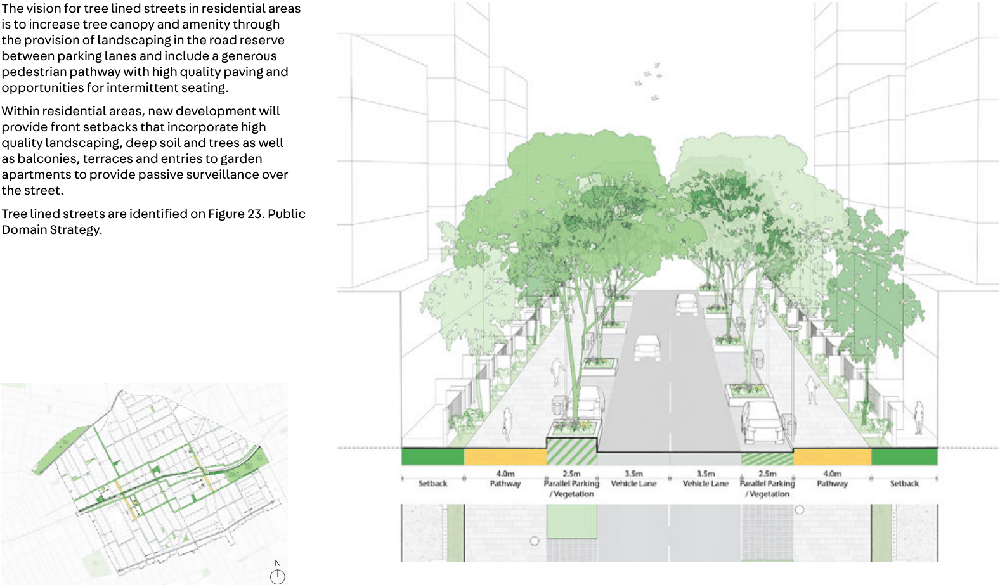

> [Picture on page 54: a picture, saved as a picture (images/ch-07-06-belmore-and-lakemba-page-54-16.gif, 150 dpi).]
> Words printed on the picture (title and legend, copied from the PDF):
> N

Snippet of Public Domain Strategy. For location of proposed tree lined streets see Figure 23. Public Domain Strategy

Figure 27. Perspective section and plan for residential tree lined street

#### Tree lined street with cycleway

The vision for tree lined streets with a cycleway in residential areas is to increase amenity, walking and cycling through the provision of a dedicated cycleway, new trees and landscaping in the road reserve between parking lanes and include a generous pedestrian pathway with high quality paving and opportunities for intermittent seating. Within residential areas, new development will provide setbacks that incorporate high quality landscaping, deep soil and trees, as well as balconies, terraces and entries to apartments to provide passive surveillance over the street. Tree lined streets are identified on Figure 23. Public Domain Strategy.

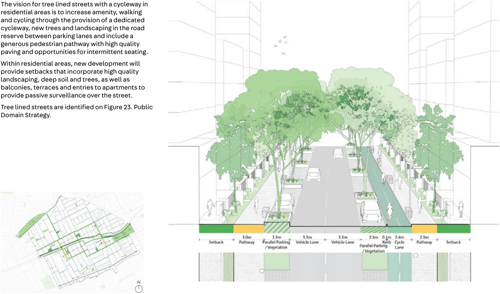

> [Picture on page 55: a picture, saved as a picture (images/ch-07-06-belmore-and-lakemba-page-55-16.gif, 150 dpi).]
> Words printed on the picture (title and legend, copied from the PDF):
> N

Snippet of Public Domain Strategy. For location of proposed tree lined streets with cycleways see Figure 23. Public Domain Strategy

Figure 28. Perspective section and plan for residential tree lined street with an off-road cycleway

#### Redman Parade

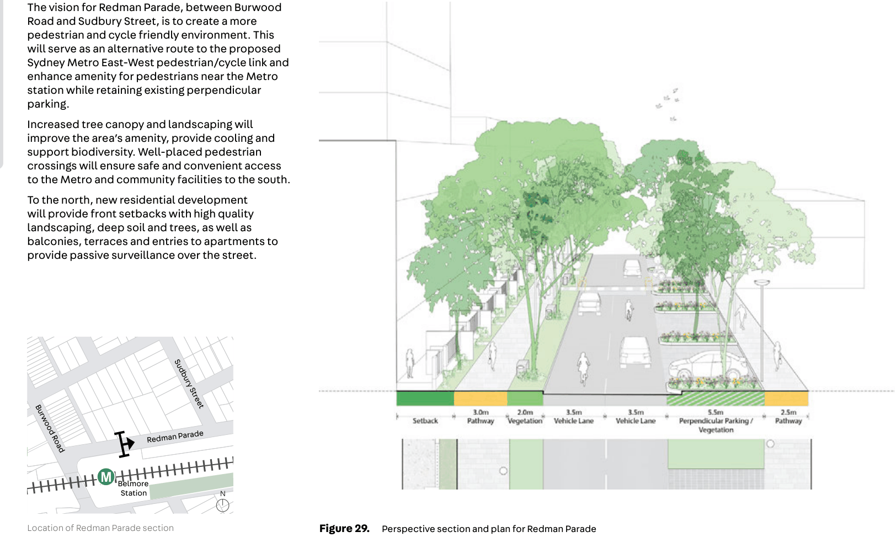

> [Picture on page 56: a picture, saved as a picture (images/ch-07-06-belmore-and-lakemba-page-56-2.gif, 150 dpi).]
> Words printed on the picture (title and legend, copied from the PDF):
> support biodiversity. Well-placed pedestrian
> Sudbury Street
> Redman Parade
> Burwood Road
> Station
> N
> Location of Redman Parade section

Figure 29. Perspective section and plan for Redman Parade

The vision for Redman Parade, between Burwood Road and Sudbury Street, is to create a more pedestrian and cycle friendly environment. This will serve as an alternative route to the proposed Sydney Metro East-West pedestrian/cycle link and enhance amenity for pedestrians near the Metro station while retaining existing perpendicular parking. Increased tree canopy and landscaping will improve the area’s amenity, provide cooling and

crossings will ensure safe and convenient access to the Metro and community facilities to the south. To the north, new residential development will provide front setbacks with high quality landscaping, deep soil and trees, as well as balconies, terraces and entries to apartments to provide passive surveillance over the street.

#### M Belmore

#### Paragon Lane

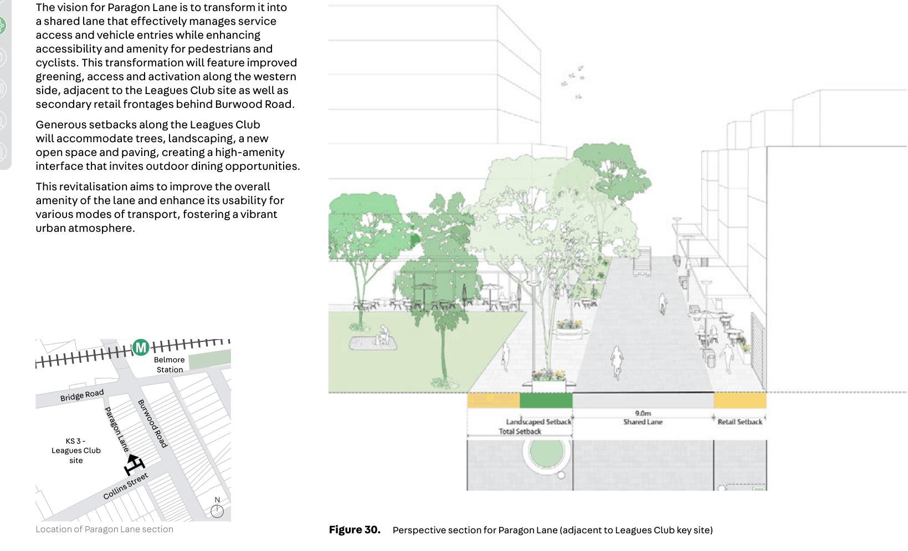

> [Picture on page 57: a map, saved as a picture (images/ch-07-06-belmore-and-lakemba-page-57-2.gif, 150 dpi); the street names and other small labels are on the picture.]
> Words printed on the picture (title and legend, copied from the PDF):
> KS 3 -
> Location of Paragon Lane section

Figure 30. Perspective section for Paragon Lane (adjacent to Leagues Club key site)

The vision for Paragon Lane is to transform it into a shared lane that effectively manages service access and vehicle entries while enhancing accessibility and amenity for pedestrians and cyclists. This transformation will feature improved greening, access and activation along the western side, adjacent to the Leagues Club site as well as secondary retail frontages behind Burwood Road. Generous setbacks along the Leagues Club will accommodate trees, landscaping, a new open space and paving, creating a high-amenity interface that invites outdoor dining opportunities. This revitalisation aims to improve the overall amenity of the lane and enhance its usability for various modes of transport, fostering a vibrant

#### M

#### Haldon Street to Gillies Lane

#### pedestrian link (12m)

The vision for the pedestrian link between Haldon Street and Gillies Lane is to create a high-quality, activated link with retail that is open to the sky, widened, safe, legible and visually appealing. This enhanced link will improve amenity, safety, and access between Haldon Street and the Quigg Street key site, promoting greater activation in the

area. Land dedication of 3m on either side of the existing arcade will allow for its expansion and an open-air design.

Awnings will be installed along the edges for shelter and comfort, providing opportunities for outdoor dining. Additionally, planter boxes and active retail frontages will contribute to a vibrant atmosphere, making the link a lively destination for both locals and visitors.

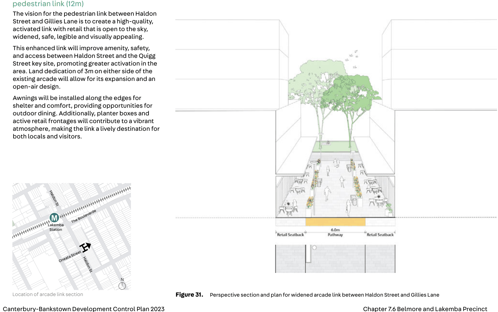

> [Picture on page 58: a picture, saved as a picture (images/ch-07-06-belmore-and-lakemba-page-58-19.gif, 150 dpi).]
> Words printed on the picture (title and legend, copied from the PDF):
> Haldon St
> Lakemba
> Station
> Oneata Street
> Haldon St
> N
> Location of arcade link section

#### M The Boulevarde

Figure 31. Perspective section and plan for widened arcade link between Haldon Street and Gillies Lane

#### Pedestrian link (min. 4m)

The vision for pedestrian links is to enhance pedestrian and cycle connectivity across long blocks in residential areas, facilitating better access and improved amenity around density and in close proximity to the Local Centres and the Metro station. These links will feature high-quality paving, uninterrupted sightlines and will be free of obstructions, complemented by adequate lighting for safety and surveillance, providing clear and accessible pathways. Additionally, setbacks will allow for garden apartments that interface with the pedestrian links, incorporating high-quality landscaping, tree canopies and terraces and balconies that promote passive surveillance. An active edge along the pedestrian links will create opportunities for corner shops or cafés, fostering convenience, amenity and a sense of community. New pedestrian links are required to be delivered through new development on land identified in Figure 23. Public Domain Strategy.

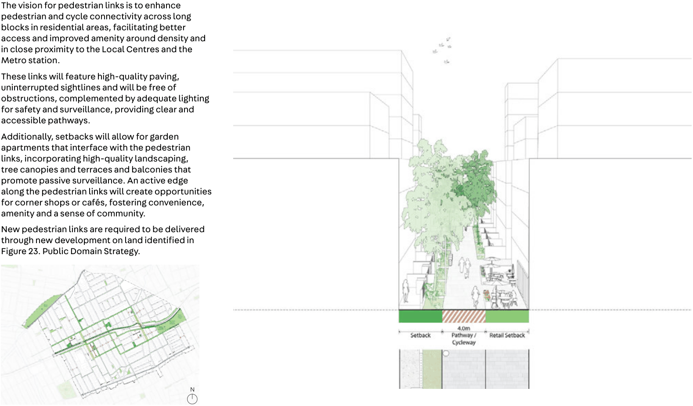

> [Picture on page 59: a picture, saved as a picture (images/ch-07-06-belmore-and-lakemba-page-59-24.gif, 150 dpi).]
> Words printed on the picture (title and legend, copied from the PDF):
> N

Snippet of Public Domain Strategy. For location of proposed pedestrian links see Figure 23. Public Domain Strategy

Figure 32. Perspective section and plan of a  pedestrian link
