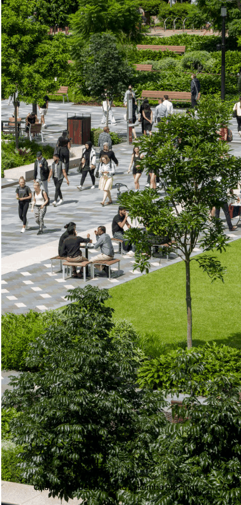

### 3.5	 Solar access to open space

#### Objectives

O1. To ensure for solar access to parks and spaces for the enjoyment of residents and visitors.

O2. To balance sunlight access to the principal useable parts of public open space with shaded areas to enable a range of activities and the planting of a variety of trees and vegetation.

O3. To maintain or maximise solar access to public space during periods of the day when they are most used.

O4. To ensure the successful growth and survival of trees and vegetation within parks, publicly accessible open space and public spaces.

#### Principles

P1. Provide high levels of solar access to ensure that trees and vegetation in public open spaces and publicly accessible open spaces thrive and provide amenity for the community and warmth in winter sun.

P2. Provide solar access on balance with shaded areas to ensure for amenity to all users all year around.

Image - 1 Central Courtyard, Macquarie University, NSW (Source: Architectus)

#### Controls

C1. Development Applications must

demonstrate that the hours of solar access

outlined in Figure 34 are maintained or

preferably exceeded.

C2. Where overshadowing of parks and spaces

is likely, a statement with supporting solar

access studies must be submitted by a

registered architect demonstrating that

the proposed development mitigates

overshadowing to the affected open space

or publicly accessible space.

C3. Ancillary structures such as columns,

pillars, spires, flag poles, public art, and

architectural roof features including

equipment for servicing the building, such

as plant, lift motor rooms, fire stairs and

the like, must not be excluded from any

overshadowing analysis.

> [Picture on page 63: a picture, saved as a picture (images/ch-07-06-belmore-and-lakemba-page-63-47.gif, 150 dpi).]

McCourt Fairmount

Street Reserve Street Reserve

#### Legend

Application of DCP

Minimum 2 hours of sun for 50% of the open space in the winter solstice

Minimum 3 hours of sun for 50% of the open space in the winter solstice

Minimum 4 hours of sun for 50% of the open space in the winter solstice

Minimum 5 hours of sun for 50% of the open space in the winter solstice

Potential open space locations at key site

Key sites solar requirements in Section 6 - Key Sites

Hampden Street

Reserve

MacDonald Street Reserve

Jubilee Reserve

Wangee Road

#### Lakemba

#### Station

Solar access to public and publicly accessible open space

#### Figure 34.

Knox Street

Reserve

Benda Reserve

Dinor

Street

Reserve

Lakemba Street Peel

Park

The Boulevarde

Haldon St

Dennis Harold

Street Reserve

Bull Reserve

Anne Pringle Reserve

Burwood Rd

Marie

Street

Reserve

Hunt

Park

Canterbury Rd

#### Belmore

#### Station

Burwood Rd

Leylands Parade

1:12,500

N

100 200 300 500M

Chapter 7.6 Belmore and Lakemba Precinct 64
