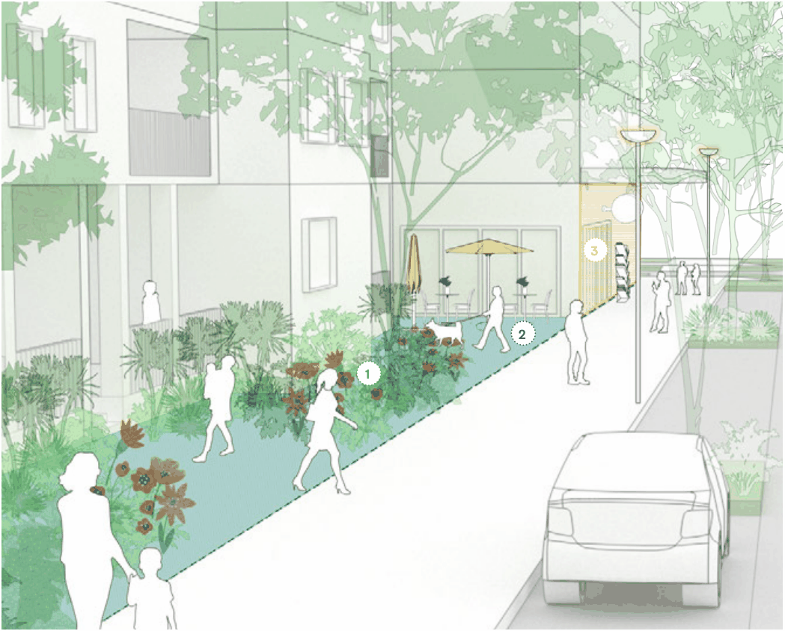
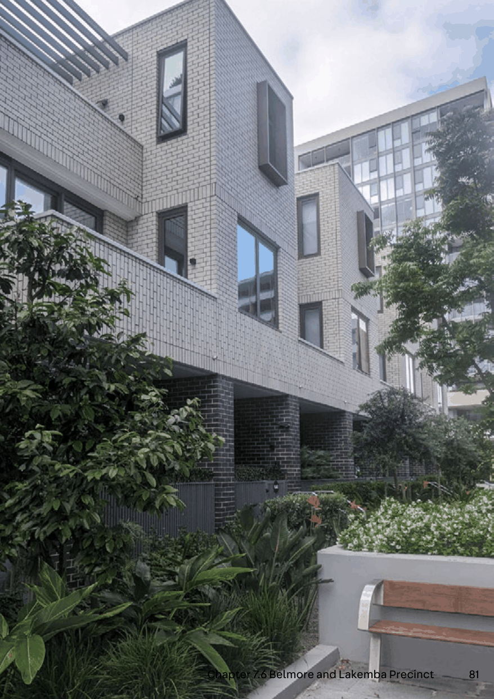

#### 4.2.4 Front setbacks Objectives

O1. To define streets, public spaces and key elements that include heritage and landscape features.

O2. To allow flexibility in setbacks where appropriate, minimising impacts on surrounding properties and the public domain.

O3. To enable sensory engagement with the street.

O4. To encourage setbacks that reinforce the desired future character of the area.

O5. To utilise front setbacks to provide privacy and amenity.

O6. To create lively destinations in the Precinct that caters for the growth in population and provides space for outdoor trading and dining, lingering and increased tree canopy.

> [Picture on page 80: a picture, saved as a picture (images/ch-07-06-belmore-and-lakemba-page-80-20.gif, 150 dpi).]
> Words printed on the picture (title and legend, copied from the PDF):
> 3
> 2
> 1

#### 3

#### Landscape setbacks

for plantings and visual

privacy in residential areas

#### 2

Urban street edge with

active frontages in Local

Centres

#### 1

#### Setbacks reflect

#### context  and delineate

privacy and public space

Figure 43. Key design guidance for ground level setbacks to provide amenity, contribute to deep soil and planting, provide activation and respond to context.

#### Principles

P1. Reinforce the Belmore and Lakemba Local Centres by creating a defined urban street edge.

P2. To allow flexibility in response to context only where amenity and environmental impacts are minimal.

#### Controls

C1. Front setbacks are to be consistent with Figure 44.

C2. For land with no mapped front setbacks, the following controls apply:

a)	 For land designated in Area 1 (low-rise living character area), front, side and rear setbacks are to be provided in accordance with Chapter 5 Residential Accommodation in the CBDCP 2023.

b)	 For land designated in Area 2 (industrial lands character area), front, side and rear setbacks are to be provided in accordance with Chapter 9 Industrial Precincts in the CBDCP 2023. Consideration should be given to the treatment of setbacks that bound residential uses to mitigate noise, pollution and other amenity impacts.

Image - Garden apartments with landscaping in setback, Fuse Street, Zetland (Source: Architectus)

> [Picture on page 81: a picture, saved as a picture (images/ch-07-06-belmore-and-lakemba-page-81-28.gif, 150 dpi).]

Wangee Road

#### Lakemba

#### Station

#### LEGEND

Application of DCP

0m

3m

5m

6m

1 Area 1 - refer to Chapter 5

Residential Accommodation

CBDCP 2023

2 Area 2 - refer to Chapter 9

Industrial Precincts of CBDCP

Figure 44. Front setbacks map

Lakemba Street

The Boulevarde

Leylands Parade

Haldon Street

Canterbury Road

#### Belmore

#### Station

Burwood Road

1:12,500

N

100 200 300 500M

Chapter 7.6 Belmore and Lakemba Precinct 82
