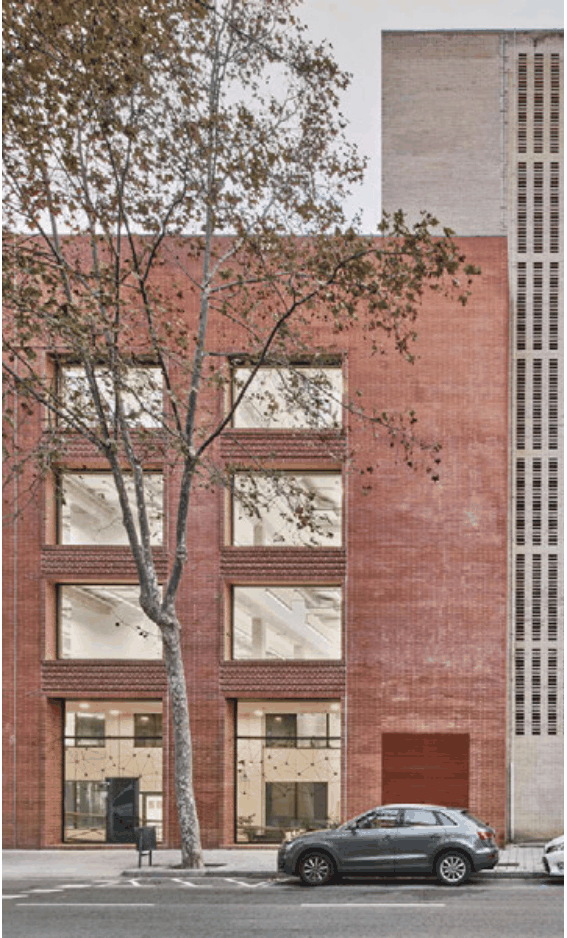

#### 2 Slender towers

for residential buildings with a

maximum of 800m² of GFA

Figure 48. Floorplate controls for towers seek to ensure good functionality, circulation, amenity, solar access and maximise views to the sky.

> [Picture on page 89: a picture, saved as a picture (images/ch-07-06-belmore-and-lakemba-page-89-33.gif, 150 dpi).]

Joan Miro Office Building, Barcelona, Spain (Source: Jose Hevia)
