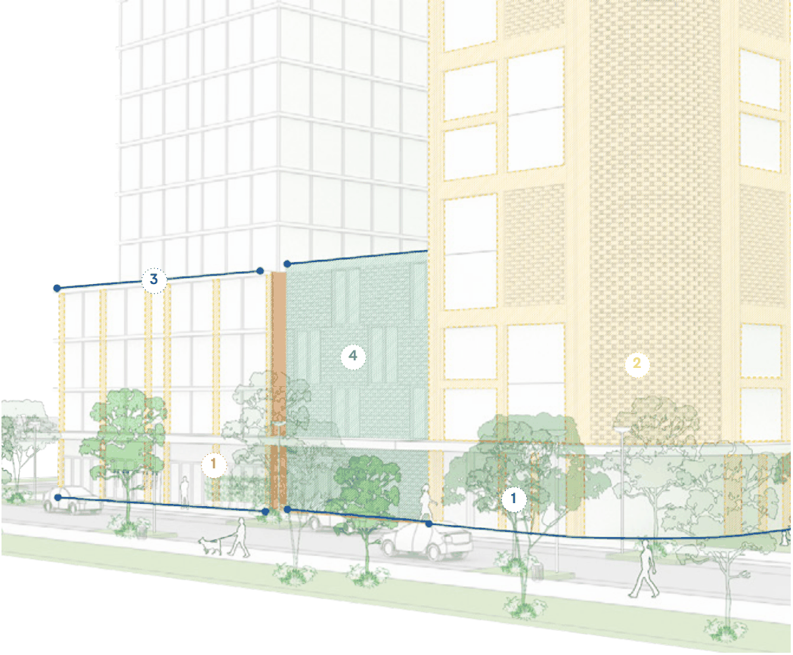

### 4.4	 Visual diversity,

### articulation and fine grain

#### Objectives

O1. Encourage variety in architectural design and character to provide a fine grain which enriches and enlivens the Precinct’s public domain.

O2. Ensure building mass is reduced by articulating building envelopes into smaller components.

O3. Ensure that the scale, modulation and façade articulation of development responds to the character within the Precinct.

O4. To use architectural character to provide visual interest, texture and engagement.

#### Principles

P1. Reduce the scale of building mass through vertical or horizontal articulation and using depth in façades.

P2. Use articulation zones in podiums to reduce mass, provide outdoor space and greenery and create depth and shade.

P3. Strive for simplicity of and not complexity in articulation.

> [Picture on page 96: a picture, saved as a picture (images/ch-07-06-belmore-and-lakemba-page-96-26.gif, 150 dpi).]
> Words printed on the picture (title and legend, copied from the PDF):
> 3
> 4
> 1
> 1
> 2
