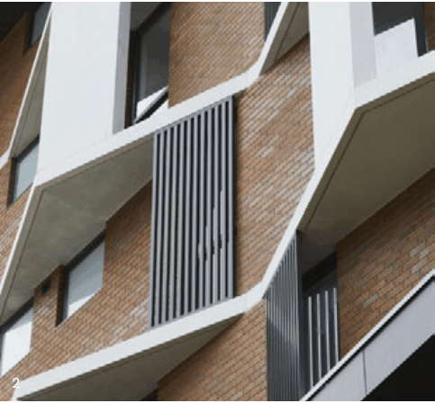
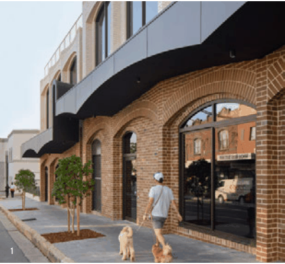
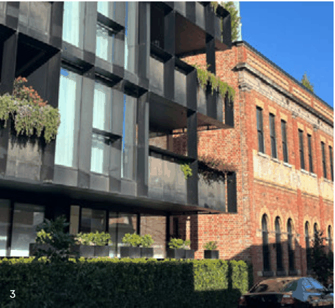
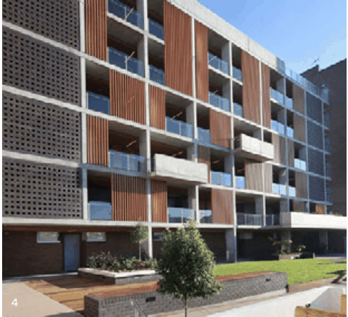
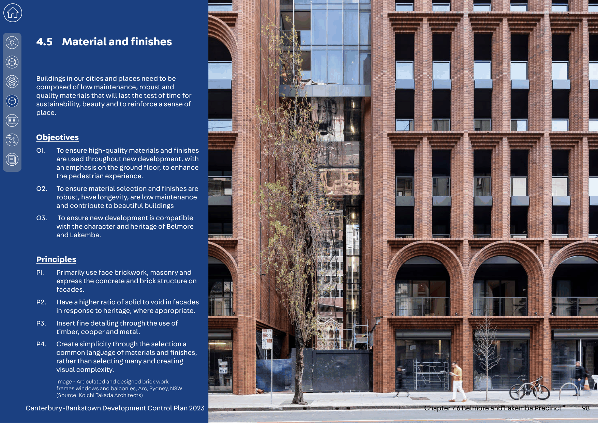

#### 3 Long podiums

#### visually broken

to create variety and ensure human scale

#### Articulation zone

in podiums to provide depth, shadow, greenery and outdoor space

#### 4

Design guidance on building façades to ensure visual diversity, articulation and fine grain.

#### Figure 52.

#### Controls

C1. Ensure for articulation of buildings into vertical bays and the integration of landscape into elevations that are seen from public space.

C2. An articulation zone with a 1m depth should be included in the street wall to allow architectural form to develop. Outdoor space within this zone can be applied to all building uses for amenity, surveillance and to add depth to facades.

C3. Facades facing the street or public space should be articulated with depth, relief and shadow. A minimum relief of 150mm between the masonry finish and glazing face should be utilised to provide depth and shadow.

C4. The finishing of service cupboards and basement car park entry should be coordinated in dark recessive colours to minimise the visual impact to the street.

Images: 1 - A finer grain, human scale facade, Nightingale, Marrickville, NSW, by SJB. The services are hidden in one of the bays (Source: Tom Roe). 2 - Articulation and modulation of the facade. Concrete structure is exposed as part of the design. Via Apartments, Gladesville, NSW (Source: Glyde Bautovich) 3 - Articulation and modulation of the facade. Rose Street, Melbourne, VIC (Source: Architectus) 4 - Articulation and modulation of the facade. Platform Apartments, North Eveleigh, NSW, Architectus (Source: Brett Broadman)

> [Picture on page 97: a picture, saved as a picture (images/ch-07-06-belmore-and-lakemba-page-97-33.gif, 150 dpi).]
> Words printed on the picture (title and legend, copied from the PDF):
> 2

> [Picture on page 97: a picture, saved as a picture (images/ch-07-06-belmore-and-lakemba-page-97-34.gif, 150 dpi).]
> Words printed on the picture (title and legend, copied from the PDF):
> 1

> [Picture on page 97: a picture, saved as a picture (images/ch-07-06-belmore-and-lakemba-page-97-35.gif, 150 dpi).]
> Words printed on the picture (title and legend, copied from the PDF):
> 3

> [Picture on page 97: a picture, saved as a picture (images/ch-07-06-belmore-and-lakemba-page-97-36.gif, 150 dpi).]
> Words printed on the picture (title and legend, copied from the PDF):
> 4

> [Picture on page 98: a picture, saved as a picture (images/ch-07-06-belmore-and-lakemba-page-98-1.gif, 150 dpi).]
> Words printed on the picture (title and legend, copied from the PDF):
> place.
> the pedestrian experience.
> and Lakemba.
> facades.
> timber, copper and metal.
> visual complexity.
> Image - Articulated and designed brick work
> frames windows and balconies, Arc, Sydney, NSW
> (Source: Koichi Takada Architects)
