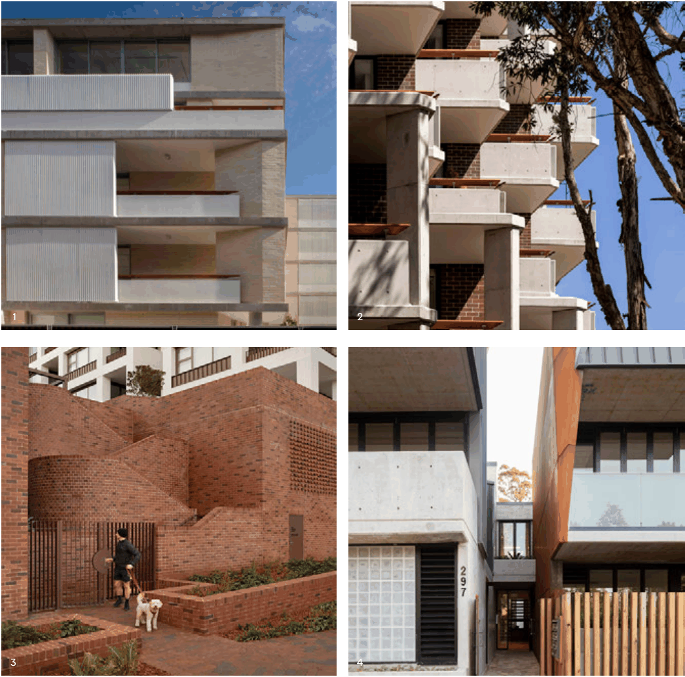
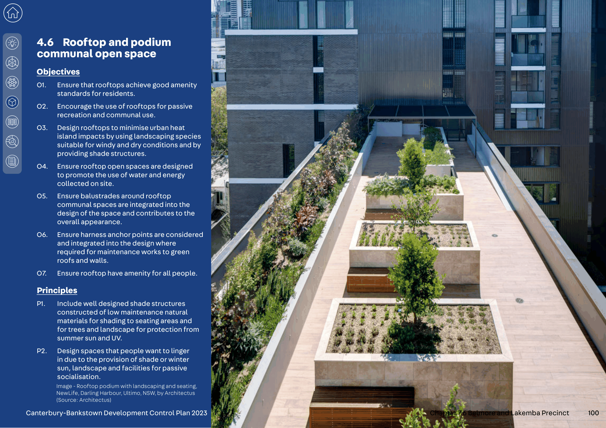

### 4.5	 Material and finishes

Buildings in our cities and places need to be composed of low maintenance, robust and quality materials that will last the test of time for sustainability, beauty and to reinforce a sense of

#### Objectives

O1. To ensure high-quality materials and finishes are used throughout new development, with an emphasis on the ground floor, to enhance

O2. To ensure material selection and finishes are robust, have longevity, are low maintenance and contribute to beautiful buildings

O3. To ensure new development is compatible with the character and heritage of Belmore

#### Principles

P1. Primarily use face brickwork, masonry and express the concrete and brick structure on

P2. Have a higher ratio of solid to void in facades in response to heritage, where appropriate.

P3. Insert fine detailing through the use of

P4. Create simplicity through the selection a common language of materials and finishes, rather than selecting many and creating

#### Controls

C1. Buildings must include durable single finish materials such as masonry and face brick. The concrete structure of buildings should form part of the architecture and be expressed in facades.

C2. Painted cement render or similar painted finishes and Aluminium Composite Panel Cladding (e.g. Alucobond) should not be

used. The use of glazing is not supported for awning construction or for parapet edges on rooftops.

C3. Elevate the pedestrian experience at street level through the use of textured materials and fine grained detailing using timber, textured brickwork and stone.

Images: Examples of high quality materials and finishes. 1 - Gordon Street, Brighton-Le-Sands, Candalepas, (Source: Brett Boardman) 2 - The Regent, Petersham, Candalepas (Source: Brett Boardman), 3 - Wurderlich Lane, Redfern, Sydney (Source: SJB), 4 - Darlington Apartments, Darlington, Sydney (Source: Glyde Bautovich)

> [Picture on page 99: a picture, saved as a picture (images/ch-07-06-belmore-and-lakemba-page-99-26.gif, 150 dpi).]
> Words printed on the picture (title and legend, copied from the PDF):
> 2

> [Picture on page 100: a picture, saved as a picture (images/ch-07-06-belmore-and-lakemba-page-100-1.gif, 150 dpi).]
> Words printed on the picture (title and legend, copied from the PDF):
> standards for residents.
> recreation and communal use.
> providing shade structures.
> collected on site.
> overall appearance.
> roofs and walls.
> summer sun and UV.
> socialisation.
> Image - Rooftop podium with landscaping and seating,
> NewLife, Darling Harbour, Ultimo, NSW, by Architectus
> (Source: Architectus)
