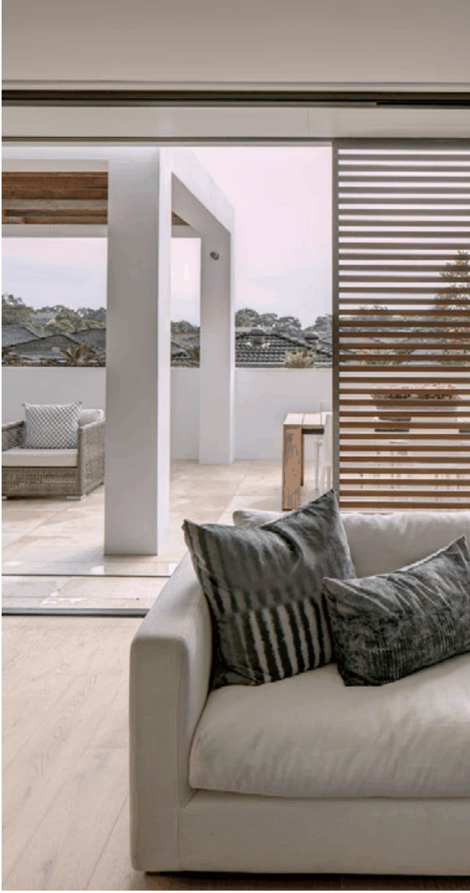
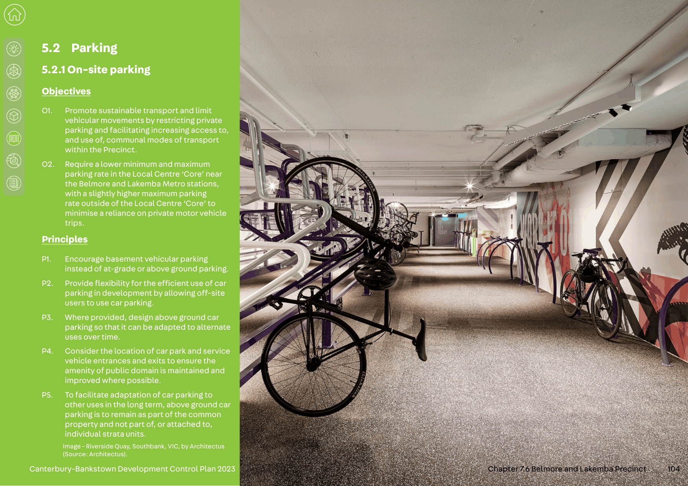

### 5.1 Dwelling mix and flexible

### housing

#### Objectives

O1. Provide a range of housing types and sizes to support diverse households including single person families, multi-generational families, group households, students and seniors.

O2. Ensure for equitable access to new housing opportunities for culturally and socio-economically diverse groups.

O3. Encourage the design of buildings that are adaptable and flexible to accommodate residents’ changing housing needs over their lifetimes.

O4. Deliver a place-based dwelling mix more suited to the Belmore and Lakemba Precinct's needs.

#### Principles

P1. Encourage a diversity of housing that meets the needs of Belmore and Lakemba residents and caters to  different social groups.

#### Controls

C1. The following dwelling mix is required for residential flat buildings and shop top housing developments containing 20 or more dwellings:

a)	 Studio: 5-10%.

b)	 1 bedroom: 10-30%.

c)	 2 bedroom: 40-75%.

d)	 3 or more bedroom: minimum 10%. C2. The dwelling mix requirements may be altered only if the development serves the purpose of public housing or if the applicant represents a community housing or non-profit organisation.

C3. Residential flat buildings should provide accessible apartments for people with a disability and who are elderly and family sized apartments that have level and easy access to adjoining communal space. These apartments should be located at the lower levels of the building to provide ease of access to the street.

> [Picture on page 103: a picture, saved as a picture (images/ch-07-06-belmore-and-lakemba-page-103-45.gif, 150 dpi).]

MIRA Apartments, Ramsgate, NSW, by Architectus (Source: Brett Boardman)

> [Picture on page 104: a picture, saved as a picture (images/ch-07-06-belmore-and-lakemba-page-104-1.gif, 150 dpi).]
> Words printed on the picture (title and legend, copied from the PDF):
> within the Precinct.
> trips.
> uses over time.
> improved where possible.
> individual strata units.
> Image - Riverside Quay, Southbank, VIC, by Architectus
> (Source: Architectus).
