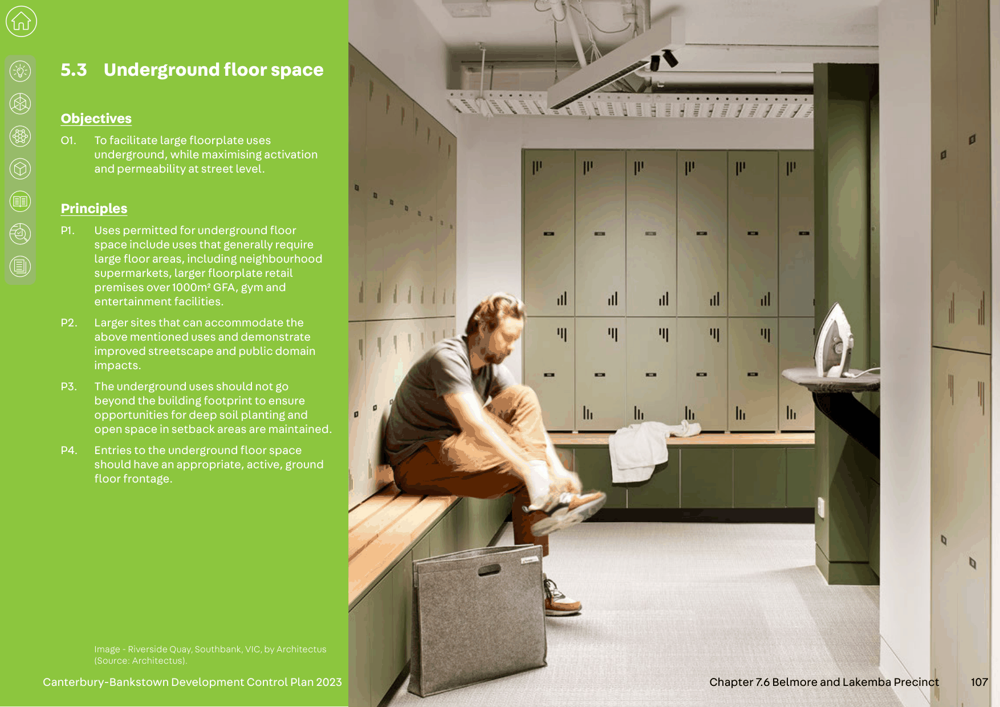

### 5.2	 Parking

#### 5.2.1 On-site parking

#### Objectives

O1. Promote sustainable transport and limit vehicular movements by restricting private parking and facilitating increasing access to, and use of, communal modes of transport

O2. Require a lower minimum and maximum parking rate in the Local Centre ‘Core’ near the Belmore and Lakemba Metro stations, with a slightly higher maximum parking rate outside of the Local Centre ‘Core’ to minimise a reliance on private motor vehicle

#### Principles

P1. Encourage basement vehicular parking instead of at-grade or above ground parking.

P2. Provide flexibility for the efficient use of car parking in development by allowing off-site users to use car parking.

P3. Where provided, design above ground car parking so that it can be adapted to alternate

P4. Consider the location of car park and service vehicle entrances and exits to ensure the amenity of public domain is maintained and

P5. To facilitate adaptation of car parking to other uses in the long term, above ground car parking is to remain as part of the common property and not part of, or attached to,

#### Controls

C1. All car parking within the Precinct must be provided in accordance with the rates as specified in Table 6 and Figure 53. If a land use is not included in Table 6, the car parking rates in Chapter 3.2 of the CBDCP 2023 will apply.

C2. Parking for non-residential uses, and non-staff related parking can be considered collectively and be shared if parking is accessible to the public and the hours of use have different peak demand times.

C3. If the total Gross Floor Area (GFA) of retail premises exceeds 2,000m², a Transport Impact Assessment for the development proposed is to be prepared and submitted.

C4. Accessible parking is required to be designed and constructed in accordance with Chapter 3.2-Parking of the CBDCP 2023.

| Land Use | Size/ | Inside Belmore and Lakemba |  | Outside of Belmore and |  |
|---|---|---|---|---|---|
|  | Description | Local Centre Core |  | Lakemba Local | Centre Cores |
|  |  | Minimum car parking rate | Maximum car parking rate | Minimum car parking rate | Maximum car parking rate |
| Residential flat buildings/ Shop | Studio | 0 | 0.5 space per dwelling | 0 | 0.75 space per dwelling |
| top housing | 1 Bedroom 2 Bedroom 3 Bedroom Visitor | 0 0.25 0.75 1 per 20 dwellings | 0.5 space per dwelling 1 space per dwelling 1.5 spaces per dwelling 1 space per 10 dwellings | 0.2 space per dwellings 0.5 space per dwellings 1 space per dwelling 1 space per 10 dwellings | 0.75 space per dwelling 1.5 spaces per dwelling 2 spaces per dwelling 1 space per 5 dwellings |
| Office premises | N/A | 0 | 1.25 spaces per 1000m2 | 1 space per 100m² | 2 spaces per 100m² |
| Retail premises | Shops | 0 | 1.25 spaces per 100m2 | 1 space per 100m² | 2 spaces per 100m² |
| All other land | N/A | Refer to Chapter 3.2- Parking in the CBDCP 2023 |  |  |  |
| uses |  |  |  |  |  |

Car parking requirements for the Belmore and Lakemba Precinct 'core' and outside of 'core' areas.

#### Table 6.

#### Car Parking Map

#### Legend

Application of DCP Core car parking areas

Figure 53. Parking map

Wangee Road

The Boulevarde

#### Lakemba

#### Station

Haldon Street

Lakemba Street

#### Belmore

#### Station

Burwood Road

Leylands Parade

Canterbury Road

1:12,500

N

100 200 300 500M

Chapter 7.6 Belmore and Lakemba Precinct 106

> [Picture on page 107: a picture, saved as a picture (images/ch-07-06-belmore-and-lakemba-page-107-1.gif, 150 dpi).]
> Words printed on the picture (title and legend, copied from the PDF):
> underground, while maximising activation
> supermarkets, larger floorplate retail
> entertainment facilities.
> impacts.
> floor frontage.
> Image - Riverside Quay, Southbank, VIC, by Architectus
> (Source: Architectus).
