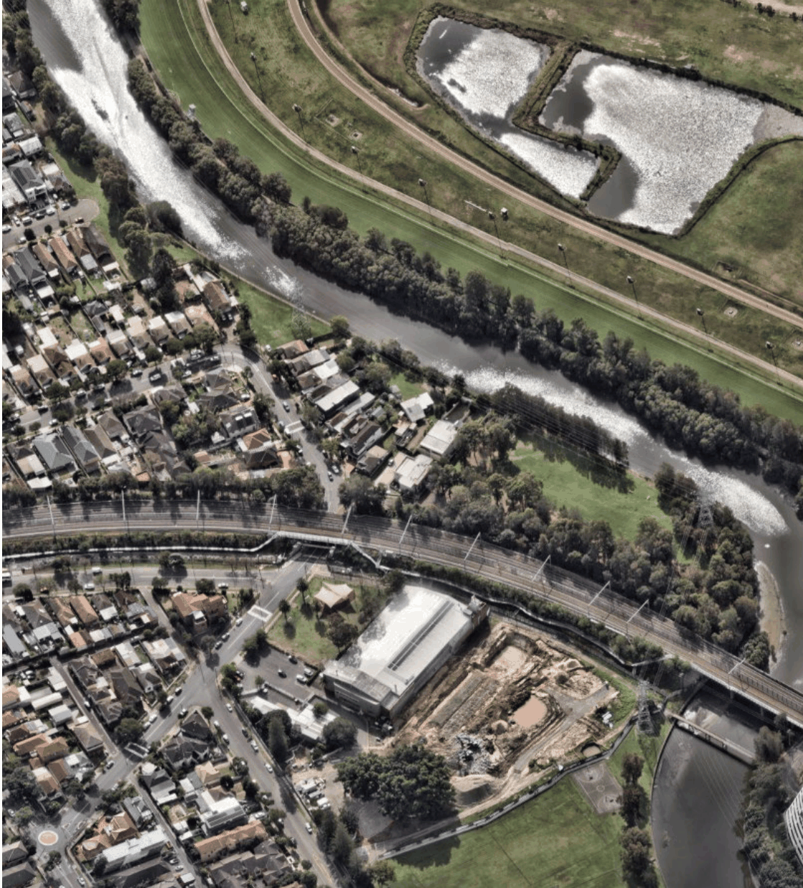

### 5.5	 Flood development

### controls

The provisions in this section are in addition

to the controls in CBDCP 2023 Chapter 2.2 -

Flood Risk Management. The flood related

development controls in this section are

applicable to the flood prone land areas

identified in Figure 54.

Any development on PMF affected lots must

address the requirements of this section and

Chapter 2.2.

#### Objectives

O1. To establish clear requirements for any

shelter-in-place  or evacuation provisions

for future development in flood prone land

areas of the Belmore and Lakemba Precinct.

O2. To ensure that the future developments

within or adjacent to floodways or overland

flow paths (OLFPs) have detailed hydraulic

assessment and design.

O3. To ensure that the development

demonstrates maintenance of sufficient

conveyance space for floodwaters.

O4. To ensure the development will incorporate

design responses such as OLFP redirection

or site-specific flow management strategies.

O5. To ensure flood risk is managed effectively

particularly in areas subject to high hazard,

flood emergency response limitations or

development intensification.

#### Spot 1

#### Spot 8

PMF affected lots  - significant impact

Spots 1, 5 and 8

PMF affected lots  - floodways

PMF affected lots  - storage

Figure 54. PMF affectation within the Precinct

#### Spot 5

#### Principles

P1. Avoid obstruction of the waterway by proposed development.

P2. Prevent adverse impacts on neighbouring properties or flood paths.

#### Controls

C1. Development on flood prone land must

address shelter-in-place guidelines (NSW

Government, 2025) to manage flood risk.

Image - Panoramic view of the Cooks River  (Source: Nearmap)

> [Picture on page 117: a picture, saved as a picture (images/ch-07-06-belmore-and-lakemba-page-117-12.gif, 150 dpi).]
