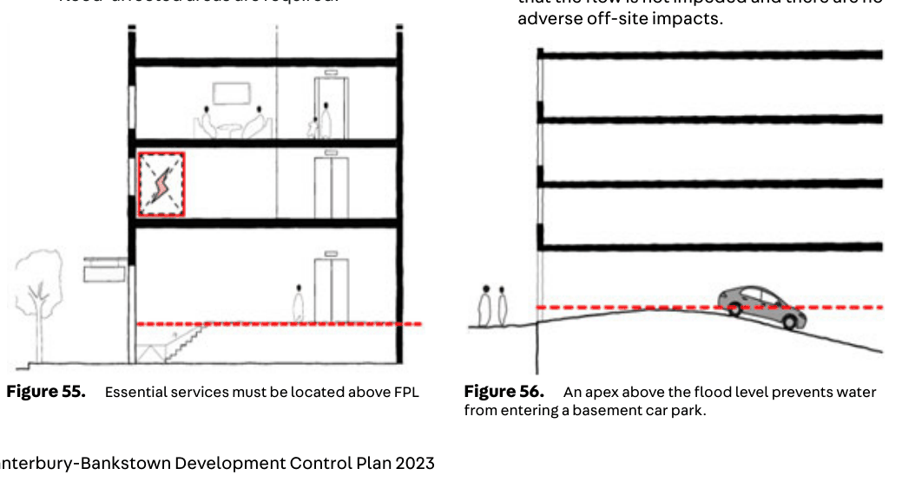

#### 5.5.5 Fill design considerations and

#### compliance with council policy

#### Objectives

O1. To prevent future developments from

building in Overland Flow Paths(OLFPs).

#### Principles

P1. Ensure that the sites that fall within OLFP have post development flood modelling, to demonstrate that flood conveyance is retained.

P2. Ensure the built form in areas within OLFP are designed to either maintain open flow corridors or incorporate suspended structures that allow floodwaters to pass beneath the development footprint.

P3. Council may support a diversion of an overland flow path within the property boundary, provided it can be demonstrated

> [Picture on page 119: a picture, saved as a picture (images/ch-07-06-belmore-and-lakemba-page-119-38.gif, 150 dpi).]
> Words printed on the picture (title and legend, copied from the PDF):
> adverse off-site impacts.
> from entering a basement car park.

Figure 55. Essential services must be located above FPL

Figure 56. An apex above the flood level prevents water

that the flow is not impeded and there are no

#### ID SIP Guideline (2025) Design Criteria Requirement

1\. The floor level of the SIP should be part of the development be above the PMF.

2\. Structural soundness for conditions in a PMF event, considering flood and debris forces, be verified by a suitably qualified structural engineer.

3\. Area and access to the area does not rely on access to electricity and is self-directing. Have clearly marked internal access for all people on site,including consideration of access for potential occupants and/ or visitors.

4\. Protection from weather and appropriate heating and cooling.

5\. Access to personal hygiene facilities such as toilet.

6\. A minimum floor space of 2 m² per person.

7\. Items for self-sufficiency that are stored, maintained and are regularly updated in an accessible location above the PMF, including sufficient drinking water and food for occupants, fire extinguishers, radics and torches with spare batteries, and a first aid kit with an automated external defibrillator (AED).

8\. Centralised communal shelters may be considered but must be freely accessible internally at all times and externally accessible during events.

9\. Access is provided to on-site systems that generate power the shelter-in-place location during and after the event for a full range of flood events up to the PMF.

10\. Includes signage, communication or design elements to support sheltering.

Table 11. Shelter-in-place design criteria.

Figures Reference: Good Design Guide for Flood Affected Areas.
