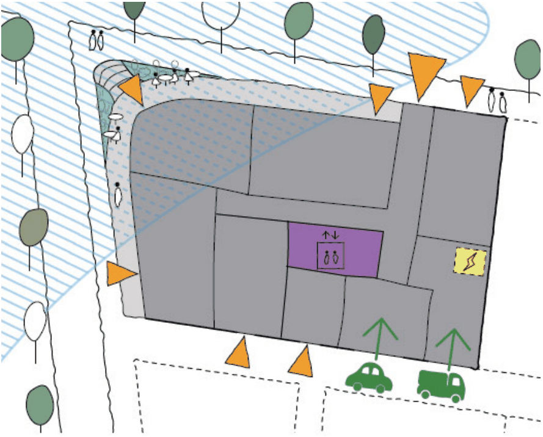

#### 5.5.7 Management Plan

#### Controls

C1. Where finished floor levels or basement car

park entries are below the flood prone land

level for the site, Council will require the

applicant prepare a Flood Risk Management

Plan and for this to be registered on the land

title as a condition of development consent.

The Flood Risk Management Plan must

address the following requirements:

a)	 Site-specific flood risks

b)	 An operational risk assessment

c)	 Maintenance and reporting schedule.

d)	 Implement a flood-risk management plan which has been approved by Council.

Figures Reference: Good Design Guide for Flood Affected Areas.

> [Picture on page 120: a picture, saved as a picture (images/ch-07-06-belmore-and-lakemba-page-120-24.gif, 150 dpi).]

#### Legend

Flood area

Raised ground floor within

flood area

Car park / loading zone entry

Building entry

Lift

Substation

Figure 57. Building entrances are located above the flood line on natural ground and the elevated ground level via a colonnade with raised terrace. Access to car parking and loading zone is located outside of flood area at the rear of the property. The lift and substation are also located outside and above of flood area (Good Design Guide pp 27).

### 6
