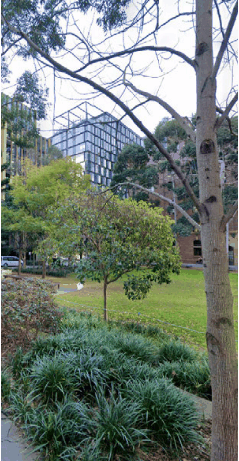
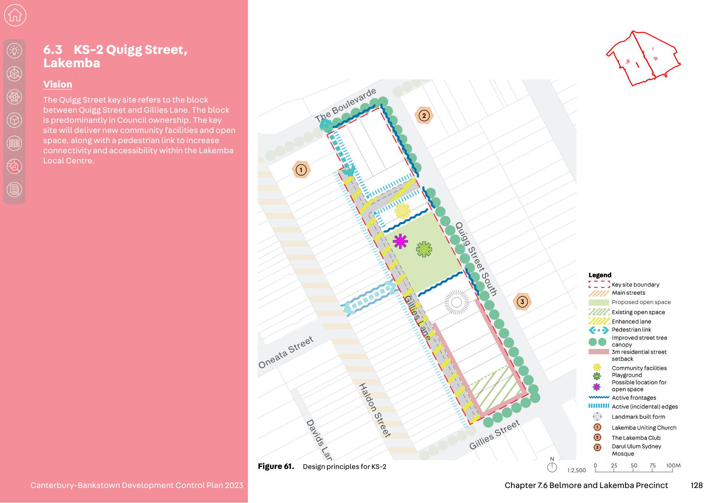

### 6.2	 KS-1 Jubilee Reserve,

### Lakemba

#### Vision

The Jubilee Reserve key site refers to the block bounded by Lakemba Street, Croydon Street, Railway Parade and Bellevue Avenue in Lakemba. Certain lots within this block do not form part of this key site as shown on the plan. The key site includes five large landholdings adjoining Jubilee Reserve and the Lakemba Community Garden located in the southwest corner of the block. Development of the key site will expand Jubilee Reserve and create a new pedestrian link and lane.

#### Design Principles

P1. Deliver an open space that achieves a minimum solar access for 4 hours (for 50% of the site) on June 21st to ensure optimal conditions for the growth of the trees and landscape and for the usability of the park.

P2. Provide a minimum of 20% shade to the open space and include shade to any play equipment.

P3. A maximum 900mm level change should be provided between the pedestrian link and the ground floor of the adjacent building within the overland flow path area. Further detail regarding this level change and interface should be investigated during the detailed design phase, ensuring the design outcome prioritises access, surveillance and amenity. Solutions should include providing stepping, limiting ramping, include high quality landscaping for screening and providing active and passive surveillance over the pedestrian link.

P4. Deliver tree lined streets along  Lakemba Street through the provision of new tree planting, landscaping and high quality paving.

P5. Provide a new north-south pedestrian link between Lakemba Street and Railway Parade to improve pedestrian connectivity to Jubilee Reserve and Lakemba Metro station.

P6. Provide a new lane through the site from Croydon Street to Railway Parade.

P7. Deliver community facilities fronting Lakemba Street that are easily visible and

accessible.

P8. Create ground-level apartments that

interface with Croydon Street, Railway

Parade and the new open space featuring

private landscaping, deep soil and direct

street access, enhancing amenity, access

and passive surveillance of the public

domain.

P9. Provide a retail ground setback along

Lakemba Street featuring space for active

uses including outdoor dining, landscaping

and high quality paving enhancing amenity,

pedestrian movement and activation of the

public domain.

P10. Provide a landscaped buffer along the lane.

P11. Design a striking landmark tower at the

corner of Lakemba Street and Croydon

Street, characterised by its unique and

innovative architectural design that stands

out in the skyline.

P12. Provide high quality active frontages along

identified streets.

P13. Development interfacing lanes and

pedestrian links should provide incidental

active uses along these edges.

P14. Provide high quality landscape design to the

podium rooftop reflecting Connecting with

Country principles, enhancing local amenity,

establishing habitat and supporting passive

cooling of the urban environment.

> [Picture on page 127: a picture, saved as a picture (images/ch-07-06-belmore-and-lakemba-page-127-65.gif, 150 dpi).]

Central Park, Broadway, NSW (Source: Architectus)

t

> [Picture on page 128: a map, saved as a picture (images/ch-07-06-belmore-and-lakemba-page-128-2.gif, 150 dpi); the street names and other small labels are on the picture.]
> Words printed on the picture (title and legend, copied from the PDF):
> Key site boundary
> Key site boundary
> Quigg Street South
> Proposed open space
> Existing open space
> Existing open space
> Improved street tree
> 3m residential street
> Improved street tree
> 3m residential street
> Possible location for
> Possible location for
> Active (incidental) edges
> Active (incidental) edges
> Landmark built form
> Landmark built form
> 1 Lakemba Uniting Church
> 1 Lakemba Uniting Church
> 2 The Lakemba Club
> 2 The Lakemba Club
> Darul Ulum Sydney
> Darul Ulum Sydney
> 0 25 50 75 100M

Figure 61. Design principles for KS-2
