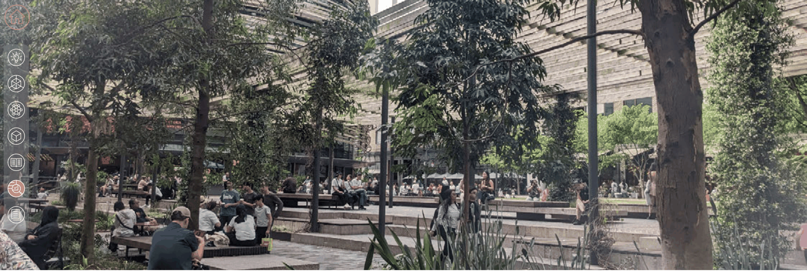
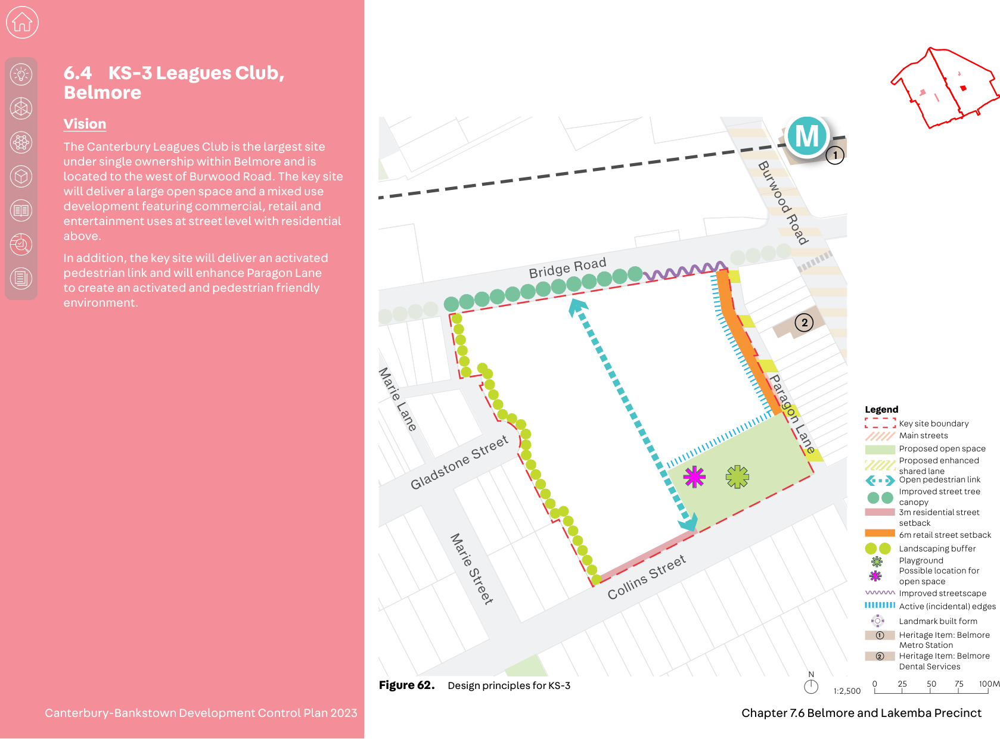

### 6.3	 KS-2 Quigg Street,

### Lakemba

#### Vision

The Quigg Street key site refers to the block between Quigg Street and Gillies Lane. The block is predominantly in Council ownership. The key site will deliver new community facilities and open space, along with a pedestrian link to increase connectivity and accessibility within the Lakemba

ade

Ta

> [Picture on page 129: a picture, saved as a picture (images/ch-07-06-belmore-and-lakemba-page-129-1.gif, 150 dpi).]

#### Design Principles

P1. Deliver open space that achieves a minimum solar access for 3 hours (for 50% of the site) on June 21st to ensure optimal conditions for the growth of the trees and landscape and for the usability of the park.

P2. Deliver tree lined streets along  The Boulevarde, Quigg Street South and Gillies Street through the provision of new tree planting, landscaping and high quality paving.

P3. Provide a new north-south pedestrian link between The Boulevarde and Gillies Lane to improve pedestrian connectivity to the new Gillies Lane open space.

P4. Retain and enhance Gillies Lane.

Image - Darling Square, Haymarket, NSW (Source: Architectus)

P5. Deliver community facilities that front the new open space that are easily visible and accessible from the pedestrian link.

P6. Create ground-level apartments that interface with the Quigg Streets and Gillies Street featuring private landscaping, deep soil and direct street access, enhancing amenity, access and passive surveillance of the public domain.

P7. Design a distinctive landmark tower on the southern side of the open space, characterised by its unique and innovative architectural design that stands out in the skyline.

P8. Provide high quality active frontages along

identified streets, pedestrian links and open space.

P9. Development interfacing Gillies Lane and the pedestrian links should provide incidental active uses along these edges.

P10. Provide high quality landscape design to the podium rooftop reflecting Connecting with Country principles, enhancing local amenity, establishing habitat and supporting passive cooling of the urban environment.

P11. Provide an appropriate interface to places of worship. Consider design elements such as bulk, scale, privacy, landscaping and material choice.

> [Picture on page 130: a map, saved as a picture (images/ch-07-06-belmore-and-lakemba-page-130-1.gif, 150 dpi); the street names and other small labels are on the picture.]
> Words printed on the picture (title and legend, copied from the PDF):
> Key site boundary
> Proposed open space
> Open pedestrian link
> Improved street tree
> 3m residential street
> 6m retail street setback
> Possible location for
> Active (incidental) edges
> Landmark built form
> 1 Heritage Item: Belmore
> 2 Heritage Item: Belmore
> 0 25 50 75 100M

Figure 62. Design principles for KS-3
