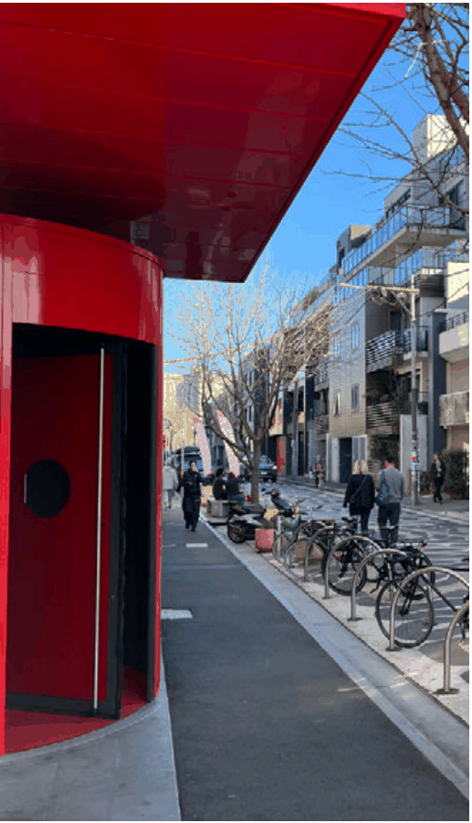
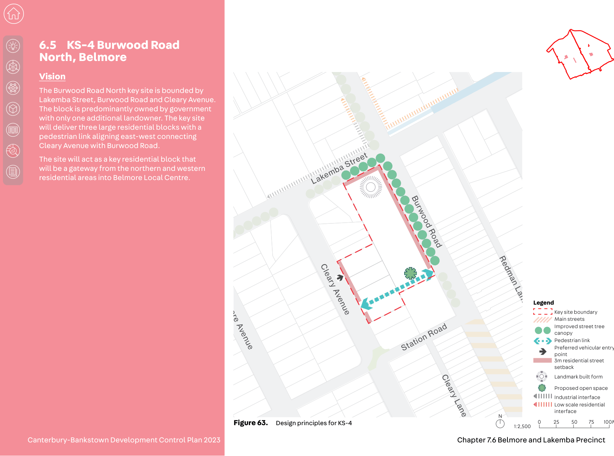

### 6.4	 KS-3 Leagues Club,

### Belmore

#### Vision

The Canterbury Leagues Club is the largest site under single ownership within Belmore and is located to the west of Burwood Road. The key site will deliver a large open space and a mixed use development featuring commercial, retail and entertainment uses at street level with residential above.

In addition, the key site will deliver an activated pedestrian link and will enhance Paragon Lane to create an activated and pedestrian friendly

Acacia Lane

#### Design Principles

P1. Deliver a 3,000sqm open space that achieves a minimum solar access for 2 hours (for 50% of the site) on June 21st to ensure for optimal conditions for the growth of trees and landscape and to maximise the usability of the park.

P2. Deliver tree lined streets along  Bridge Road through the provision of new tree planting, landscaping and high quality paving.

P3. Provide a new pedestrian link between Bridge Road and Collins Street to improve connectivity to the open space and Belmore Metro Station.

P4. Provide a new shared lane through the site between Gladstone Street and Paragon Lane.

P5. Create ground-level apartments that interface with Collins Street and the open space featuring private landscaping, deep soil and direct street access, enhancing amenity, access and passive surveillance of the public domain.

P6. Provide a retail ground setback along Paragon Lane featuring space for active uses including outdoor dining as well as landscaping and high quality paving, enhancing amenity, pedestrian movement and activation of the public domain.

P7. Design a unique place based tower along Bridge Road.

P8. Provide high quality active frontages and edges along identified streets.

P9. Development interfacing the lane and the open space should provide incidental active uses along these edges.

P10. Provide high quality landscape design to the podium rooftop reflecting Connecting with Country principles, enhancing local amenity, establishing habitat and supporting passive cooling of the urban environment.

P11. Provide an appropriate interface to the existing places of worship. Consider design elements such as bulk, scale, privacy, landscaping and material choice.

> [Picture on page 131: a picture, saved as a picture (images/ch-07-06-belmore-and-lakemba-page-131-46.gif, 150 dpi).]

Rose Street, Fitzroy, Melbourne, NSW (Source: Architectus)

St

> [Picture on page 132: a map, saved as a picture (images/ch-07-06-belmore-and-lakemba-page-132-2.gif, 150 dpi); the street names and other small labels are on the picture.]
> Words printed on the picture (title and legend, copied from the PDF):
> St Clair Street
> Redman Lane Legend
> Key site boundary
> Improved street tree
> Preferred vehicular entry
> 3m residential street
> Landmark built form
> Proposed open space
> Low scale residential
> Cleary Lane N
> 0 25 50 75 100M

Figure 63. Design principles for KS-4
