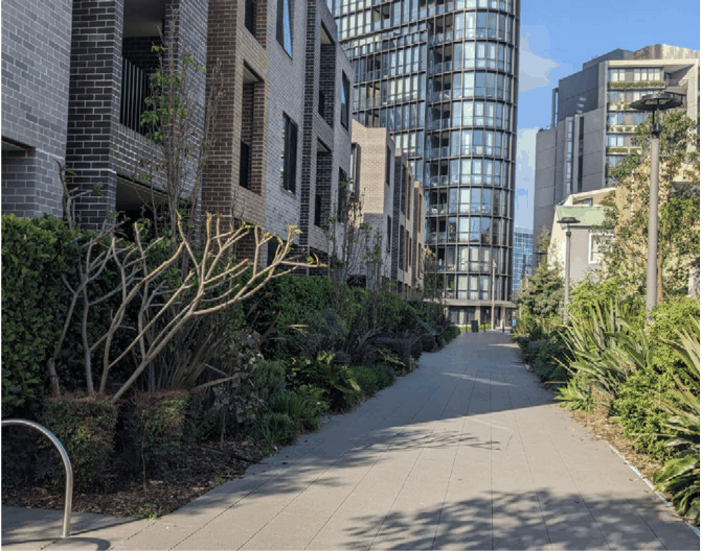

### 6.5	 KS-4 Burwood Road

### North, Belmore

#### Vision

The Burwood Road North key site is bounded by

Lakemba Street, Burwood Road and Cleary Avenue.

The block is predominantly owned by government

with only one additional landowner. The key site

will deliver three large residential blocks with a

pedestrian link aligning east-west connecting

Cleary Avenue with Burwood Road.

The site will act as a key residential block that

will be a gateway from the northern and western

residential areas into Belmore Local Centre.

e

### e

#### Design Principles

P1. Deliver an open space that achieves a minimum solar access for 2 hours (for 50% of the site) on June 21st to ensure optimal conditions for the growth of the trees and landscape and for the usability of the park.

P2. Deliver tree lined streets along  Burwood Road and Lakemba Street through tree planting, landscaping and high quality paving.

P3. Provide a new east-west through pedestrian link between Burwood Road and Cleary Avenue to improve pedestrian and cycle connectivity.

P4. Create ground-level apartments that interface with streets and the pedestrian link, featuring private landscaping, deep soil and direct street access, enhancing amenity, access and passive surveillance of the public domain.

P5. Vehicular access should be located away from Burwood Road and Lakemba Street.

P6. Create a landmark tower along Burwood Road that provides a visual marker for the Local Centre.

P7. Provide high quality landscape design to the podium rooftop reflecting Connecting with Country principles, enhancing local amenity, establishing habitat and supporting passive cooling of the urban environment.

> [Picture on page 133: a picture, saved as a picture (images/ch-07-06-belmore-and-lakemba-page-133-31.gif, 150 dpi).]

Blues Lane, Zetland, NSW (Source: Architectus)

P8. Provide an appropriate interface to the low scale industrial and residential uses north of Lakemba Street -  consider design elements such as bulk, scale, privacy, landscaping and material choice.
