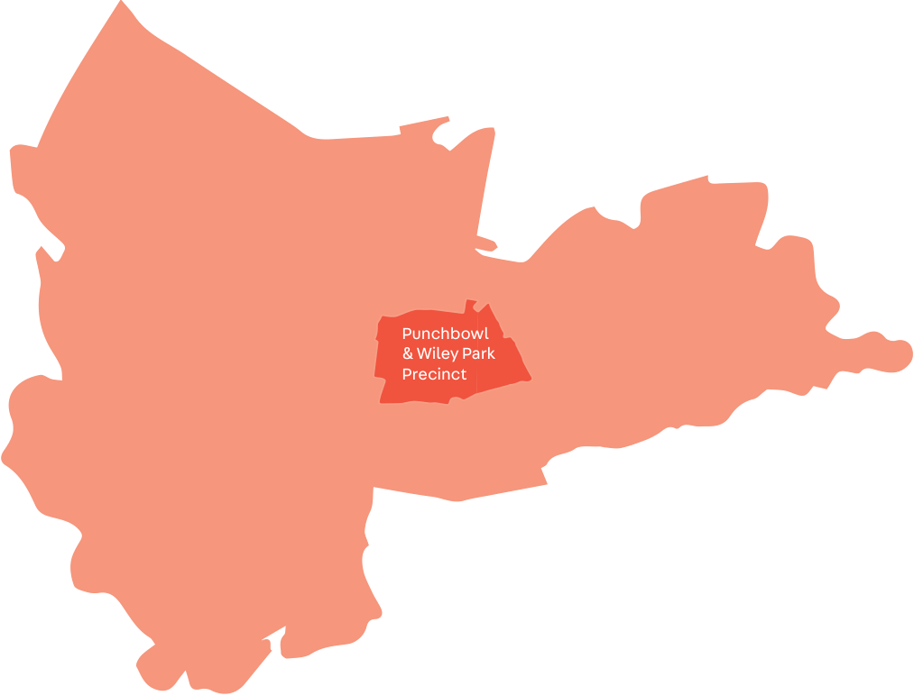
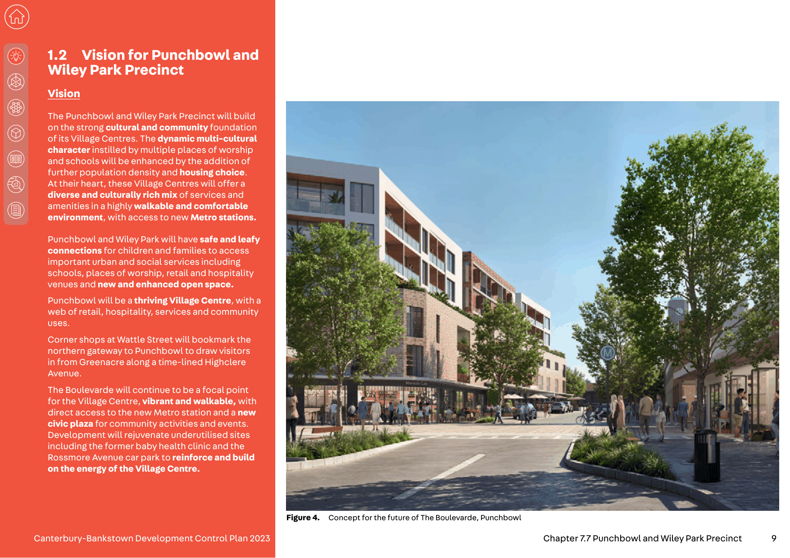

### 1.1 Application of this Chapter

This Chapter of the Canterbury-Bankstown DCP 2023, (CBDCP 2023), supports the Canterbury- Bankstown Local Environmental Plan 2023, (LEP), by providing objectives, principles and development controls to enhance the functionality, design and amenity of development within the Punchbowl and Wiley Park Precinct, (also referred to as ‘the Precinct’ in this Chapter). The Precinct is comprised of two Villages Centres, Punchbowl and Wiley Park, as noted in Canterbury Bankstown Council's Local Strategic Planning Statement.

This Chapter of the CBDCP 2023 applies to all development on the land within the Punchbowl and Wiley Park Precinct as identified in Figure 3. Other  Chapters, as relevant, of the CBDCP 2023 must also be addressed as part of a Development Application(DA).

Where there is an inconsistency between the controls in this Chapter and other Chapters of the CBDCP 2023, this chapter prevails to the extent of the inconsistency with the exception of Chapter 4 Heritage.

> [Picture on page 7: a picture, saved as a picture (images/ch-07-07-punchbowl-and-wiley-park-page-7-25.gif, 150 dpi).]
> Words printed on the picture (title and legend, copied from the PDF):
> Punchbowl
> & Wiley Park
> Precinct

#### LEGEND

Canterbury-Bankstown Local Government Area (LGA)

Punchbowl and Wiley Park Precinct

Location of Punchbowl and Wiley Park Precinct within Canterbury-Bankstown LGA

#### Figure 2.

Highclere Avenue

#### Punchbowl Station

Rossmore Avenue

#### LEGEND

Land Application Map

Punchbowl and Wiley Park Precinct land application map

#### Figure 3.

Punchbowl Road

de

evar

oul

e B

Th

Hillcrest Street

Canterbury Road

Lakemba Street

#### Wiley Park Station

King Georges Road

1:12,500

0 100

N

200 300 500M

Chapter 7.7 Punchbowl and Wiley Park Precinct 8

> [Picture on page 9: a picture, saved as a picture (images/ch-07-07-punchbowl-and-wiley-park-page-9-1.gif, 150 dpi).]

Figure 4. Concept for the future of The Boulevarde, Punchbowl
