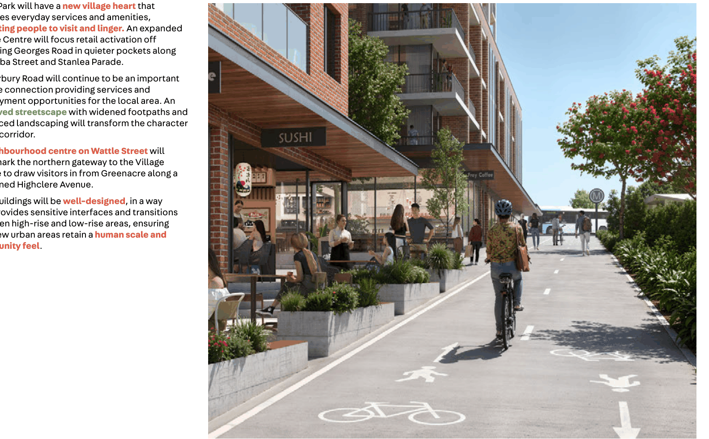
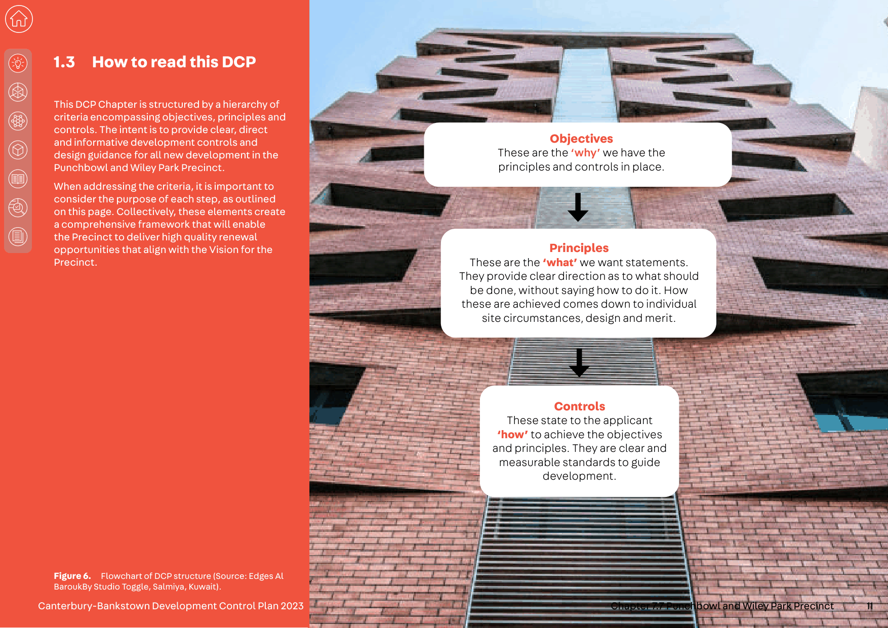

### 1.2	 Vision for Punchbowl and

### Wiley Park Precinct

#### Vision

The Punchbowl and Wiley Park Precinct will build

on the strong cultural and community foundation of its Village Centres. The dynamic multi-cultural character instilled by multiple places of worship and schools will be enhanced by the addition of further population density and housing choice. At their heart, these Village Centres will offer a diverse and culturally rich mix of services and amenities in a highly walkable and comfortable environment, with access to new Metro stations.

Punchbowl and Wiley Park will have safe and leafy connections for children and families to access important urban and social services including schools, places of worship, retail and hospitality venues and new and enhanced open space. Punchbowl will be a thriving Village Centre, with a web of retail, hospitality, services and community uses. Corner shops at Wattle Street will bookmark the northern gateway to Punchbowl to draw visitors in from Greenacre along a time-lined Highclere Avenue. The Boulevarde will continue to be a focal point for the Village Centre, vibrant and walkable, with direct access to the new Metro station and a new civic plaza for community activities and events. Development will rejuvenate underutilised sites including the former baby health clinic and the Rossmore Avenue car park to reinforce and build on the energy of the Village Centre.

> [Picture on page 10: a picture, saved as a picture (images/ch-07-07-punchbowl-and-wiley-park-page-10-1.gif, 150 dpi).]
> Words printed on the picture (title and legend, copied from the PDF):
> community feel.

Wiley Park will have a new village heart that provides everyday services and amenities, attracting people to visit and linger. An expanded Village Centre will focus retail activation off busy King Georges Road in quieter pockets along Lakemba Street and Stanlea Parade. Canterbury Road will continue to be an important vehicle connection providing services and employment opportunities for the local area. An improved streetscape with widened footpaths and enhanced landscaping will transform the character of the corridor. A neighbourhood centre on Wattle Street will bookmark the northern gateway to the Village Centre to draw visitors in from Greenacre along a tree-lined Highclere Avenue. New buildings will be well-designed, in a way that provides sensitive interfaces and transitions between high-rise and low-rise areas, ensuring that new urban areas retain a human scale and

Figure 5. Concept for the future of Stanlea Parade, Wiley Park

> [Picture on page 11: a picture, saved as a picture (images/ch-07-07-punchbowl-and-wiley-park-page-11-1.gif, 150 dpi).]
> Words printed on the picture (title and legend, copied from the PDF):
> Precinct.
> BaroukBy Studio Toggle, Salmiya, Kuwait).
> These are the ‘why’ we have the
> principles and controls in place.
> These are the ‘what’ we want statements.
> They provide clear direction as to what should
> be done, without saying how to do it. How
> these are achieved comes down to individual
> site circumstances, design and merit.
> These state to the applicant
> ‘how’ to achieve the objectives
> and principles. They are clear and
> measurable standards to guide
> development.

Figure 6. Flowchart of DCP structure (Source: Edges Al
