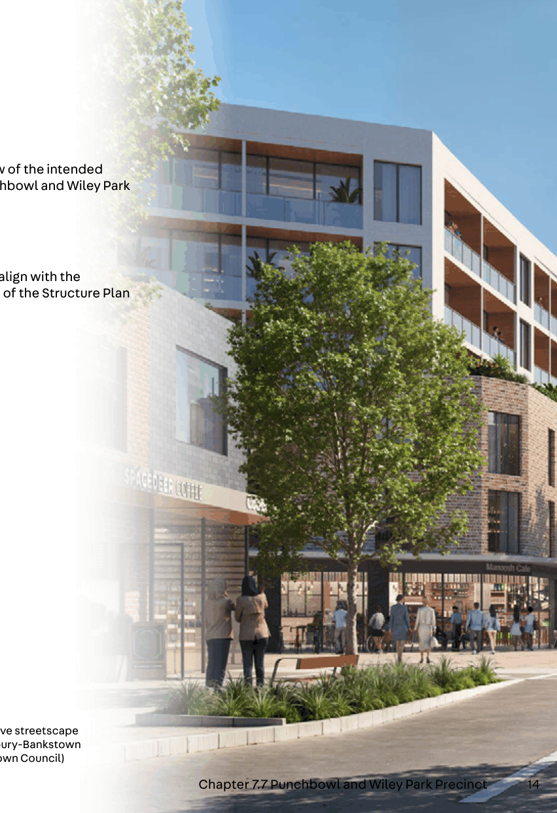

### 2.1 Structure Plan

The Structure Plan provides an overview of the intended outcomes for the Punchbowl and Wiley Park Precinct. The Structure Plan has been informed by analysis of the opportunities and constraints of the Village Centres.  These opportunities include desired land uses, built form character, housing types, open space, streetscape improvements and pedestrian and cycling connections.

Key elements of the Structure Plan consist of: ⚬ Revitalised and vibrant Village Centres with active high streets.

⚬ New and enhanced parks and plazas. ⚬ New social infrastructure that supports a growing community.

⚬ Green connections, shared lanes and pedestrian links that support walking, cycling and social interaction. ⚬ Increased tree canopy and green cover to create cool, green and attractive neighbourhoods and to reduce urban heat gain.

⚬ High-quality built form outcomes that reflect character of place and protect sensitive interfaces.

⚬ The Introduction of creative industries in employment areas.

The Structure Plan is shown in Figure 9.

#### Objectives

> [Picture on page 14: a picture, saved as a picture (images/ch-07-07-punchbowl-and-wiley-park-page-14-31.gif, 150 dpi).]

O1. To provide an overview of the intended outcomes of the Punchbowl and Wiley Park Precinct.

#### Principles

P1. Development should align with the overarching elements of the Structure Plan as shown in Figure 9.

Figure 8. Visualisation of improve streetscape around a Metro station in Canterbury-Bankstown LGA (Source: Canterbury-Bankstown Council)

Chapter 7.7 Punchbowl and Wiley Park Precinct 14

### Punchbowl and Wiley Park Structure Plan

Lakemba Street

Shadforth Street

Highclere Avenue

#### Legend

Application of DCP

#### Wiley Park

Kelly Street

South Terrace

Punchbowl Road

#### Station

Commercial and mixed use

rade

a Pa

ung

Ur

de

evar

oul

e B

High density residential Medium density residential Low density residential

Th

Griffiths Avenue

#### Punchbowl

School

Alice Street South

#### Station

Existing open space Upgraded open space

King Georges Rd

Hillcrest St

Punchbowl Road

Ferguson Avenue

Arthur Street

Proposed new open space Proposed community facility M Metro station Major road

Rossmore Ave

High street improvements

Broadway

Priority streets for tree canopy

Viola Street

Priority streets for cycleways

Canterbury Road

Planned East-West cycle link (Sydney Metro) Proposed / enhanced pedestrian link (min. 4m) Proposed new shared lane (9m) Active frontages Active edges

Figure 9. Punchbowl and Wiley Park Structure Plan

1:12,500

0 100 200 300 500M

N

Note: The Structure Plan is draft and may change following the NSW Department of Planning, Housing and Infrastructure's finalisation of LEP controls for Punchbowl and Wiley Park Precinct (expected to be completed by early 2026).
