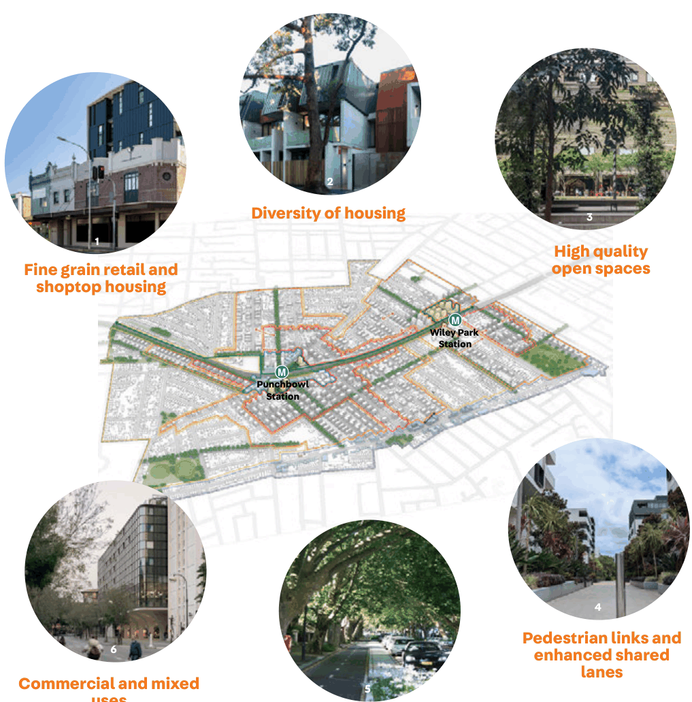
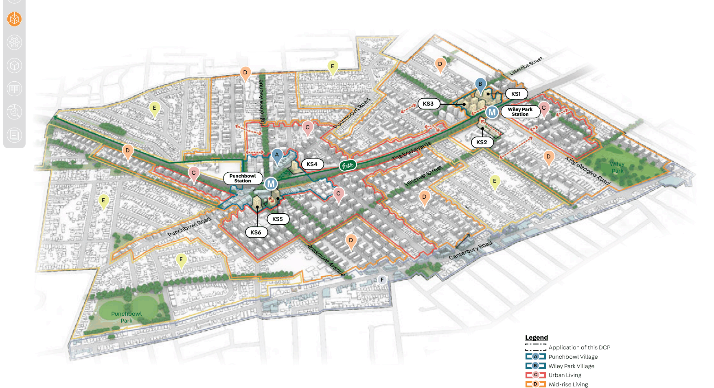
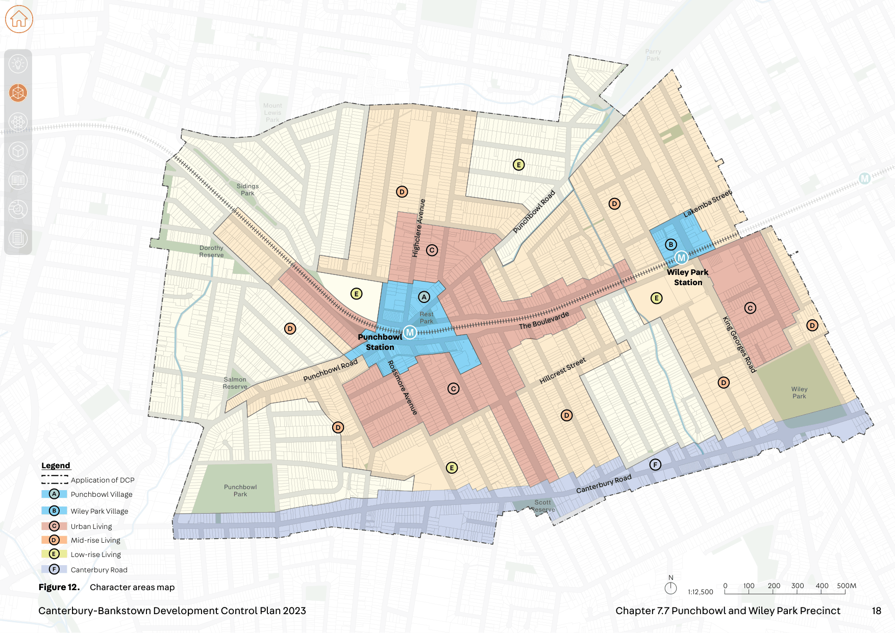

### 2.2	 Character Areas

The Punchbowl and Wiley Park Precinct will be comprised of different areas of distinct character. Through detailed analysis, seven character areas have been identified. Applicants are to identify which character area that a development site is located in and be cognisant of the key attributes of the existing context, where relevant, and the desired future context for the character area.

#### Objectives

O1. To achieve the desired future character of the Punchbowl and Wiley Park Precinct and guide development to deliver this desired character.

#### Controls

C1. Development must consider and address the outcomes expressed in the character area statements and principles.

C2. Development Applications must be accompanied by a site and context analysis plan that demonstrates an understanding of the manner a site integrates and is consistent with the desired future character area.

Images:

1 - Illawarra Road, Marrickville, NSW 2 - Brickworks Apartments, NSW 3 - Darling Square, Haymarket, NSW 4- North Rosebery, Rosebery, NSW 5 - Bourke Street, Surry Hills, NSW 6 - Morland Mixite Capitale, France

> [Picture on page 16: a map, saved as a picture (images/ch-07-07-punchbowl-and-wiley-park-page-16-31.gif, 150 dpi); the street names and other small labels are on the picture.]

#### Diversity of housing

#### High quality

#### open spaces

Fine grain retail and

#### shoptop housing

Pedestrian links and

#### enhanced shared

#### lanes

#### Commercial and mixed

#### uses

Tree lined streets and

#### cycleways

Figure 10. Key features of Punchbowl and Wiley Park Precinct character areas

> [Picture on page 17: a map, saved as a picture (images/ch-07-07-punchbowl-and-wiley-park-page-17-1.gif, 150 dpi); the street names and other small labels are on the picture.]
> Words printed on the picture (title and legend, copied from the PDF):
> King Georges Road
> Application of this DCP
> A Punchbowl Village
> B Wiley Park Village
> C Urban Living
> D Mid-rise Living

E Low-rise Living F Canterbury Road Key Sites (see Section 6)

N

Figure 11. Axonometric view of character areas with indicative massing of potential future development

> [Picture on page 18: a map, saved as a picture (images/ch-07-07-punchbowl-and-wiley-park-page-18-1.gif, 150 dpi); the street names and other small labels are on the picture.]
> Words printed on the picture (title and legend, copied from the PDF):
> Application of DCP
> A Punchbowl Village
> B Wiley Park Village
> C Urban Living
> D Mid-rise Living
> E Low-rise Living
> F Canterbury Road
> King Georges Road
> 0 100 200

Figure 12. Character areas map

Chapter 7.7 Punchbowl and Wiley Park Precinct 18

### Desired Future Character Areas
