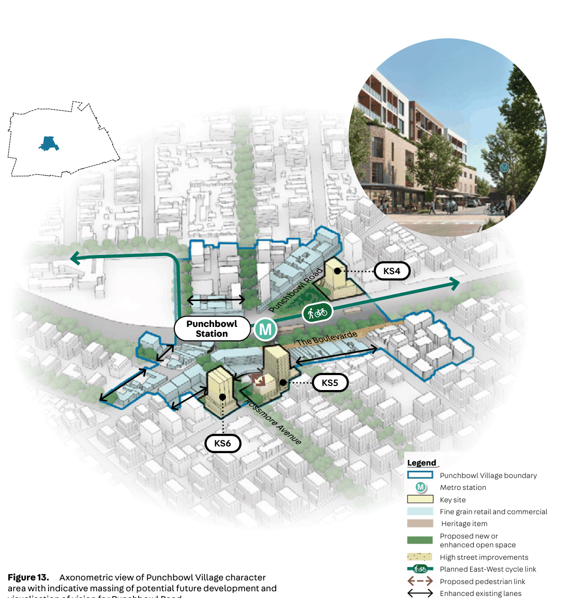
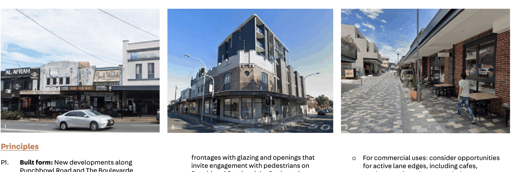

#### 2.2.1 Punchbowl Village

#### The Punchbowl Village character area

#### will be a vibrant multi-nodal area which

#### has a focus on the new Metro station.

#### The character area will have an exciting

mix of retail, hospitality, community and

#### residential uses with key public open

spaces and high streets. A diversity of

services will be provided to meet the

#### needs of the community, that includes

#### uses that encourage social interaction.

There will be offerings that draw people in

and an amenity that encourages them to

#### stay.

Rejuvenated frontages along Breust Place, Punchbowl Road, Highclere Avenue, Arthur Street and The Boulevarde will reinvigorate the Village character area and will be key circulation corridors to and from the Metro Station with new arrival plazas welcoming visitors into the surrounding neighbourhoods.

The architectural character of the Village will respond to the existing 'high street' character of two storey shops with provision of fine-grain retail and human scale street walls encouraging face brick and masonry elements that reflect existing building stock. Street life will be bolstered by improved landscaping and streetscape outcomes. The pre 1950 shop facades will be retained and sympathetically restored.

Adaptive reuse of the heritage-listed former Baby Health Centre and upgraded Rest Park will be a focal point of community life and support the activation of Punchbowl Road.

> [Picture on page 19: a map, saved as a picture (images/ch-07-07-punchbowl-and-wiley-park-page-19-36.gif, 150 dpi); the street names and other small labels are on the picture.]
> Words printed on the picture (title and legend, copied from the PDF):
> Punchbowl Village boundary
> Fine grain retail and commercial
> Proposed new or
> enhanced open space
> High street improvements
> Planned East-West cycle link
> Proposed pedestrian link
> Enhanced existing lanes
> area with indicative massing of potential future development and

Figure 13. Axonometric view of Punchbowl Village character

visualisation of vision for Punchbowl Road

#### Principles

Illawarra Rd

Directions Save Nearby Send to Share

phone

Sydney NSW

P1. Built form: New developments along Punchbowl Road and The Boulevarde shall maintain the existing character of the traditional high street and ensure for:

a) A street wall height of 2 to 3 storeys that aligns with the predominant existing building height and is designed to reflect the detailing of neighbouring buildings including parapets and windows. See Section 4.2.3 Street wall heights.

b) Retention of pre 1950 shop facades at 743 to 759 and 802-806 Punchbowl Road which are to be sympathetically integrated into the design of any new development including restoration and removal of any uncharacteristic and intrusive features.

c) A fine-grain character with narrow active

Images:

1 - Pre 1950 shop facades at 743 to 759 Punchbowl Road 2 - Shoptop housing, Illawarra Road, Marrickville 3 - Enhanced and activated Birdwood Lane, Lane Cove (Source: Architectus)

441 Illawarra Rd

> [Picture on page 20: a picture, saved as a picture (images/ch-07-07-punchbowl-and-wiley-park-page-20-29.gif, 150 dpi).]
> Words printed on the picture (title and legend, copied from the PDF):
> Marrickville, New South Wales
> Google Street View
> July 2020 See more dates
> 1
> 2
> 3

1

frontages with glazing and openings that invite engagement with pedestrians on Punchbowl Road and the Boulevarde, fostering a lively atmosphere. See Section

4.3.2 Active street frontages and edges.

d) Materials that reflect the traditional brickwork and masonry of the surrounding buildings including heritage. See Section 4.5 Materials and finishes.

e) Upper levels setback to provide green podium communal spaces and surveillance of the street. See Section 4.6 Rooftop and communal open spaces.

P2. Lanes: Lanes behind Punchbowl Road and The Boulevarde will be enhanced to better accommodate pedestrians and cyclists, while also facilitating service vehicles and driveways, creating a high-amenity network that promotes safety and accessibility for all users. See Section 3.3 Streets, shared lanes, pedestrian links and arcades.

P3. Development interfacing with lanes should:

Image capture: July 2020 © 2025 Google

⚬ For commercial uses: consider opportunities for active lane edges, including cafes, outdoor seating, planters and where possible deep soil.

⚬ For residential uses: provide high quality landscaping, deep soil and apartments with private entries.

P4. Key sites: Development on the Rossmore Avenue and Punchbowl Road key sites are to provide improved permeability and interfaces to streets and lanes and deliver open spaces and community facilities. See Section 6 Key sites KS4, KS5 and KS6.
