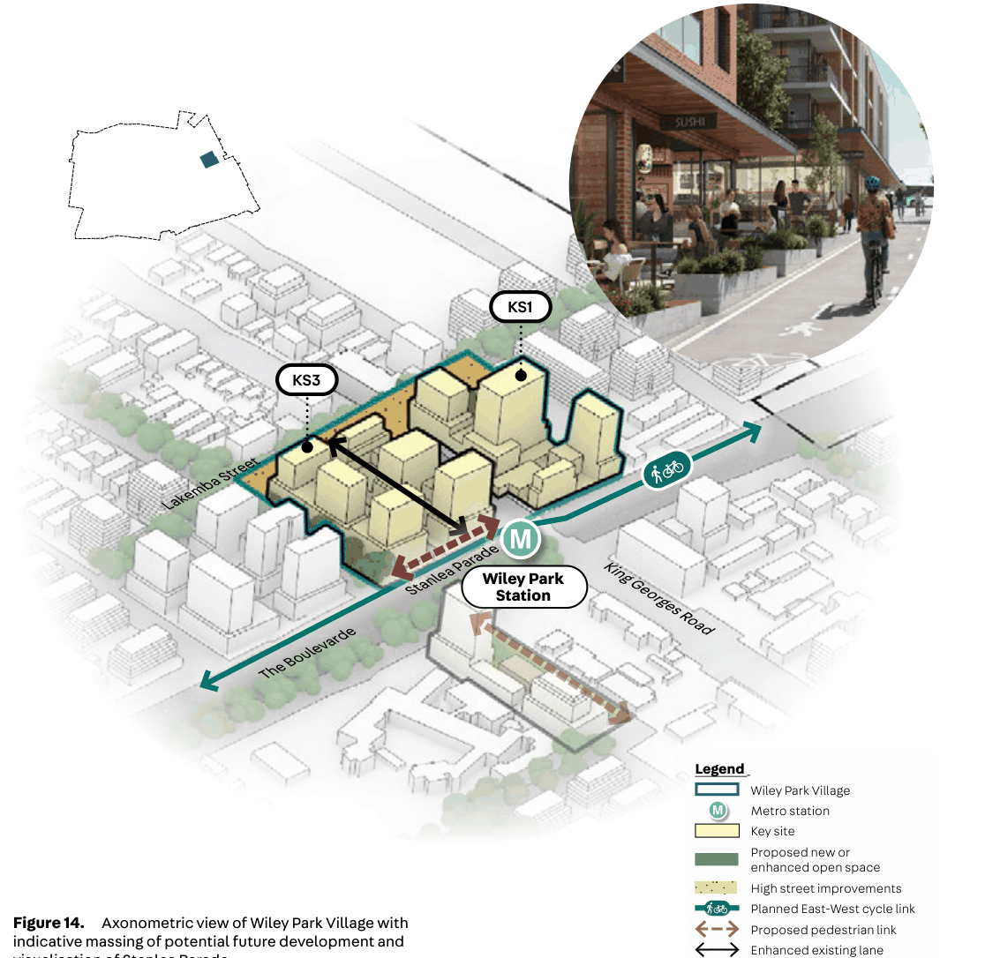
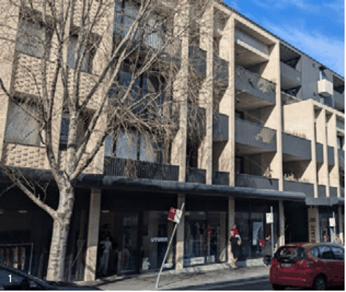
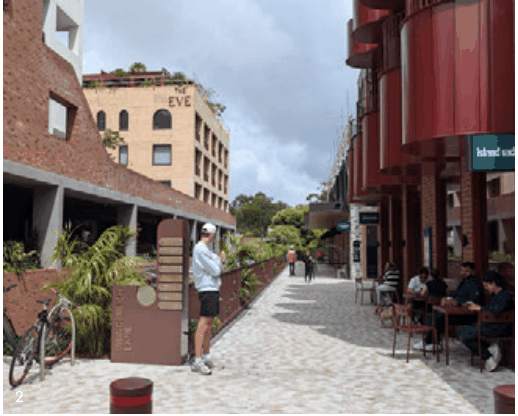
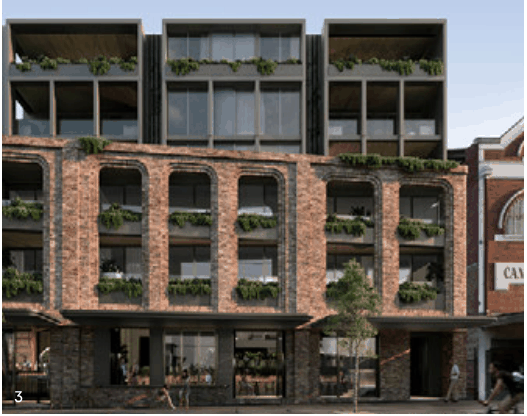

#### 2.2.2 Wiley Park Village

#### The implementation of the new Metro

#### station and addition population density

#### will inject activity into this character area.

The land in this location is comprised of

#### two key sites which will provide housing

#### and active uses at street level. Wiley Park Village character area will

#### provide a range of retail and other

services, as well as being a place that

#### will attract the community to linger. The

#### existing station area will be expanded

#### and will focus retail activation off busy

#### King Georges Road on side streets

#### such as Lakemba Street and Stanlea

#### Parade, where it is quieter with greater

#### amenity. Additional setbacks will assist

#### in re-imaging these as higher quality

#### environments for active uses.

New highrise mixed-use residential developments will be encouraged near the Metro station to concentrate housing, activities and amenities in this highly accessible area.

A continuous and active 4 storey street wall is proposed along King Georges Road, Lakemba Street and Stanlea Parade to provide a consistent built form character. Tower forms are to be set back from the street and be well-separated to ensure good solar access and view sharing. The architectural character will incorporate textured materials such as face brick and timber, reflecting the existing masonry character of Wiley Park.

> [Picture on page 21: a map, saved as a picture (images/ch-07-07-punchbowl-and-wiley-park-page-21-33.gif, 150 dpi); the street names and other small labels are on the picture.]
> Words printed on the picture (title and legend, copied from the PDF):
> King Georges Road
> Wiley Park Village
> Proposed new or
> enhanced open space
> High street improvements
> Planned East-West cycle link
> Proposed pedestrian link
> Enhanced existing lane
> indicative massing of potential future development and

Figure 14. Axonometric view of Wiley Park Village with

visualisation of Stanlea Parade

1

2

> [Picture on page 22: a picture, saved as a picture (images/ch-07-07-punchbowl-and-wiley-park-page-22-3.gif, 150 dpi).]

1 1

#### Principles

> [Picture on page 22: a picture, saved as a picture (images/ch-07-07-punchbowl-and-wiley-park-page-22-6.gif, 150 dpi).]
> Words printed on the picture (title and legend, copied from the PDF):
> 2

c)

d)

P1. Built form: New developments along Lakemba Street shall ensure for:

a) A street wall height of between 4 to 6 storeys that aligns with the predominant existing parapet height and is designed to reflect the detailing of neighbouring buildings including parapets and windows. See Section 4.2.3 Street wall.

b) A fine-grain character with vibrant active frontages with glazing and openings that are engaging. See Section  4.3.2 Active street frontages and edges.

P2.

Images:

1 -  New mixed use development with fine grain articulation, Illawarra Road, Marrickville, NSW (Source: Architectus)

2 - Activated retail link, Surry Hills Village, Redfern, NSW 3 - Mixed use development, Cookson, Camberwell, Melbourne, VIC by DKO (Source: Mr P) (Source: Architectus)

Materials that reflect the traditional brickwork and masonry of surrounding buildings including heritage. See Section 4.5 Materials and finishes.

Upper level setbacks above the street wall to provide green podium communal spaces and passive surveillance. See Section 4.6 Rooftop and communal open space. Lanes: Wiley Lane and Stanlea Parade will be enhanced to better accommodate pedestrians and cyclists, while also facilitating service vehicles and driveways, creating a high-amenity network of lanes that promotes safety and accessibility for all users.

> [Picture on page 22: a picture, saved as a picture (images/ch-07-07-punchbowl-and-wiley-park-page-22-45.gif, 150 dpi).]
> Words printed on the picture (title and legend, copied from the PDF):
> 3 3

P3. Development interfacing lanes should: ⚬ For commercial uses: consider opportunities for active lane edges, including cafes, outdoor seating, planters and where possible deep soil. ⚬ For residential uses: provide high quality landscaping, deep soil, and apartments with private entries. See Section 3.3 Streets, shared lanes, pedestrian links and arcades.

P4. Key sites: Development on the key sites are to provide improved permeability and interfaces to streets and deliver new open space. See Section 6 Key sites KS1 and KS3.
