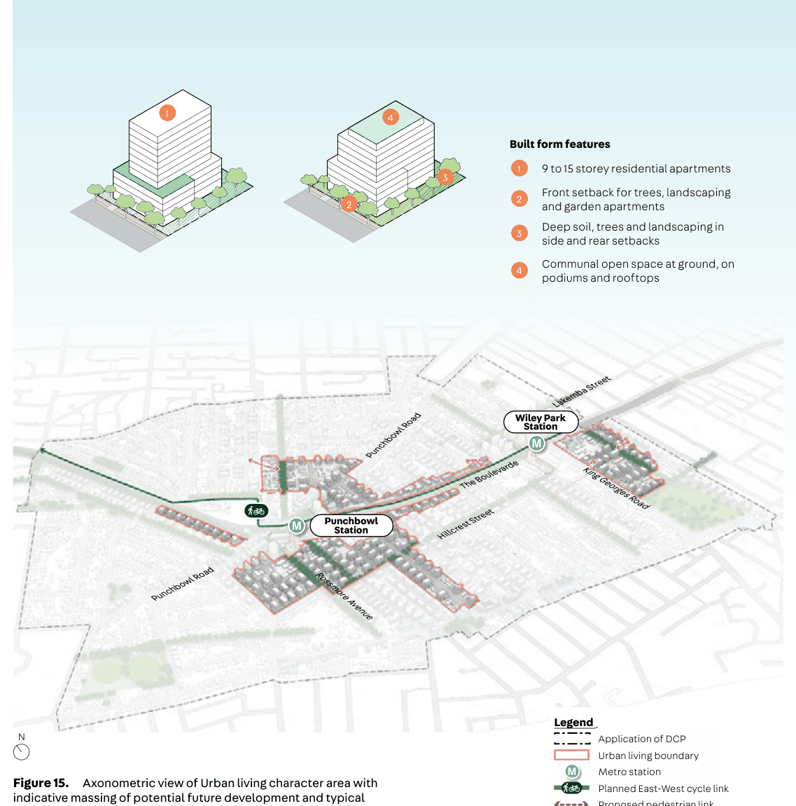
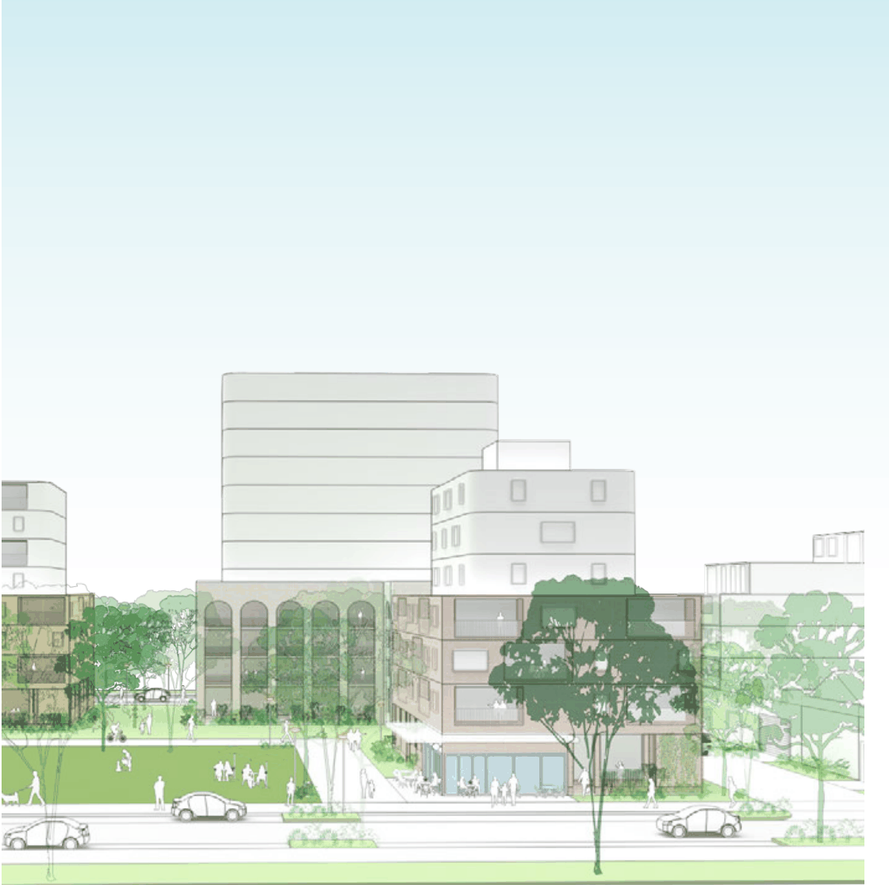
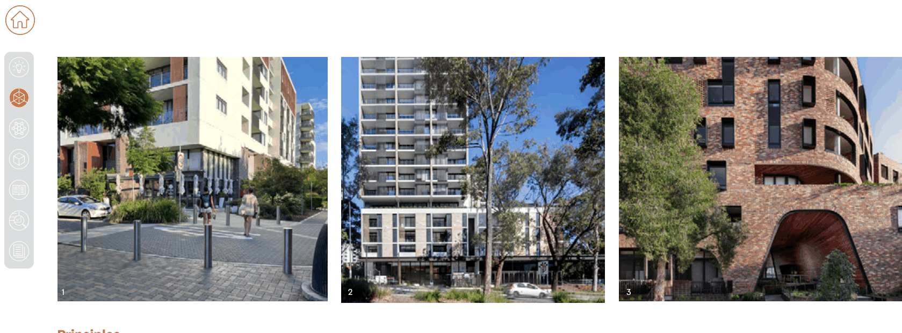

#### 2.2.3 Urban living

The Urban living character areas will be

#### attractive and have high accessibility.

These areas will deliver a diversity of higher rise housing, providing a vibrant, safe and desirable street life reinforced by

#### generous soft landscaping and supported

by infrastructure. The area will feature green streets, pedestrian and cycle links, along with

#### inviting public space. This design aims

#### to cultivate a vibrant, walkable urban

#### neighbourhood conveniently located near

#### transport, services and amenity.

The Urban living character area will experience significant renewal with a range of development heights and densities that respond to their context. The greatest densities will be delivered in proximity to Metro stations and services and on those sites which are larger in area and orientated to achieve high quality development outcomes.

> [Picture on page 23: a map, saved as a picture (images/ch-07-07-punchbowl-and-wiley-park-page-23-22.gif, 150 dpi); the street names and other small labels are on the picture.]
> Words printed on the picture (title and legend, copied from the PDF):
> Built form features
> 1 9 to 15 storey residential apartments
> Front setback for trees, landscaping
> and garden apartments
> Deep soil, trees and landscaping in
> side and rear setbacks
> Communal open space at ground, on
> podiums and rooftops
> King Georges Road
> Application of DCP
> Urban living boundary
> Planned East-West cycle link
> Proposed pedestrian link
> indicative massing of potential future development and typical

Figure 15. Axonometric view of Urban living character area with

residential typologies

New developments will prioritise direct street access and landscaped private open space within setbacks for ground-floor apartments and terraces, encouraging passive surveillance of the streets, pedestrian links and shared lanes. Apartments adjacent to open space will be designed to provide a high quality interface and frontage to parks. Podiums and rooftops will offer opportunities to contribute to urban greening and communal open space for residents. Parts of this character area contain existing residential flat buildings while others include detached dwellings. New development will need to be sensitive to both contexts, providing appropriate setbacks, landscaping and articulated built form.

> [Picture on page 24: a picture, saved as a picture (images/ch-07-07-punchbowl-and-wiley-park-page-24-18.gif, 150 dpi).]

Figure 16. Illustration of apartments interfacing a park with direct ground floor access and landscaping showing an activated edge with outdoor dining

> [Picture on page 25: a picture, saved as a picture (images/ch-07-07-punchbowl-and-wiley-park-page-25-1.gif, 150 dpi).]
> Words printed on the picture (title and legend, copied from the PDF):
> 1
> 2
> 3

#### Principles

P1. New taller developments must be sympathetic to the surrounding context, which includes detached dwellings, three-storey walk-ups and newer apartment buildings. In areas interfacing with lower-density zones, a sensitive transition is essential. This should be achieved through careful consideration of scale, setbacks, separation, landscaping, and privacy measures. See Section 4.2 The building envelope.

Images:

1 - Corner cafe providing active edge, Eve Street, Erskineville, NSW

2 - Slender tower on podium, Natura, Macquarie Park, NSW, by Architectus

3 - High quality brickwork finish with solids and voids, Arkadia Apartments, Alexandria, NSW by DKO (Source: Architectus)

P2. Development adjacent to public open space, including Wiley Park, will be orientated to face the park and provide passive surveillance through the implementation of entrances, balconies and terraces.

P3. High quality pedestrian links must be free of obstructions and feature landscaping along their edges. These links should also include adequate lighting as well as apartments with direct entries from the public domain to increase activity and enhance passive surveillance. See Section 4.3.1 Residential ground floor.

P4. Encourage the provision of small scale retail, commercial, food and drink premises, where permissible, at street corners and through site links to create active edges. See Section

4.3.2 Active street frontages and edges.

P5. Slender, elegant towers set upon podiums will exhibit high quality design of form that responds to context including the orientation of facades. Longer podiums will include articulation to ensure they do not overwhelm the streetscape and provide visual interest. High quality materials and finishes should be used at the interface with the public domain. See Section 4.2.1 Building height and storeys and  4.4 Visual diversity, articulation and fine grain.

P6. The use of brick and masonry, along with exposed concrete structure in podiums, will reflect the existing brick materiality of the character area, ensuring cohesion with the surrounding architectural context. See Section 4.5 Materials and finishes.
