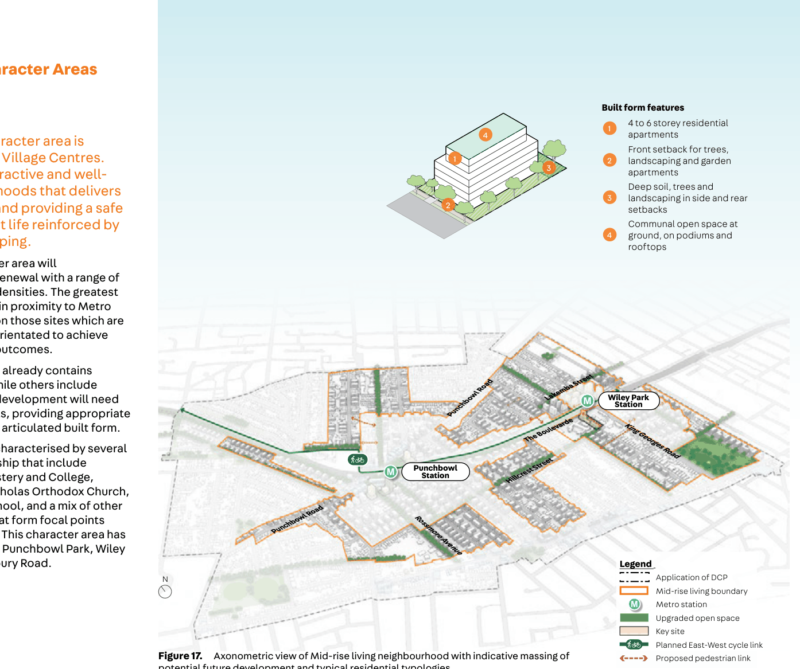

#### 2.2.4 Mid-rise living

> [Picture on page 26: a map, saved as a picture (images/ch-07-07-punchbowl-and-wiley-park-page-26-2.gif, 150 dpi); the street names and other small labels are on the picture.]
> Words printed on the picture (title and legend, copied from the PDF):
> Built form features
> 4 to 6 storey residential
> Front setback for trees,
> landscaping and garden
> Deep soil, trees and
> landscaping in side and rear
> Communal open space at
> ground, on podiums and
> King Georges Road
> Application of DCP
> Mid-rise living boundary
> Upgraded open space
> Planned East-West cycle link
> Proposed pedestrian link
> potential future development and typical residential typologies

Figure 17. Axonometric view of Mid-rise living neighbourhood with indicative massing of

The Mid-rise living character area is

#### spread across the two Village Centres.

#### These areas will be attractive and well-

#### connected neighbourhoods that delivers

#### a diversity of housing and providing a safe

and comfortable street life reinforced by

#### generous soft landscaping.

The Mid-rise living character area will accommodate significant renewal with a range of development heights and densities. The greatest densities will be delivered in proximity to Metro stations and services and on those sites which are appropriately scaled and orientated to achieve high quality development outcomes. Parts of this character area already contains residential flat buildings while others include detached dwellings. New development will need to respond to both contexts, providing appropriate setbacks, landscaping and articulated built form.

min 30m

The character area is also characterised by several schools and places of worship that include St Charbels Church, Monastery and College, Punchbowl Mosque, St Nicholas Orthodox Church, St Jerome's Church and School, and a mix of other Churches and mosques, that form focal points within the street structure. This character area has convenient connections to Punchbowl Park, Wiley Park Village and to Canterbury Road.

#### Principles

P1. Development interfacing lower density areas will provide sensitive transition and ensure scale, setbacks, separation, landscaping, privacy seamlessly integrate the new and old developments with varying densities and scales. See Section 4.2  The building envelope.

P2. Developments are to demonstrate a range of residential options including dwellings, walk up flats and mid-rise apartments with an activated and inviting street edge by providing ground floor garden apartments. See Section 4.1 Minimum lot sizes and Section

4.2.1 Building height and storeys.

P3. In areas that allow additional levels these are to be setback above the podium to ensure protection of streetscapes. See Section
