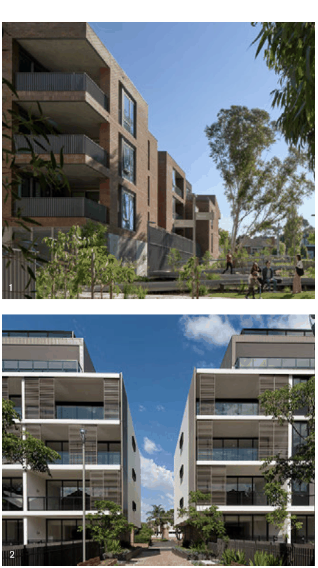

#### 4.2.3 Street wall and Section 4.2.5 Upper storey

setbacks.

P4. Developments on priority streets for tree canopy are to provide well landscaped streetscapes and setbacks. See Section 3.1 Public domain strategy and Section 4.2.4 Front setbacks.

P5. Development adjacent to public open space, including Wiley Park, will be orientated to face the park, and create a positive interface that promotes passive surveillance through entrances, balconies, terraces and high quality landscaping.

Images:

1 - Markham Avenue, Ashburton, VIC, by Architectus 2 - Gantry, Camperdown, NSW by Bates Smart (Source: Brett Boardman)

P6. High quality pedestrian links must be free

of obstructions and feature landscaping

along their edges. These links should also

include adequate lighting and setbacks

that accommodate landscaping as well as

apartments with direct entries to enhance

passive surveillance. See Section 4.3.1

Residential ground floor.

P7. The use of brick and masonry, along with

exposed concrete structure in podiums,

will reflect the existing brick and masonry

character of the neighbourhood and

ensure materials are robust over time while

providing for cohesion with the surrounding

architectural context. See Section 4.5

Materials and finishes.

P8. New development adjacent to key places

of worship is to foster a sympathetic

relationship between the two uses and

building form. Key design considerations

include appropriate scale, setbacks and

landscape buffers to provide a transition,

as well as views, pedestrian movement and

permeability.

> [Picture on page 27: a picture, saved as a picture (images/ch-07-07-punchbowl-and-wiley-park-page-27-59.gif, 150 dpi).]
> Words printed on the picture (title and legend, copied from the PDF):
> 1
> 2
