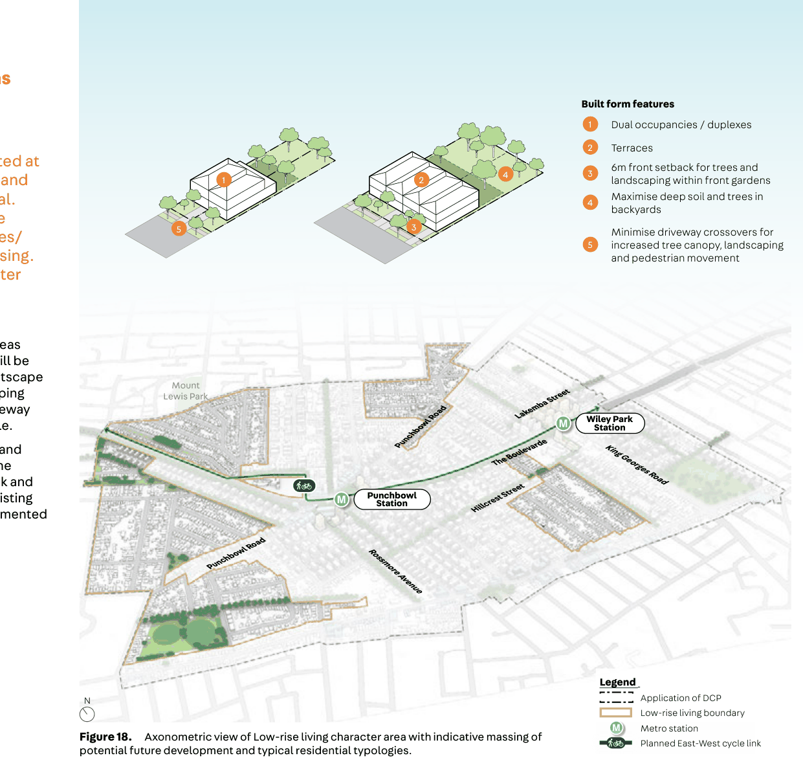
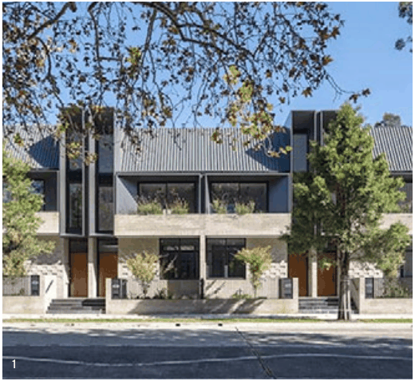
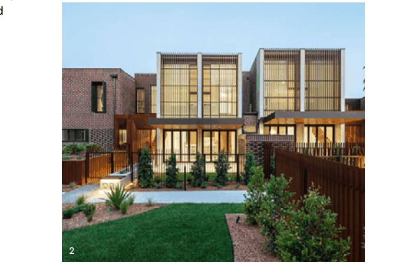
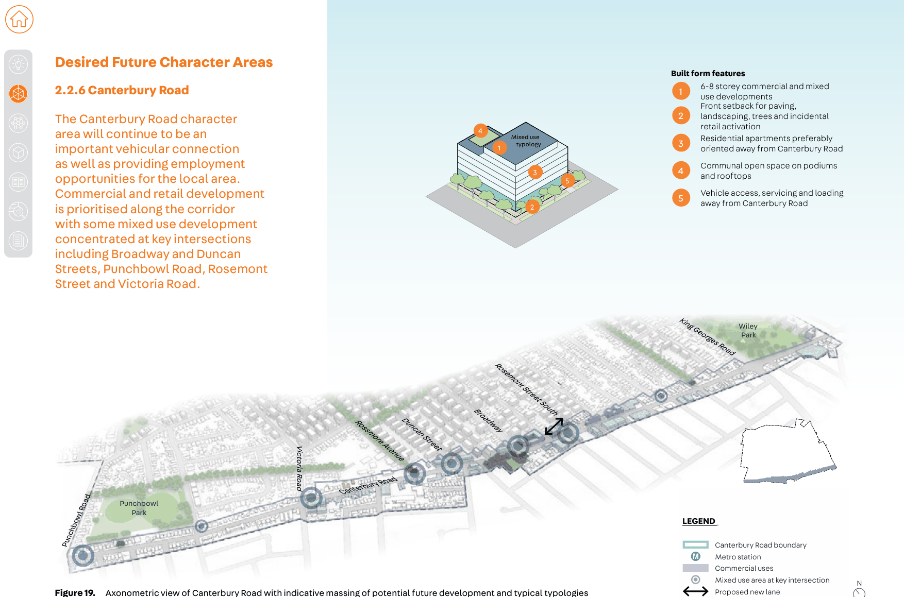

#### 2.2.5 Low-rise living

6.0 15.0

#### This character area is generally located at

the periphery of the Village Centres and

#### will accommodate moderate renewal.

#### New development will include single

#### dwellings, dual occupancies, terraces/

#### townhouses and multi-dwelling housing.

#### The existing quiet residential character

#### will be retained.

The existing low scale character of these areas will be celebrated and new development will be sympathetic to the existing scale. The streetscape will be enhance through increased landscaping and tree canopy within front setbacks. Driveway crossovers will be minimised where possible. New development will draw upon the form and materiality of existing dwellings including the pattern of pitched roofs, generally facebrick and masonry walls and landscape character. Existing tree planting will be maintained and supplemented with additional canopy cover.

> [Picture on page 28: a map, saved as a picture (images/ch-07-07-punchbowl-and-wiley-park-page-28-24.gif, 150 dpi); the street names and other small labels are on the picture.]
> Words printed on the picture (title and legend, copied from the PDF):
> Built form features
> 1 Dual occupancies / duplexes 1.5
> 6m front setback for trees and
> landscaping within front gardens
> Maximise deep soil and trees in
> Minimise driveway crossovers for
> increased tree canopy, landscaping
> and pedestrian movement
> King Georges Road
> Application of DCP
> Low-rise living boundary
> Planned East-West cycle link
> potential future development and typical residential typologies.

Figure 18. Axonometric view of Low-rise living character area with indicative massing of

#### Principles

P1. Development will preserve the existing low-scale and in some instances, historic character in the areas and will provide sensitive transition. Ensure scale, setbacks, separation, landscaping character seamlessly integrate the new and old developments. See Section 4.2 The building envelope.

P2. Developments are to demonstrate a range of residential building types that consist of one to two storeys and include single dwellings, dual occupancies, terraces, townhouses, multi-dwelling housing and low-scale apartments.  Create an inviting street edge and preserve the landscape character of the area See Section 4.1 Minimum lot sizes and Section 4.2.1 Building height and storeys.

P3. Maintain and draw inspiration from the surrounding design and materials of existing homes, reflecting the patterns, setbacks, pitched roofs, dark brick and masonry structures, quality finishes and maintain the bulk and scale with the surrounding architectural context to create cohesion throughout See Section 4.5 Materials and finishes.

Images:

1 - Millard Place, Glebe, NSW, by WMK Architecture (Source: Richard Glover)

2 - The Abbey, Cronulla, NSW, by AJH+ (Source: Tom Ferguson)

P4. Setbacks are to provide landscaping and

deep soil provision. Driveways are to be

limited and consolidated where possible

to ensure walkable green streets that allow

for tree canopy and landscaping along the

street and within setbacks. See Chapter 5

Residential Accommodation in the CBDCP 2023

for detail on setback requirements and design for

this character area.

P5. In sloped areas, such as the northern

section of the character area towards Mount

Lewis Park, new developments should be

thoughtfully designed to integrate with the

topography. Some of the key considerations

include minimising height and bulk through

split-level designs, strategic placement of

driveways and access points, reducing the

height and visibility of retaining walls, and

implementing suitable landscaping and

runoff management.

> [Picture on page 29: a picture, saved as a picture (images/ch-07-07-punchbowl-and-wiley-park-page-29-53.gif, 150 dpi).]
> Words printed on the picture (title and legend, copied from the PDF):
> 1

> [Picture on page 29: a picture, saved as a picture (images/ch-07-07-punchbowl-and-wiley-park-page-29-54.gif, 150 dpi).]
> Words printed on the picture (title and legend, copied from the PDF):
> 2

> [Picture on page 30: a map, saved as a picture (images/ch-07-07-punchbowl-and-wiley-park-page-30-1.gif, 150 dpi); the street names and other small labels are on the picture.]
> Words printed on the picture (title and legend, copied from the PDF):
> Rosemont Street South
> Built form features
> 6-8 storey commercial and mixed
> Front setback for paving,
> landscaping, trees and incidental
> Residential apartments preferably
> oriented away from Canterbury Road
> Communal open space on podiums
> Vehicle access, servicing and loading
> away from Canterbury Road
> King Georges Road
> Canterbury Road boundary
> M Metro station
> Mixed use area at key intersection
> Axonometric view of Canterbury Road with indicative massing of potential future development and typical typologies
> Proposed new lane

Figure 19.
