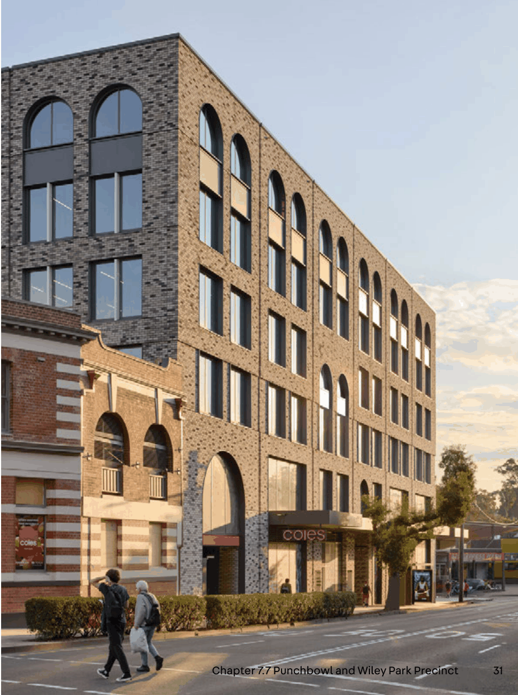
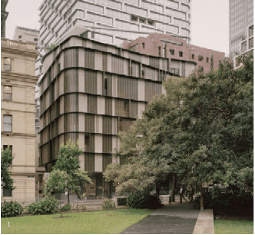
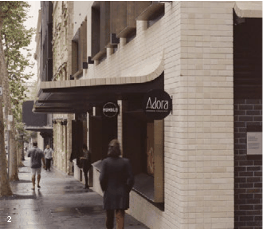

#### 2.2.6 Canterbury Road

#### The Canterbury Road character

area will continue to be an

#### important vehicular connection

#### as well as providing employment

#### opportunities for the local area.

#### Commercial and retail development

#### is prioritised along the corridor

#### with some mixed use development

#### concentrated at key intersections

#### including Broadway and Duncan

#### Streets, Punchbowl Road, Rosemont

#### Street and Victoria Road.

The corridor will support mixed use and commercial infill opportunities ranging from 4 to 8 storeys. A minimum 5m ground floor to ceiling height will support large format commercial uses including showroom retail, bulky goods, as well as business uses located below residential apartments. A setback from Canterbury Road at ground level will enable opportunities for streetscape improvements including widened footpaths, verges and landscaping. Similarly rear setbacks and setbacks on side streets will enable increased opportunities for deep soil and greening to soften the corridor and improve pedestrian amenity. Within mixed use development, residential uses are to be located above the ground floor, well separated and oriented away from the busy roads to provide for the best amenity outcomes. The corridor will link back to Punchbowl and Wiley Park Village character areas via enhanced connections along Broadway, Rossmore Avenue and King Georges Road.

Image - Brick commercial building with active edge, Surry Hills Village, Redfern, NSW, by SJB & Toga (Source: Tom Roe)

> [Picture on page 31: a picture, saved as a picture (images/ch-07-07-punchbowl-and-wiley-park-page-31-25.gif, 150 dpi).]

#### Principles

P1. Ground-floor commercial and retail spaces along Canterbury Road will feature active edges along their frontages and at key corners. Additionally, there will be opportunities for landscape improvements. These will include enhanced paving and deep soil areas for tree canopy and plantings to enhance amenity for pedestrians along this busy vehicular thoroughfare. Refer to Section 4.3.2 Active street frontages and edges and Section 3.4 Tree canopy, deep soil and green cover.

P2. New development will contribute to enhanced lanes by incorporating generous setbacks of 3 to 6 metres to facilitate ground level landscaping and opportunity to create secondary frontages balanced with servicing needs and driveways. Additionally, extended lanes will provide improved permeability and alternative pedestrian and cycle routes away from Canterbury Road. Refer to Section 3.3 Streets, shared lanes, pedestrian links and arcades.

Images:

1 - 8 Loftus Street, Sydney (Studio Bright) 2 -18 Loftus Street, Sydney (Slivester Fuller)

P3. New development will be sympathetic to the

variety of scales and uses along Canterbury

Road. In particular, new developments that

interface with the low scale residential

areas to the north and Punchbowl Public

School will provide a sensitive interface

that considers scale, setbacks, appropriate

privacy and landscaping. Refer to Section 4.2

The building envelope.

P4. New mixed-use developments should be

concentrated at key cross streets, with

residential units situated above ground level.

These units must be designed and oriented

to mitigate amenity impacts from noise and

pollution originating from Canterbury Road

while also ensuring adequate solar access,

views, landscaping and high-quality podium

and rooftop space. Refer to Section 4.2 The

building envelope and 4.6 Rooftop and communal

open space.

> [Picture on page 32: a picture, saved as a picture (images/ch-07-07-punchbowl-and-wiley-park-page-32-48.gif, 150 dpi).]
> Words printed on the picture (title and legend, copied from the PDF):
> 1

> [Picture on page 32: a picture, saved as a picture (images/ch-07-07-punchbowl-and-wiley-park-page-32-49.gif, 150 dpi).]
> Words printed on the picture (title and legend, copied from the PDF):
> 2
